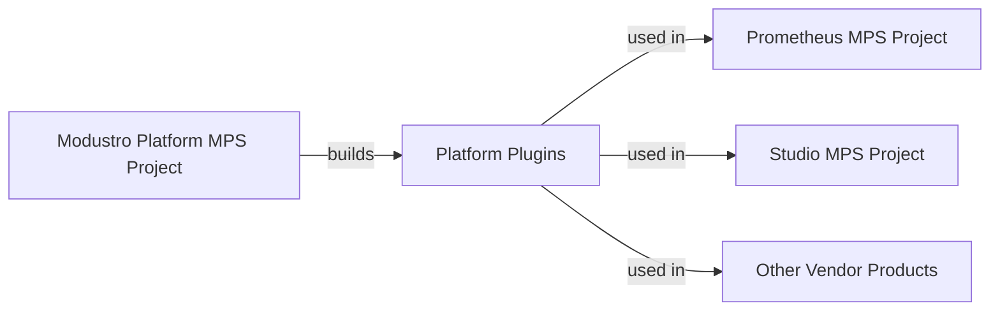

[[UNCONFIRMED]]

# Modustro Platform

Modustro Platform is the foundational layer of the Modustro ecosystem.  
It contains the core DSL, modeling infrastructure, runtime engine API, basic editors and generators, 
and all architectural modules that define Modustro as a model‑driven engineering platform.

---

## 1. Purpose

This repository delivers:
- The **Modustro platform artifacts** (Languages and Solutions based on JetBrains MPS)
- Modeling languages (Database Schema, Interchange Schema, ...)
- Structural editors & diagram projections
- The Modustro **runtime engine API**
- Model analyzers & validators
- All built‑in common code generators (SQL, API, application scaffolding)
- Reference implementations of the platform like Modustro Prometheus
- Custom product public APIs of Products, based on Modustro Platform

The platform is **technology‑centric**, not user‑centric. 
Products—such as Algites Modustro Studio consume this platform.

---

## 2. Build & Development

The platform uses **JetBrains MPS**.

### Requirements
- JetBrains MPS (latest recommended version)
- JDK 17+
- Gradle / MPS build scripts (included)

### Build commands
(To be defined once build scripts exist.)

---

## 3. Repository Structure (proposed)

```
platform.Modustro/
  ├── platform/             # Platform specific files (DSL)
  │       ├── mps/             # MPS project root
  │       │     ├── languages/             # MPS language definitions (DSL)
  │       │     │      ├── base/
  │       │     │      ├── er/
  │       │     │      ├── domain/
  │       │     │      ├── api/
  │       │     │      └── diagrams/
  │       │     │
  │       │     ├── runtime/               # Runtime components for model execution
  │       │     │      ├── loader/
  │       │     │      ├── validator/
  │       │     │      └── engine/
  │       │     │
  │       │     └──  generators/            # Built-in code generators
  │       │            ├── sql/
  │       │            ├── api/
  │       │            └── app/
  │       │      
  │       ├── plugins/               # Optional MPS plugins
  │       ├── docs/
  │       ├── examples/
  │       └── bld/
  │
  └── product/             # Public product resources, available to developers for development for specific vendor products
          └── {vendor}             # specific resources of the given vendor, like Algites (should start with capital letter)
                  └── {product family name}   # specific code of the product family, like Modustro (should start with capital letter)
                            └── {product name}   # specific code of the product, like Studio or Prometheus (should start with capital letter)
                                     ├── mps   # Product MPS Project root
                                     └── docs  # Product documentation                        
```
# 2.1 Platform MPS Integration Philosophy

This chapter defines the normative philosophy for integrating the Modustro Platform with product implementations using JetBrains MPS. It establishes how platform DSLs are developed, distributed, and consumed by products such as Modustro Prometheus and Modustro Studio, and serves as a reference for all future ecosystem participants.

---

#### 3.1.1 Core Principles

The Modustro ecosystem adopts the following principles:

- **Separation of Concerns**  
  The Modustro Platform and Modustro-based products MUST be developed in separate MPS projects.

- **Plugin-Based Integration**  
  Platform DSLs MUST be packaged and distributed as MPS plugins (distributions) and consumed by products as external dependencies.

- **Reference by Consumption**  
  Reference products (e.g., Modustro Prometheus) MUST consume the platform exactly as any other product would, without privileged access to platform sources.

- **Architecture over Convenience**  
  Long-term architectural clarity and ecosystem consistency take precedence over short-term development convenience.

---

#### 3.1.2 Platform as an Independent MPS Project

The Modustro Platform is implemented as its own MPS project, containing:

- normative DSLs (Core, Schema, Profiles, Runtime API, etc.),
- base editors and constraints,
- basic generators and validations,
- documentation and samples where applicable.

The platform project:

- MUST NOT depend on any product or runtime implementation,
- MUST be buildable and releasable independently,
- MUST export its languages as one or more MPS plugins.

This ensures that the platform remains:

- stable,
- reusable,
- and independently versioned.

---

#### 3.1.3 Products as Independent MPS Projects

Each product (including reference implementations) is developed in its own MPS project, for example:

- Modustro Prometheus (reference product),
- Modustro Studio (commercial product),
- third-party vendor products.

A product project:

- declares dependencies on the Modustro Platform plugins,
- MAY define additional DSLs and solutions,
- MUST treat the platform as an external API.

Products MUST NOT modify or rely on platform internals beyond what is exposed through exported DSLs and APIs.

---

#### 3.1.4 Modustro Prometheus as a Reference Pattern

Modustro Prometheus is not only a reference runtime implementation, but also a **reference integration pattern**.

Prometheus demonstrates:

- how to consume platform DSLs as plugins,
- how to structure a Modustro-based product project,
- how to manage dependencies and versions,
- how to build, test, and package a product using the platform.

Prometheus therefore serves as:

- executable documentation,
- a learning resource,
- and a baseline for tooling and automation.

Any integration workflow validated in Prometheus is considered the normative approach for the ecosystem.

---

#### 3.1.5 Normative Workflow

The standard workflow is:

1. Develop and evolve DSLs in the Modustro Platform project.
2. Build and package the platform as MPS plugins.
3. Publish plugins to a repository or distribution channel.
4. In a product project:
    - declare dependency on platform plugins,
    - use platform DSLs in product languages and solutions.
5. Build and package the product independently.

This workflow MUST be used for:

- Prometheus,
- Studio,
- and all third-party products.

---

#### 3.1.6 Tooling and Automation Expectations

Because this workflow is normative, the ecosystem SHOULD in a long term provide:

- project wizards for creating new Modustro-based products,
- scripts for fetching and updating platform plugins,
- CI templates for building platform and products,
- compatibility checks between platform and product versions.

Prometheus SHOULD be used as the primary validation ground for such tooling.

---

#### 3.1.7 Architectural Benefits

This integration philosophy provides:

- **Clear boundaries** between platform and products,
- **True API discipline**, forcing explicit contracts,
- **Independent release cycles**,
- **Ecosystem scalability**, enabling multiple vendors,
- **Long-term maintainability** of the platform.

It also ensures that reference implementations do not become hidden dependencies or shortcuts.

---

#### 3.1.8 Trade-offs and Rationale

The approach introduces certain costs:

- additional setup for plugin build and installation,
- more explicit version management,
- less immediate convenience during co-evolution of platform and products.

However, these trade-offs are intentional and justified:

- they mirror real-world ecosystem usage,
- they prevent architectural erosion,
- they enforce production-grade discipline early.

The Modustro ecosystem explicitly prefers these trade-offs over a monolithic or shared-workspace approach.

---

#### 3.1.9 Conceptual Overview



The platform is developed once, packaged as plugins, and then consumed uniformly by all products.

---

#### 3.1.10 Normative Statement

All Modustro-based products:

- MUST be implemented as independent MPS projects,
- MUST consume the Modustro Platform exclusively via plugins,
- MUST follow the integration pattern validated by Modustro Prometheus.

This philosophy is foundational for the Modustro ecosystem and is not subject to product-specific deviation.

---

## 4. Conventions

### Naming
- All modules use prefix `modustro`
- Language namespaces - Example: `eu.modustro.pltf.*`
- Generators - Example: `modustro.gen.*`

### Versioning
- Platform follows semantic versioning: **MAJOR.MINOR.PATCH**
- Products may use independent versioning

---

## 5. Usage

This repo is **not** a product except the reference implementation.  
It provides the engine and languages used by applications such as:

- `product.Modustro Studio`
- future cloud services
- CLI tools
- external integrations

---

## 6. Roadmap

for Roadmap see the document specs/
### Phase 1
- ER modeling DSL
- SQL generators
- MPS project structure
- Minimal runtime

### Phase 2
- Domain modeling
- API definitions
- Diagram editors

### Phase 3
- Application layer DSL
- App generators

### Phase 4
- Extensibility: plugin API
- Integration with Cloud & Studio

---

## 7. License
(To be defined.)

---

## 8. Contact
Author: Artur Linhart  
Project: Modustro — Model‑Driven Application Architecture  


## 🔄 Continuous Integration (Algites CI)

This repository uses the **Algites unified GitHub Actions CI pipeline** (build/test/publish rules are centralized).

For exact usage and naming of the branches to utilize fully the defined possibilities, see
https://github.com/Algites-EU/pub.gov.Algites.specs/blob/main/ci/Algites-Github-CI-Policy.md

---

[[/UNCONFIRMED]]
