# Modustro Builder — Reference Manual

**Document:** `MODUSTRO-BUILDER-REFERENCE.md`  
**Status:** Target-architecture reference with temporary implementation/migration appendices — reviewed 17 November 2026  
**Baseline:** Modustro Builder 1.1 development, 16–17 November 2026  
**Primary source location:** `platform/builder/docs/`

> **Reference convention.** Chapters 1–4 describe the agreed **target architecture** and the descriptor contract. Unimplemented wire fields and examples are identified as **proposed/illustrative**. Legacy implementation details, migration sequencing, source inventory and provisional naming questions are isolated in **Temporary Appendices C and D**, which can be removed after conformance. No diagram or example implies that the reviewed Builder 1.1 parser already supports the proposed `execute:` usages.

## Contents

- [Introduction](#introduction)
    - [What Modustro Builder is](#what-modustro-builder-is)
    - [Scope and audience](#scope-and-audience)
    - [Module terminology](#module-terminology)
- [1. Framework Overview and Philosophy](#1-framework-overview-and-philosophy)
  - [1.1. Purpose and central principle](#11-purpose-and-central-principle)
  - [1.2. Design objectives and non-objectives](#12-design-objectives-and-non-objectives)
  - [1.3. The architectural boundary](#13-the-architectural-boundary)
  - [1.4. Responsibility assignment](#14-responsibility-assignment)
  - [1.5. Portable lifecycle semantics versus backend orchestration](#15-portable-lifecycle-semantics-versus-backend-orchestration)
  - [1.6. Dependency Usages and Execution Placement](#16-dependency-usages-and-execution-placement)
  - [1.7. Technology-specific behavior versus backend-specific behavior](#17-technology-specific-behavior-versus-backend-specific-behavior)
  - [1.8. Source generation and build-time tools](#18-source-generation-and-build-time-tools)
  - [1.9. External inputs, credentials, and publication](#19-external-inputs-credentials-and-publication)
  - [1.10. Conformance and testing](#110-conformance-and-testing)
  - [1.11. Architectural decision](#111-architectural-decision)
- [2. Structural Concepts and Framework Semantics](#2-structural-concepts-and-framework-semantics)
  - [2.1. Independent Dimensions of Dependency Interpretation](#21-independent-dimensions-of-dependency-interpretation)
  - [2.2. Effective Execution Scopes and Inheritance Origins](#22-effective-execution-scopes-and-inheritance-origins)
    - [2.2.1. Contextual Paths and Availability of Build Inputs](#221-contextual-paths-and-availability-of-build-inputs)
  - [2.3. Phase Lifecycle and Global Boundaries](#23-phase-lifecycle-and-global-boundaries)
    - [2.3.1. Ten Ordered Production and Verification Phases](#231-ten-ordered-production-and-verification-phases)
    - [2.3.2. Repository-wide Phase Barriers and Isolated Domains](#232-repository-wide-phase-barriers-and-isolated-domains)
    - [2.3.3. Verification After Publication](#233-verification-after-publication)
  - [2.4. Execution Graph, Ordering and Validation](#24-execution-graph-ordering-and-validation)
    - [2.4.1. Phase-local Graph Boundaries](#241-phase-local-graph-boundaries)
    - [2.4.2. Validation, Diagnostic Provenance and Remediation](#242-validation-diagnostic-provenance-and-remediation)
      - [2.4.2.1. Validation passes](#2421-validation-passes)
      - [2.4.2.2. Provenance of every inherited property](#2422-provenance-of-every-inherited-property)
      - [2.4.2.3. Canonical example: a phase expansion invalidates inherited needs](#2423-canonical-example-a-phase-expansion-invalidates-inherited-needs)
      - [2.4.2.4. Cross-tool duplicate effective ID](#2424-cross-tool-duplicate-effective-id)
      - [2.4.2.5. A needed execution is skipped](#2425-a-needed-execution-is-skipped)
      - [2.4.2.6. An unresolved optional-order reference](#2426-an-unresolved-optional-order-reference)
      - [2.4.2.7. Other required diagnostic classes](#2427-other-required-diagnostic-classes)
      - [2.4.2.8. Cycle examples](#2428-cycle-examples)
  - [2.5. Verification, Testing and Tool-Execution Contracts](#25-verification-testing-and-tool-execution-contracts)
    - [2.5.1. Test Execution Contracts and Verification Inputs](#251-test-execution-contracts-and-verification-inputs)
    - [2.5.2. Default test usages versus chosen phase](#252-default-test-usages-versus-chosen-phase)
    - [2.5.3. Proposed Java and Python test configuration](#253-proposed-java-and-python-test-configuration)
    - [2.5.4. Configuration and execution environment](#254-configuration-and-execution-environment)
  - [2.6. Capabilities, BuildOutputTypes and Executions](#26-capabilities-buildoutputtypes-and-executions)
    - [2.6.1. Built-in Capability Identifiers and Scope Constraints](#261-built-in-capability-identifiers-and-scope-constraints)
    - [2.6.2. What capabilities, usages, phases and outputs mean](#262-what-capabilities-usages-phases-and-outputs-mean)
    - [2.6.3. Built-in BuildOutputType Catalog](#263-built-in-buildoutputtype-catalog)
    - [2.6.4. Documentation and verification examples](#264-documentation-and-verification-examples)
  - [2.7. Dependency Evaluation, Translation and Provider Extensibility](#27-dependency-evaluation-translation-and-provider-extensibility)
    - [2.7.1. Two distinct processing stages](#271-two-distinct-processing-stages)
    - [2.7.2. Native dependencies versus executions](#272-native-dependencies-versus-executions)
    - [2.7.3. Usage Contract Metadata and Invocation Requirements](#273-usage-contract-metadata-and-invocation-requirements)
      - [2.7.3.1. Schema-based extension](#2731-schema-based-extension)
      - [2.7.3.2. Execution is still supplied by a discoverable provider](#2732-execution-is-still-supplied-by-a-discoverable-provider)
    - [2.7.4. CPDiscovery Extension Points and Specialized Factories](#274-cpdiscovery-extension-points-and-specialized-factories)
    - [2.7.5. Python/Java parity and standalone generators](#275-pythonjava-parity-and-standalone-generators)
    - [2.7.6. Dependency usages and native mapping limitations](#276-dependency-usages-and-native-mapping-limitations)
  - [2.8. External Inputs, Publication, Documentation and Security](#28-external-inputs-publication-documentation-and-security)
    - [2.8.1. Keep inputs and outputs separate](#281-keep-inputs-and-outputs-separate)
    - [2.8.2. Publishing as a phase with a final verification boundary](#282-publishing-as-a-phase-with-a-final-verification-boundary)
    - [2.8.3. Repository-level docs-site example](#283-repository-level-docs-site-example)
    - [2.8.4. Credentials and reproducibility](#284-credentials-and-reproducibility)
- [3. YAML Descriptor Reference](#3-yaml-descriptor-reference)
  - [3.1. Descriptor Hierarchy and Shared Metadata](#31-descriptor-hierarchy-and-shared-metadata)
  - [3.2. Source Repository Descriptor (`modustro-source-repository.yml`)](#32-source-repository-descriptor-modustro-source-repositoryyml)
  - [3.3. ArtifactSet Descriptor (`modustro-artifact-set.yml`)](#33-artifactset-descriptor-modustro-artifact-setyml)
  - [3.4. Artifact Descriptor (`modustro-artifact.yml`)](#34-artifact-descriptor-modustro-artifactyml)
  - [3.5. Dependencies](#35-dependencies)
    - [3.5.1. Usage Items and Their Scalar/Structured Representations](#351-usage-items-and-their-scalarstructured-representations)
      - [3.5.1.1. Backward-compatible scalar interpretation](#3511-backward-compatible-scalar-interpretation)
    - [3.5.2. Usage Naming and Binding/Execution Contracts](#352-usage-naming-and-bindingexecution-contracts)
      - [3.5.2.1. Binding Contracts Versus Executable Contracts](#3521-binding-contracts-versus-executable-contracts)
      - [3.5.2.2. Binding Usages and Java Configuration Mapping](#3522-binding-usages-and-java-configuration-mapping)
      - [3.5.2.3. Standard and Custom Executable Usage Contracts](#3523-standard-and-custom-executable-usage-contracts)
      - [3.5.2.4. Source Generation Versus Source Processing](#3524-source-generation-versus-source-processing)
    - [3.5.3. Usage Contract Metadata, Data Schemas and Registration](#353-usage-contract-metadata-data-schemas-and-registration)
      - [3.5.3.1. Schema versus runtime implementation](#3531-schema-versus-runtime-implementation)
      - [3.5.3.2. Proposed contract-registration example](#3532-proposed-contract-registration-example)
      - [3.5.3.3. Build-tool Metadata Discovery Through CPDiscovery](#3533-build-tool-metadata-discovery-through-cpdiscovery)
      - [3.5.3.4. Metadata Manifest for a Tool Supporting Multiple Usages](#3534-metadata-manifest-for-a-tool-supporting-multiple-usages)
      - [3.5.3.5. Contract Resolution and Conflict Policy](#3535-contract-resolution-and-conflict-policy)
    - [3.5.4. Binding, Provider Identification and Handler Discovery](#354-binding-provider-identification-and-handler-discovery)
    - [3.5.5. Dependency Identity, Versions, Inheritance and Required Outputs](#355-dependency-identity-versions-inheritance-and-required-outputs)
    - [3.5.6. BuildExecution Declarations and Tool Invocation](#356-buildexecution-declarations-and-tool-invocation)
      - [3.5.6.1. BuildExecution Placement Under Tool Usages](#3561-buildexecution-placement-under-tool-usages)
      - [3.5.6.2. Common execution properties](#3562-common-execution-properties)
      - [3.5.6.3. Target technologies are mandatory invocation context](#3563-target-technologies-are-mandatory-invocation-context)
      - [3.5.6.4. Tool-specific validation and runtime responsibilities](#3564-tool-specific-validation-and-runtime-responsibilities)
      - [3.5.6.5. Output visibility and repeatability](#3565-output-visibility-and-repeatability)
      - [3.5.6.6. Comparison with Maven plugin executions](#3566-comparison-with-maven-plugin-executions)
    - [3.5.7. BuildExecution Inheritance, Phase Variants and Override Rules](#357-buildexecution-inheritance-phase-variants-and-override-rules)
      - [3.5.7.1. Inheritance goals](#3571-inheritance-goals)
      - [3.5.7.2. Property merge rules](#3572-property-merge-rules)
      - [3.5.7.3. Generic override applies to every phase variant](#3573-generic-override-applies-to-every-phase-variant)
      - [3.5.7.4. Expansion into multiple phases](#3574-expansion-into-multiple-phases)
      - [3.5.7.5. Move versus append: a deterministic, limited rule](#3575-move-versus-append-a-deterministic-limited-rule)
      - [3.5.7.6. Phase defaulting](#3576-phase-defaulting)
      - [3.5.7.7. Explicit and implicit skip](#3577-explicit-and-implicit-skip)
    - [3.5.8. Usage DefaultPhase and Per-execution Phase Override](#358-usage-defaultphase-and-per-execution-phase-override)
    - [3.5.9. Execution Relationship Fields and Conditional Ordering](#359-execution-relationship-fields-and-conditional-ordering)
      - [3.5.9.1. The three execution relationships](#3591-the-three-execution-relationships)
      - [3.5.9.2. Candidate model versus selected execution graph](#3592-candidate-model-versus-selected-execution-graph)
      - [3.5.9.3. Mandatory dependency versus mandatory order](#3593-mandatory-dependency-versus-mandatory-order)
      - [3.5.9.4. Only one phase and one effective scope per reference](#3594-only-one-phase-and-one-effective-scope-per-reference)
      - [3.5.9.5. DAG validation and parallel execution](#3595-dag-validation-and-parallel-execution)
      - [3.5.9.6. Full-source example: B and C then A](#3596-full-source-example-b-and-c-then-a)
    - [3.5.10. Complete Dependency and BuildExecution Examples](#3510-complete-dependency-and-buildexecution-examples)
      - [3.5.10.1. Same execution ID across different artifacts](#35101-same-execution-id-across-different-artifacts)
      - [3.5.10.2. Re-enable one previously skipped phase variant](#35102-re-enable-one-previously-skipped-phase-variant)
      - [3.5.10.3. A dynamic usage defined by a third-party tool](#35103-a-dynamic-usage-defined-by-a-third-party-tool)
      - [3.5.10.4. Unit test before compilation](#35104-unit-test-before-compilation)
      - [3.5.10.5. Integration test without package and unit test after package](#35105-integration-test-without-package-and-unit-test-after-package)
      - [3.5.10.6. Execution not selected for a partial build](#35106-execution-not-selected-for-a-partial-build)
      - [3.5.10.7. Python and Java in a single source-generation execution](#35107-python-and-java-in-a-single-source-generation-execution)
  - [3.6. InputSubscriptions](#36-inputsubscriptions)
  - [3.7. OutputPublications, Output Types and Finalization](#37-outputpublications-output-types-and-finalization)
  - [3.8. Other Descriptor Settings and Configuration Schema Rules](#38-other-descriptor-settings-and-configuration-schema-rules)
- [4. Build Framework Integration](#4-build-framework-integration)
  - [4.1. Gradle Adapter, Task DAG and Incremental Builds](#41-gradle-adapter-task-dag-and-incremental-builds)
    - [4.1.1. One Gradle task per independently executable operation](#411-one-gradle-task-per-independently-executable-operation)
    - [4.1.2. Gradle's three ordering APIs](#412-gradles-three-ordering-apis)
    - [4.1.3. Per-phase graphs and repository-wide phase barriers](#413-per-phase-graphs-and-repository-wide-phase-barriers)
    - [4.1.4. Incrementality and generated-source ownership](#414-incrementality-and-generated-source-ownership)
  - [4.2. CI Integration, Build Invocation and Bootstrap](#42-ci-integration-build-invocation-and-bootstrap)
- [Appendix A. Compact Reference for Descriptor Authors](#appendix-a-compact-reference-for-descriptor-authors)
- [Appendix B. Terminology](#appendix-b-terminology)
- [Temporary Appendix C. Implementation Status, Conformance and Migration](#temporary-appendix-c-implementation-status-conformance-and-migration)
  - [C.1. Builder 1.1 Source State](#c1-builder-11-source-state)
  - [C.2. Existing Governance Scripts and Gradle Migration](#c2-existing-governance-scripts-and-gradle-migration)
  - [C.3. Existing Java TestNG Execution](#c3-existing-java-testng-execution)
  - [C.4. Existing Python pytest Preview](#c4-existing-python-pytest-preview)
    - [C.4.1. Why the current Python preview conflicts with verification-before-package](#c41-why-the-current-python-preview-conflicts-with-verification-before-package)
  - [C.5. Legacy Testing Compatibility and Rollout](#c5-legacy-testing-compatibility-and-rollout)
  - [C.6. Conformance, Tests and Incremental Migration](#c6-conformance-tests-and-incremental-migration)
    - [C.6.1. Core schema and normalization tests](#c61-core-schema-and-normalization-tests)
    - [C.6.2. Integration tests](#c62-integration-tests)
    - [C.6.3. Incremental implementation sequence](#c63-incremental-implementation-sequence)
    - [C.6.4. Separation of responsibilities remains testable](#c64-separation-of-responsibilities-remains-testable)
  - [C.7. Historical Implementation Details Relocated from Normative Chapters](#c7-historical-implementation-details-relocated-from-normative-chapters)
    - [C.7.1. Old six-phase controller](#c71-old-six-phase-controller)
    - [C.7.2. Old Gradle barriers](#c72-old-gradle-barriers)
    - [C.7.3. Current built-in capability catalog](#c73-current-built-in-capability-catalog)
    - [C.7.4. Current hardcoded capability prerequisite rule](#c74-current-hardcoded-capability-prerequisite-rule)
    - [C.7.5. Existing closed usage enum/parser](#c75-existing-closed-usage-enumparser)
    - [C.7.6. Transitional bootstrap](#c76-transitional-bootstrap)
    - [C.7.7. Legacy-to-target Java binding mapping](#c77-legacy-to-target-java-binding-mapping)
- [Temporary Appendix D. Decisions, Provisional Details and Source Inventory](#temporary-appendix-d-decisions-provisional-details-and-source-inventory)
  - [D.1. Agreed architectural decisions](#d1-agreed-architectural-decisions)
  - [D.2. Naming and wire-format details not fully frozen](#d2-naming-and-wire-format-details-not-fully-frozen)
  - [D.3. Limited open design questions](#d3-limited-open-design-questions)
  - [D.4. Reviewed implementation source inventory (17 November 2026)](#d4-reviewed-implementation-source-inventory-17-november-2026)

---

## Introduction


### What Modustro Builder is


Modustro Builder is the infrastructure for interpreting Modustro software-artifact descriptions and supplying reusable services for building, validating, packaging, and publishing software. It establishes a declarative, technology-aware representation of **what** an artifact is, **what** it requires, **what** it produces, and **which policies** govern those operations. Concrete integrations decide **how and when** to execute those operations in their own environments.

The descriptions are organized around the Modustro source-repository hierarchy, including `modustro-source-repository.yml`, `modustro-artifact-set.yml`, and `modustro-artifact.yml`. Configuration can be inherited and refined along the hierarchy. Their effective meaning, rather than the incidental structure of any particular build script, is the basis for Builder behavior.

The initial production integration is **Gradle**. This does not make Builder Core a Gradle wrapper: the Core is intended to be independently usable by integration adapters and supporting tools. At the same time, supporting a second complete build backend is **not** an immediate project objective.

### Scope and audience


This reference is intended for developers maintaining the Builder Core, developers writing an integration adapter, authors of Modustro descriptors, and maintainers of bootstrap and CI infrastructure.

The **Introduction** and **Chapter 1** establish vocabulary and module boundaries. Chapter 2 covers common structural mechanisms, Chapter 3 describes the YAML descriptor settings and dependency usages, and Chapter 4 explains build-framework integration. Temporary Appendices C and D retain implementation, migration and decision-history material separately from the target reference. Illustrations marked **Proposed syntax** are not claims that the current descriptor parser accepts them.

### Module terminology


The current Builder repository contains these relevant artifacts:

| Module | Intended responsibility |
|---|---|
| `platform/builder/core/intf` | Public, backend-neutral contracts, models, and canonical definitions. |
| `platform/builder/core/impl` | Reusable implementations of Core services, validation, planning, and portable operations. |
| `platform/builder/runtime` | Distribution/dependency bundle supporting the current integration; **not** an independent build backend. |
| `platform/builder/gradle` | Gradle Settings and Project integration, Gradle-specific mappings, tasks, and lifecycle wiring. |

The distinction between *portable* and *backend-neutral* is intentional: a portable service may know about a Java artifact, a Python distribution, or a Maven repository without knowing about Gradle tasks or Gradle configurations.

---

# 1. Framework Overview and Philosophy


## 1.1. Purpose and central principle


**Architectural rule — Builder Core provides independently usable contracts and portable build-planning semantics, not an internal scheduler.**

Builder Core defines models, interpretation rules, validations, planners, and operations that can be invoked from different execution environments. It can define portable phase identities, default execution placement, and cross-phase validation for the agreed Modustro lifecycle. It does **not** execute a task graph, launch Gradle, or own Gradle task scheduling.

An integration selects the capabilities it needs, binds their inputs and outputs to its environment, establishes execution dependencies, and decides how failures, retries, cancellation, and lifecycle events are exposed to that environment. Portable Core operations can still implement their own intrinsic semantics—for example, publication retry policies, ordering within a publication plan, or validation prerequisites. They must not invoke or simulate a particular build backend. The agreed ten-phase Modustro lifecycle is a portable **ordering contract**; its implementation through Gradle invocation barriers remains adapter/controller responsibility.

This separation allows Builder to remain useful beyond one Gradle invocation without requiring us to implement an alternative to Gradle today.

## 1.2. Design objectives and non-objectives


The architecture favors a small, practical separation over abstract generality for its own sake.

**Design objectives**

1. Make artifact metadata and policies reproducible, validated, and independent of a particular build script.
2. Maintain a clear dependency direction: integrations depend on Core; Core must not depend on integrations.
3. Permit Core contracts and most algorithms to be tested without starting Gradle.
4. Reuse the execution facilities of the active backend rather than duplicating its scheduler, task graph, dependency engine, or cache.
5. Keep Java/Python technology semantics and publication-provider semantics reusable where practical.
6. Support controlled migration from the existing governance Gradle scripts without breaking working bootstrap, snapshot, and publication workflows.

**Non-objectives for Builder 1.1**

- Implementing a second complete backend such as Maven or Bazel.
- Defining a universal Gradle-like task API inside Core.
- Re-creating Gradle's incremental execution, configuration cache, or dependency-resolution machinery.
- Introducing a universal Gradle-like task scheduler inside Core. A portable representation of the agreed Modustro phases is required for descriptor interpretation and validation, but it must not expose Gradle task names.
- Rewriting every legacy integration script before its behavior is covered by parity tests.

A future backend may motivate additional portable contracts, but those contracts should be introduced when a concrete requirement demonstrates their value.

## 1.3. The architectural boundary


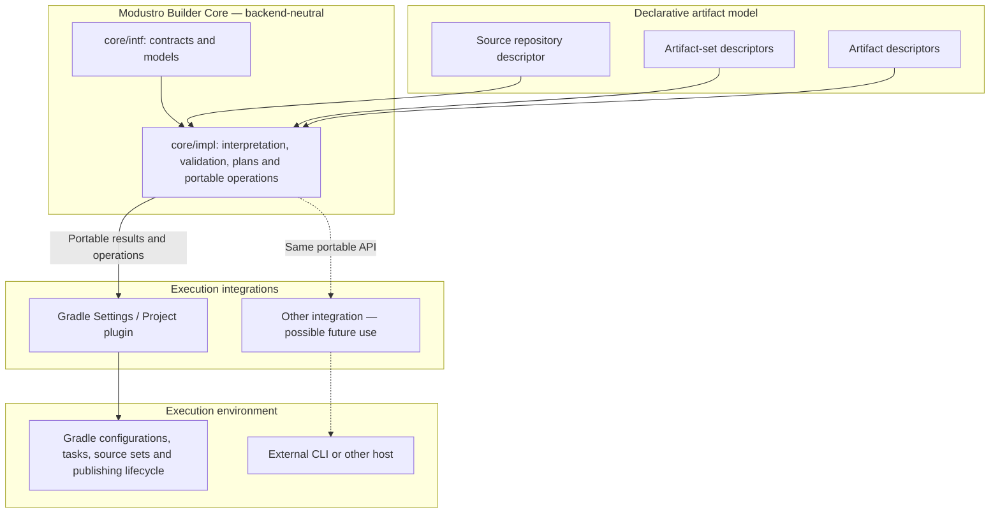

Arrows represent the consumption of data or capabilities, **not** necessarily a source-code dependency in their displayed direction. In source-code dependency terms, the integration may import Core types; Core must not import integration types. Descriptors are inputs, not executable build scripts.

The boundary is an ownership decision, not an insistence on making every module completely generic. For example, an S3 publication adapter can be a reusable Core-side implementation because its purpose is to publish content to an S3-compatible service. A Gradle `Publish` task that invokes it belongs in the Gradle integration.

## 1.4. Responsibility assignment


| Concern | Core responsibility | Integration responsibility |
|---|---|---|
| Descriptor metadata | Parse or consume normalized descriptions; validate and resolve their portable semantics and inheritance. | Supply descriptor locations, environment-specific defaults, and host-facing diagnostics. |
| Dependencies | Interpret logical dependency roles, version requirements, output requirements, and technology constraints. | Create backend configurations, resolve actual backend graphs, and connect outputs to consumers. |
| Capabilities and outputs | Determine required capabilities and plan output production. | Register and execute tasks, attach toolchains and source sets, collect built outputs. |
| Source processing | Model processors, input/output relationships, and semantic prerequisites. | Create build-time tool environments, register generators, and wire generated sources into compilation. |
| Credentials and external inputs | Express subscription requirements and credential references without leaking secret values. | Obtain host-specific secrets, create repository credentials, and enforce task-time access. |
| Publication | Plan endpoints, payloads, order, failure policy, and portable finalization semantics; execute provider operations when backend-neutral. | Trigger publication at the appropriate lifecycle point, prepare actual payloads, provide credentials, and report outcomes to the host. |
| Build lifecycle | Define portable ordered Modustro phase identifiers, execution placement/defaults, phase-local graph constraints and validation. | Implement Gradle task names, executable phase barriers, task dependencies, and invocation policy. |

**Architectural rule:** a convenience function does not belong in Core merely because several integrations could theoretically call it. Its inputs, outputs, and meaning must themselves be independent of any particular integration.

## 1.5. Portable lifecycle semantics versus backend orchestration


An artifact may require a source-processing tool before compiling, or require verification before publication. The underlying constraints are meaningful in Modustro, but the expression of those constraints as `dependsOn`, a shell command, a Gradle phase, or a CI job is **not** a Core concern.

**Target contract:** Each logical phase defines a repository-wide ordering boundary. The Gradle adapter may realize it through separate invocations, but neither the exact controller nor the existing six-task implementation defines the portable contract.

**Architectural rule / transition:** The agreed lifecycle expands these to five productive phases, each followed by its verification boundary:


The ten **portable phase identities** are normative for Modustro execution placement. Core may validate ordering and resolve an execution's effective phase, but only the Gradle integration/controller owns the concrete `modustro...Phase` tasks and repository-wide barriers. This is a correction to the initial draft's claim that *no* phase concept should exist in Core. Distinct build domains must respect the same phase boundary without requiring Core to launch `gradlew` or inspect `settings.gradle.kts`.

## 1.6. Dependency Usages and Execution Placement
A **dependency** names an artifact or native package required by the consumer. A **Usage** identifies the contract for applying that dependency. A **BuildExecution** gives a concrete invocation of a build-tool usage with configuration and phase; the **Phase** is an independently overridable execution property. Artifact technology, product/develop source role, usage kind, and execution phase must not be collapsed into one dimension.

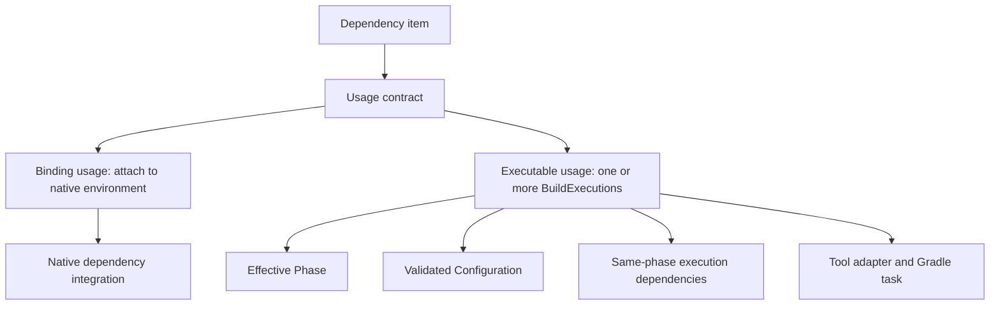

**Proposed naming:** `bind:product_implementation`, `bind:develop_implementation`, and `execute:source_generation` are illustrative portable identifiers. `bind:` is the current preferred prefix, although its exact public name remains provisional; it is not `static:` and does not conflate `product`/`develop` with executed versus bound dependencies. The existing unprefixed usages such as `product_implementation` are to be normalized compatibly during migration. Definitions and schemas of usages are extensible and not a closed hardcoded enum.

For executable usages, `DefaultPhase` is merely the default placement, **not** the earliest legal phase. The tool may run earlier or later if configured accordingly and if its real prerequisites are available. The Builder validates declared graph constraints; a tool validates undeclared file/content prerequisites at runtime.

## 1.7. Technology-specific behavior versus backend-specific behavior


Technology specialization is not equivalent to build-backend coupling.

Core may legitimately understand:

- Java API versus implementation dependency semantics.
- Python package-runtime and build-source-processing roles.
- Maven coordinates, PEP 440 requirements, Algites version semantics, and concrete repository protocols.
- Output kinds such as JAR, source archive, wheel, and sdist.

An integration-specific adapter must understand:

- Gradle configuration names such as `api`, `implementation`, and `compileOnly`.
- Gradle `VersionConstraint`, `TaskProvider`, `SourceSet`, or publication APIs.
- Gradle Settings discovery, included-build wiring, and lifecycle/task naming.

A custom library for the **Gradle version syntax** is not itself Gradle API. However, transforming a portable requirement into a Gradle-specific constraint object or Gradle configuration name belongs at the adapter boundary.

When reviewing `AIcJavaDependencyTechnologyHandler` and `AIcDependencyVersionTechnologyBridge`, the intended change is therefore to move backend mappings outward **without removing useful technology-level planning from Core**.

## 1.8. Source generation and build-time tools


Source generation is an example of why Core should describe executable usage contracts and capabilities without prescribing a Gradle task implementation. The Defs and SDO generators may have different prerequisites and may need different build-time classpaths from the artifact being produced.

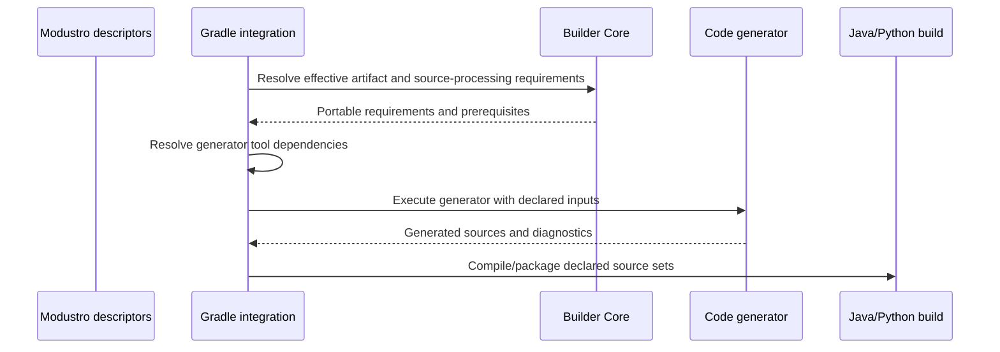

**Architectural rule:** Core need not execute the Gradle task graph. The Gradle plugin is responsible for making generation an explicit input to the appropriate compilation tasks, for preserving incremental-build semantics, and for assigning each generated file to a single responsible producer.

The current Defs/SDO bootstrap is a transitional, working path; the eventual Gradle build-time integration must be introduced without hand-editing generated `java.gen` or `python.gen` outputs and without making generator dependencies runtime requirements of the final library.

## 1.9. External inputs, credentials, and publication


Modustro separates external **inputs** consumed by a build from **outputs** published by a build. This separation is independent of whether Gradle, CI, or a dedicated tool initiates those operations.

Core is the appropriate home for portable input-subscription models, publication plans, execution policies, provider adapters, and result/finalization models. An integration is responsible for selecting when the operations run and supplying host-specific facilities. Credential references should be preserved as references until the operation that needs them; resolved secret values should not be placed into persistent plans, configuration-cache inputs, or normal build logs.

Two invariants follow:

1. A local compile or verification build must not require publication credentials simply because a publication endpoint is declared.
2. Publishing is a distinct, explicitly requested action that can be gated on successful preparation, verification, and artifact production.

The exact publication order within a Core-managed publication plan may be a portable policy; the point at which the outer build invokes that plan is integration-specific.

## 1.10. Conformance and testing


The architectural boundary is meaningful only if it is enforced.

**Core-level checks**

- Core public APIs and implementations do not depend on `org.gradle.*` or expose Gradle API objects.
- Core does not use Gradle task/configuration names as normative model identifiers.
- Core does not launch `gradlew`, interpret Gradle Settings files, or require a Gradle build context for portable operations.
- Descriptor inheritance, logical dependency plans, capability plans, and publication rules have tests that execute without Gradle.

**Integration-level checks**

- Gradle maps every supported logical usage and version requirement into the correct configuration or constraint.
- Settings discovery and isolated nested builds remain correct for realistic repository trees.
- Generated source tasks are ordered and their outputs wired into compilation without editing generated files by hand.
- Credential acquisition and publication occur only when required by the selected operation.
- Tests cover both success and failure paths, including configuration-cache and publication-finalization behavior where applicable.

A check for `org.gradle` imports is necessary but insufficient: a Core class that returns the literal task name `modustroPublishPhase` is coupled to Gradle even without importing any Gradle classes.

## 1.11. Architectural decision


> **Decision — Portable Modustro execution contracts with Gradle-first realization.** Core owns portable descriptor inheritance, extensible usage contracts, the ten ordered logical phase identities, effective BuildExecutions, validation and planning; it does **not** act as a task scheduler. Gradle owns native configurations, individual tasks, cross-domain phase barriers, toolchain environments, source sets, caches and execution details. Gradle remains the required backend for this milestone; additional backends require a real use case.

This decision provides a practical foundation for the next implementation milestone: clean the remaining Core/Gradle boundary, verify Settings and descriptor inheritance, verify input subscriptions and credentials, and then complete the standard Gradle build/publish integration incrementally.

---

# 2. Structural Concepts and Framework Semantics

This chapter describes reusable structural concepts independent of the exact YAML location of a setting. The detailed syntax of individual descriptors is documented in Chapter 3. In particular, dependency usage metadata and executable-tool configuration are reference material under §3.5, not separate peer-level chapters.

## 2.1. Independent Dimensions of Dependency Interpretation


**Architectural rule.** Keep the following axes distinct: (1) dependency kind and artifact identity, (2) dependency usage and its contract, (3) the technology kinds being processed, and (4) the phase and scope of each execution. In particular, `product` versus `develop` describes a consumer/source role; it is not the opposite of a build-time tool. A build-time tool can operate on product or development inputs and produce Java, Python, documentation, or other outputs.

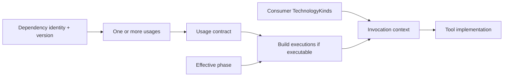

**Example — same tool both bound and executed (proposed syntax):**

```yaml
Dependencies:
  - DependencyKind: modustro
    Items:
      - GroupId: eu.algites.lib.xxx
        ArtifactId: pub.tool.General_some.build.tool.A
        VersionRequirement:
          Exact: "1.1-SNAPSHOT"
        Usages:
          - bind:product_implementation
          - execute:source_generation:
              - BuildExecutionId: generate-a
                Configuration:
                  SomeBuildToolASomethingSpecific1: xxx
                  SomeBuildToolASomethingSpecific2: yyy
```

Binding a tool to a product environment must be an **explicit** choice. Merely executing the tool must never leak its implementation dependencies into the published product's runtime closure.

## 2.2. Effective Execution Scopes and Inheritance Origins


The declaration may originate at Repository, ArtifactSet, or Artifact level, but its **effective execution owner** can differ from its declaration location. An artifact-local source generator is executed separately per artifact even when configured at the parent ArtifactSet. A repository-wide docs-site publication or generator may be executed exactly once at repository scope because its contract does not permit narrower ownership.

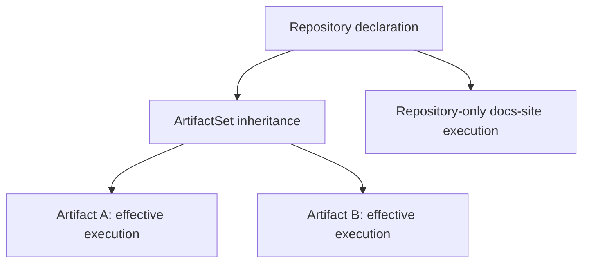

The same `BuildExecutionId` in Artifact A and Artifact B is therefore valid; it does not create a repository-global collision. Identity is checked at the **actual effective execution scope**, not at the common declaration's location. Allowed scope rules of particular contracts remain enforceable, e.g. `publication_of_docs_site` is currently repository-only.

### 2.2.1. Contextual Paths and Availability of Build Inputs


The Builder can always supply known contextual paths (artifact directory, product/develop/generated sources, build output roots) and technology-kind metadata, including when actual output files are not yet present. It can statically validate declared dependencies and producer/consumer relationships. A tool can additionally check actual files at execution time and fail with a useful diagnostic. Do not assume any directory path guarantees the presence of an output.

## 2.3. Phase Lifecycle and Global Boundaries

The phase sequence is a portable Modustro lifecycle contract. It is distinct from any particular Gradle task naming convention. Usage contracts may supply a default phase; the exact per-execution override is documented under §3.5.8.

### 2.3.1. Ten Ordered Production and Verification Phases


**Architectural rule — agreed target model:**

| Index | Phase | Intended boundary |
|---:|---|---|
| 1 | `RESOLVE` | Resolve logical/native dependency prerequisites and tools |
| 2 | `VERIFY_RESOLUTION` | Check resolved graphs, constraints, versions, provenance |
| 3 | `PREPARE` | Prepare sources, resources, metadata, generated input trees |
| 4 | `VERIFY_PREPARATION` | Validate prepared/generated material and its consistency |
| 5 | `COMPILE` | Compile native sources and test sources where appropriate |
| 6 | `VERIFY_COMPILATION` | Unit tests, bytecode/API checks, other compiled-state validation |
| 7 | `PACKAGE` | Produce wheel, sdist, JAR and other local deliverables |
| 8 | `VERIFY_PACKAGING` | Install/package-based tests, integration checks, package validation |
| 9 | `PUBLISH` | Publish selected outputs to configured endpoints |
| 10 | `VERIFY_PUBLISHING` | Verify published payloads, metadata, checksums, site availability |

The phase names describe **default lifecycle positions**, not a mandate that only certain classes of tools can execute there. Each verification boundary is an extension point for **any suitable configured execution**, not a requirement for every technology to implement a special verification task. Empty phases can be logical no-ops; an adapter may skip costly empty invocations without violating cross-domain barriers.

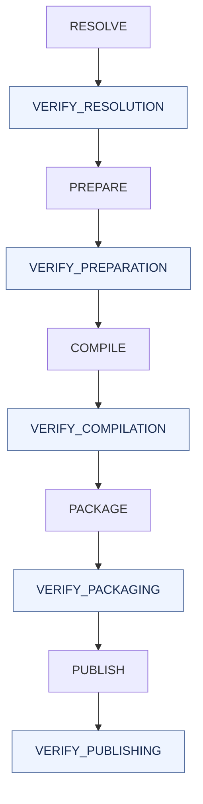

### 2.3.2. Repository-wide Phase Barriers and Isolated Domains


**Architectural rule:** Every phase completes across all included build domains before any work in the next phase starts. The Gradle implementation may use multiple invocations, but it must preserve the ten-phase boundary rather than relying only on a local project task graph.

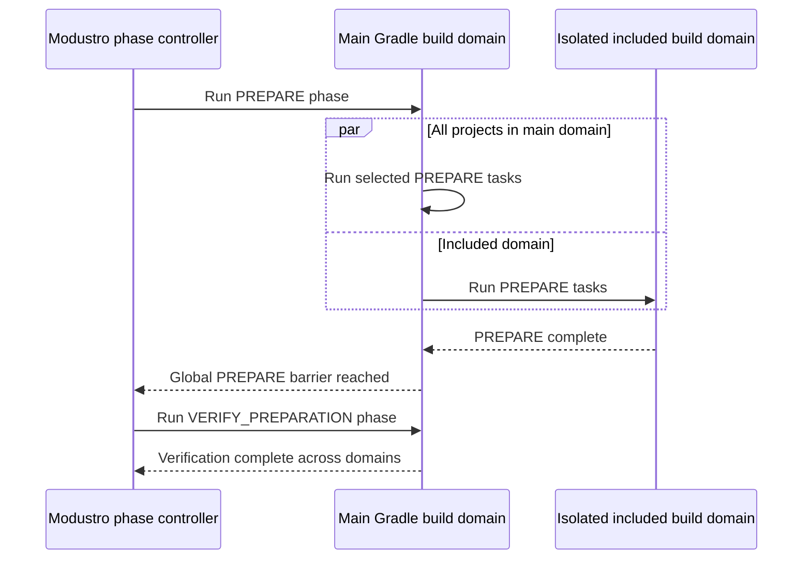

`AInGradleBuildPhase` currently represents the six task names; the agreed phase identities belong in a **portable plan**, not as Gradle task-name literals in Core. The Gradle controller maps portable phases to its own task names. No general-purpose second backend scheduler is proposed.

### 2.3.3. Verification After Publication


`VERIFY_PUBLISHING` checks *remote* state: artifact presence, versions, checksums, repository metadata, documentation site reachability and similar outcomes. It is distinct from prepublication verification. A failure may occur **after** some publications have completed, and must not be described as a transactional rollback. Respect existing publication ordering, failure policies, retry rules and finalization semantics; remote verification is potentially idempotent and rerunnable.

---

## 2.4. Execution Graph, Ordering and Validation

The general graph model is constructed for an effective owner and phase. Concrete `NeedsBuildExecutions` and conditional-ordering fields belong to a dependency's execution declaration (§3.5.6). References never silently search across phases or execution scopes.

### 2.4.1. Phase-local Graph Boundaries


**Architectural rule.** `NeedsBuildExecutions`, `MustRunAfterNotSkippedExecutions` and `PreferRunAfterNotSkippedExecutions` resolve references **only inside the same effective phase and execution scope**. The Builder does not automatically search for identically named executions in earlier or later phases and does not create cross-phase references. A referenced ID found only in another phase is an unresolved local reference, with a diagnostic naming the other phase.

All earlier phases have already completed by the phase barrier. A later-phase prerequisite is not a valid `NeedsBuildExecutions` relationship in the current phase. If a tool needs an artifact produced earlier, represent it through known available file/output inputs where appropriate; explicit execution-to-execution edges stay phase-local.

**Adapter invariant:** native Gradle `dependsOn`/input-producer wiring must not secretly launch an exclusively later-phase task as a prerequisite of an earlier phase. Validating portable execution edges alone cannot guarantee this; the integration must also check or constrain its native task graph.

### 2.4.2. Validation, Diagnostic Provenance and Remediation


#### 2.4.2.1. Validation passes


**Architectural rule.** Build an effective model for all relevant scopes and phases **before executing the first phase** of the requested operation. Validate the model, then select/skip actual work. Fail early and show the source of the configuration error rather than waiting for the native backend to report an unknown task or file.

Suggested pass order:

1. Parse descriptors and resolve dependency groups, native kinds, coordinates and inheritance membership rules.
2. Resolve registered usage contracts and their schemas; validate both simple usages and structured tool payloads.
3. Compose effective execution families and phase variants, including generic/phase-specific overrides and contract `DefaultPhase`.
4. Resolve effective `Skip`, `Configuration`, required/ordering lists and declaration provenance.
5. Validate same-scope/same-phase ID collisions **including skipped variants**, tool/usage compatibility, and supported execution scopes.
6. Validate all phase-local references, missing targets, required target skip conflicts, incompatible declared producer/consumer inputs, and mandatory dependency cycles.
7. Apply selected build intent/phases, implicit skip, explicit skip, and `Needs...` inclusion; construct the concrete executable phase graph.
8. Pass a portable plan to the Gradle integration, validate native cross-phase task boundaries and register tasks.

The exact implementation may combine passes, but must preserve those observable semantics.

#### 2.4.2.2. Provenance of every inherited property


The effective model should retain where each property came from: original descriptor path, hierarchy level (`Repository`, `ArtifactSet`, `Artifact`), dependency identity, usage ID, `BuildExecutionId`, and ideally source line/column plus the override chain. Inherited configuration and inherited `Needs...` are independent properties and therefore may originate at **different** levels.

**Do not** report merely “unknown execution generate-b” when it exists in another phase because of a child override. A good diagnostic explains the causal chain, including the inherited dependency and the newly introduced phase variant.

#### 2.4.2.3. Canonical example: a phase expansion invalidates inherited needs


##### 2.4.2.3.1. Declarations on two inheritance levels


At ArtifactSet:

```yaml
# file: artifact-set/modustro-artifact-set.yml
Usages:
  - execute:source_generation:
      - BuildExecutionId: generate-a
        NeedsBuildExecutions: [generate-b]
      - BuildExecutionId: generate-b
```

Usage default phase is `PREPARE`. At an Artifact:

```yaml
# file: artifact/modustro-artifact.yml
Usages:
  - execute:source_generation:
      - BuildExecutionId: generate-a
        Phase: PREPARE
      - BuildExecutionId: generate-a
        Phase: VERIFY_PREPARATION
```

##### 2.4.2.3.2. Effective phase graph and error


**Effective result:**

| Effective execution | Phase | Inherited needs | Valid? |
|---|---|---|---|
| `generate-b` | `PREPARE` | none | Yes |
| `generate-a` | `PREPARE` | `generate-b` | Yes |
| `generate-a` | `VERIFY_PREPARATION` | `generate-b` | **No** |

The second `generate-a` inherits the dependency but no `generate-b` exists in its phase. This happens **even if no second tool declaration has the same ID**; a missing phase-local dependency and a cross-tool duplicate are separate error kinds.

**Illustrative required diagnostic (paths/line numbers are examples):**

```text
MODUSTRO-BUILD-EXECUTION-UNRESOLVED-DEPENDENCY
Scope: ARTIFACT 'path/to/artifact'
Execution: 'generate-a'
Effective phase: VERIFY_PREPARATION
Usage: execute:source_generation

Required dependency 'generate-b' was not found in
VERIFY_PREPARATION of the same effective artifact.

Dependency 'generate-a -> generate-b' was inherited from:
  artifact-set/modustro-artifact-set.yml
  Usages[execute:source_generation] / generate-a / NeedsBuildExecutions

The phase-specific variant of 'generate-a' was introduced at:
  artifact/modustro-artifact.yml
  Usages[execute:source_generation] / generate-a / VERIFY_PREPARATION

A 'generate-b' execution exists, but only in phase PREPARE.
Cross-phase BuildExecution references are not supported.

How to fix:
  A. Declare/derive 'generate-b' in VERIFY_PREPARATION as well;
     or
  B. Override NeedsBuildExecutions: [] (or replace it with the
     appropriate IDs) specifically for generate-a / VERIFY_PREPARATION;
     or
  C. Remove/disable the additional phase variant if it is not needed.
```

##### 2.4.2.3.3. Repair only the affected variant


**Fix B — explicitly clear the inherited need only for the second phase:**

```yaml
Usages:
  - execute:source_generation:
      - BuildExecutionId: generate-a
        Phase: PREPARE
      - BuildExecutionId: generate-a
        Phase: VERIFY_PREPARATION
        NeedsBuildExecutions: []
```

The first variant retains the inherited need; the second explicitly replaces it with an empty list. A **phase-less** override `NeedsBuildExecutions: []` would instead clear the requirement on **both** variants.

#### 2.4.2.4. Cross-tool duplicate effective ID


Two distinct tools/usages in the **same scope and phase** may each declare `generate-a`. That is invalid **even if one has `Skip: true`**. The error must show **both** providers, coordinates, usage IDs, effective phases, and origins, plus an explicit fix.

```text
MODUSTRO-BUILD-EXECUTION-DUPLICATE-ID
Scope: ARTIFACT 'path/to/artifact'
Phase: PREPARE
BuildExecutionId: 'generate-a'

Conflicting declarations:
  1. Tool: eu.algites:tool-A:1.1-SNAPSHOT
     Usage: execute:source_generation
     Origin: artifact-set/modustro-artifact-set.yml
  2. Tool: eu.algites:tool-B:1.1-SNAPSHOT
     Usage: execute:source_generation
     Origin: artifact/modustro-artifact.yml

How to fix:
  - Give distinct executions different IDs within PREPARE;
  - Or move one execution to another appropriate phase;
  - Or remove one conflicting declaration, preserving the
    intended inherited override at the correct tool identity.
  - Skip: true does not make two declarations with the same
    scope/phase/ID structurally unambiguous.
```

#### 2.4.2.5. A needed execution is skipped


```yaml
- BuildExecutionId: generate-a
  Skip: true
- BuildExecutionId: generate-b
  NeedsBuildExecutions: [generate-a]
```

If `generate-b` is selected and not skipped, this is a **required-but-skipped** failure, not an opportunity to override the explicit `Skip`. Diagnostic: state the needing ID, target ID, target `Skip` origin, phase/scope and how to fix it (unskip A, remove/replace the need, or skip B if deliberately disabled). For `MustRunAfterNotSkippedExecutions` and `PreferRunAfterNotSkippedExecutions`, a skipped target simply contributes **no ordering constraint**.

#### 2.4.2.6. An unresolved optional-order reference


Existence/type/phase validation still applies to a `MustRunAfter...` or `PreferRunAfter...` target. The fact that a relation does not require the target to **run** is not permission to accept a misspelled/nonexistent ID. If the target exists in the phase but is explicitly or implicitly skipped, the relation has no ordering effect; this is not a missing-reference error.

#### 2.4.2.7. Other required diagnostic classes


| Error family | Minimum explanation and hint |
|---|---|
| Unknown usage contract | Show exact usage ID, registration scope and expected schema location/known categories; register a valid contract or correct spelling |
| Usage payload schema invalid | Show field path, expected type/schema revision, actual value and contract source |
| Ambiguous variant override | List inherited phases, child declaration(s) and how to specify intended variant selection explicitly |
| Duplicate family variant | Show both same-tool declarations with same ID/phase and where each originated |
| Cross-tool duplicate effective ID | Show both tools and declarations, same scope/phase, remediation options |
| Missing same-phase reference | Show referenced ID, requesting execution, other phases where a matching name exists, origin of inherited reference |
| Needed target has `Skip: true` | Show explicit skip origin and needing execution, suggest unskip/remove dependency |
| Cyclic required/mandatory-order edges | Show complete cycle path and edge types, including origins |
| Input requires future phase output | Show required output producer, producer phase, consumer phase and why native task wiring cannot repair the contradiction |
| Unsupported tool/configuration/scope | Show supported contract/schema/scope and violated property |
| Multiple writers of an output root | Show both executions, conflicting output path and possible separation/serialization |

An error code should be stable and machine-readable. Human-readable details should be specific and causally useful, not just generic “invalid configuration.”

#### 2.4.2.8. Cycle examples


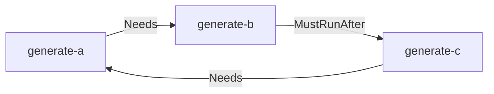

In this diagram arrows represent **dependency/ordering relations as labelled**, not necessarily Gradle execution direction. The validation error should identify `generate-a -> generate-b -> generate-c -> generate-a`, show which edges are required and which are mandatory ordering, and suggest removing/reorienting one. A cycle consisting only of advisory `Prefer...` edges is not a reason to fail a valid build; the backend may ignore those preferences.

---

## 2.5. Verification, Testing and Tool-Execution Contracts

Unit and integration tests are examples of executable usage contracts. The current technology-specific implementation and rollout notes are isolated in Temporary Appendix C; this chapter defines the target execution semantics.

### 2.5.1. Test Execution Contracts and Verification Inputs
Tests require executable invocations with configurable test sets, runner arguments, environment, timeouts, failure behavior and reports. A `BuildOutputProducer` or generic capability demand alone cannot represent them. The agreed model places testing under dynamically registered executable usages. Two meaningful default contracts are `execute:unit_test` and `execute:integration_test`; they may use the same framework but differ in typical prerequisites and placement.

A **framework dependency** is not necessarily the **runner invocation**. TestNG may appear on a Java `testImplementation` classpath as a binding while a Gradle `Test` task invokes it. Pytest is a Python package furnishing a runner. The same common `BuildExecution` fields apply, while their tool configurations remain framework-specific.

### 2.5.2. Default test usages versus chosen phase


| Usage | Illustrative default | Legitimate override |
|---|---|---|
| `execute:unit_test` | `VERIFY_COMPILATION` | `VERIFY_PREPARATION` for checks not requiring this artifact's compiled code; `VERIFY_PACKAGING` for tests against installed wheel/JAR |
| `execute:integration_test` | `VERIFY_PACKAGING` | `VERIFY_RESOLUTION` for a remote-system connectivity test independent of current build outputs |

Default phase is *not* a minimum. Actual test prerequisites depend on the chosen configuration and tool. A TestNG test may run before this artifact's compilation if its test code is already available (e.g. in another precompiled tool) or it tests only earlier artifacts. TestNG source files *within* `src/develop/java`, however, ordinarily require compiling those test classes before execution. A Python test against an installed wheel needs the wheel; a source-level Python test may not. These are different execution requirements, not arbitrary exceptions to the lifecycle model.

### 2.5.3. Proposed Java and Python test configuration


**Proposed syntax — two tools, two executions, both with validated tool-specific payloads:**

```yaml
Dependencies:
  - DependencyKind: java
    Items:
      - GroupId: org.testng
        ArtifactId: testng
        Usages:
          - bind:develop_implementation
          - execute:unit_test:
              - BuildExecutionId: java-unit-tests
                Phase: VERIFY_COMPILATION
                Configuration:
                  TestRoots: [src/develop/java]
                  IncludeGroups: [unit]
                  ExcludeGroups: [integration]
                  MaxParallelForks: 2
                  FailIfNoTests: true

  - DependencyKind: python
    Items:
      - ArtifactId: pytest
        Usages:
          - execute:unit_test:
              - BuildExecutionId: python-unit-tests
                Phase: VERIFY_PACKAGING
                Configuration:
                  TestRoots: [src/develop/python]
                  Markers: 'not slow'
                  Arguments: [-q]
                  FailIfNoTests: true
```

The `GroupId`, `ArtifactId`, and exact Python dependency wire schema above are illustrative and must be checked against the eventual native descriptor schema. Config keys `TestRoots`, `IncludeGroups`, `Markers`, etc. are **examples of tool-defined schemas**, not universal Builder fields. A TestNG tool artifact alone does not guarantee execution; a valid usage handler/adapter must know how to create an actual Gradle `Test` task or invoke a suitable standalone runner.

### 2.5.4. Configuration and execution environment


Common execution data should expose artifact/source/output directories, scope, effective phase, `TechnologyKinds`, validated `Configuration`, and permitted tool-runtime environment references. Tool-specific schemas may define suites, test names, timeout, parallelism, output reports, database/service endpoints, environment variables and more. Avoid leaking secrets into task logs/cache keys: resolve credential **references** only when authorized at task time.

The tool decides what to test and how to report failure. The Builder/adapter maps declared task outcomes into phase success/failure and must not infer that a task's missing input is valid merely because a directory path was provided.

## 2.6. Capabilities, BuildOutputTypes and Executions


### 2.6.1. Built-in Capability Identifiers and Scope Constraints


**Built-in reference catalog:** Java and Python each provide the three capability identifiers below, and Modustro provides three other identifiers: six distinct IDs and nine technology/capability registrations. Each capability retains its allowed execution scope.

| TechnologyKind | Capability | Allowed scope(s) |
|---|---|---|
| `java` | `source_native_processing` | Repository, ArtifactSet, Artifact |
| `java` | `dependency_resolution` | Repository, ArtifactSet, Artifact |
| `java` | `generation_of_native_documentation` | Repository, ArtifactSet, Artifact |
| `python` | `source_native_processing` | Repository, ArtifactSet, Artifact |
| `python` | `dependency_resolution` | Repository, ArtifactSet, Artifact |
| `python` | `generation_of_native_documentation` | Repository, ArtifactSet, Artifact |
| `modustro` | `publication_of_global_schemas` | Repository, ArtifactSet, Artifact |
| `modustro` | `publication_of_docs_site` | Repository only |
| `modustro` | `docs_site_content` | Repository, ArtifactSet, Artifact |

The canonical Java/Python native-documentation capability has prerequisites for the corresponding technology's `source_native_processing` and `dependency_resolution`. Capability prerequisite planning is not the same as `NeedsBuildExecutions`; the latter expresses relationships between concrete tool executions in one phase.

### 2.6.2. What capabilities, usages, phases and outputs mean


| Concept | Question it answers | Example |
|---|---|---|
| Capability | What prerequisite/ability must be satisfied for an output or artifact? | `java:source_native_processing` |
| Usage contract | How is a specific dependency bound or invoked? | `execute:source_generation` |
| BuildExecution | Which concrete tool invocation, parameters and relations? | `generate-definitions` |
| Phase | When is the invocation requested in the lifecycle? | `PREPARE` |
| BuildOutputType | What named artifact output can be produced/consumed? | `java_classes_jar`, `python_wheel` |

**Architectural rule.** These are related but **not synonymous**. Avoid renaming a capability into a usage or representing every intermediate generated directory as a publishable BuildOutputType. A capability planner may demand source processing; a tool execution may contribute to satisfying that demand. The same execution may generate Java and Python files, and a later output producer may consume them.

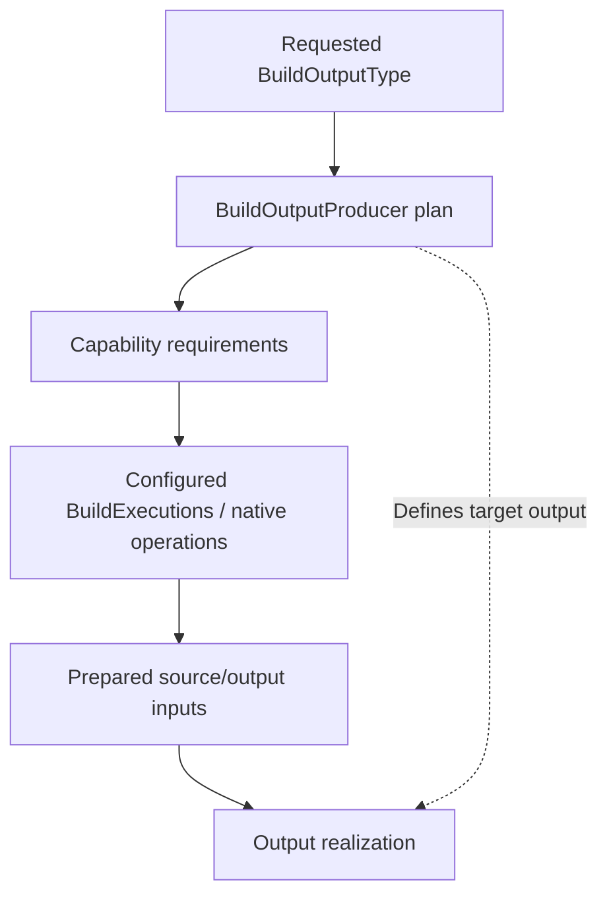

This diagram is a **dependency/planning relationship**, not a literal invocation algorithm: the planner resolves a finite DAG of requirements and the producer consumes realized inputs. For default artifacts, the existing technology definitions request Java `java_classes_jar`/`java_sources_jar` and Python `python_wheel`/`python_sdist` where configured.

### 2.6.3. Built-in BuildOutputType Catalog
| Technology | Output type | Notes |
|---|---|---|
| Java | `java_classes_jar` | Concrete package |
| Java | `java_sources_jar` | Concrete sources archive |
| Java | `java_javadoc_jar` | Concrete documentation archive |
| Python | `python_wheel` | Concrete wheel |
| Python | `python_sdist` | Concrete source distribution |
| Python | `python_distribution` | **Virtual dependency-only selector**, alternatives wheel/sdist; not directly produced |
| Modustro | `modustro_docs_site` | Site output |
| Modustro | `schema_site` | Schema publication/site output |

Producer contracts such as `AIiBuildOutputProducer` should remain portable planning interfaces, not task executors that substitute for explicit tool `BuildExecutions`. When output production itself requires a configurable tool, that invocation can use the same execution model while the producer describes the resulting named BuildOutputType.

### 2.6.4. Documentation and verification examples


A docs-site build may be a **repository-scope** execution with repository-only publication capability. A Java Javadoc JAR may be an **artifact-scope** output producer requiring `generation_of_native_documentation`. Post-package integration tests do not have to be BuildOutputProducers at all: they are executable verification usages. The `VERIFY_PUBLISHING` phase can check remote publication without producing another distributable artifact.

---

## 2.7. Dependency Evaluation, Translation and Provider Extensibility


### 2.7.1. Two distinct processing stages


**Architectural direction.** Keep **declarative dependency expansion** separate from **native dependency translation**. This avoids confusing a Modustro dependency's meaning with one backend's Gradle configuration names.

1. Normalize and expand effective declarative dependencies into any further portable declarations that are genuinely required for the consumer and tool execution environment. Expansion can include Modustro-to-Java/Python requirements and resolution of output variants; repeat safely to a fixed point with provenance/duplicate/cycle protection.
2. Translate the stable declarations to the target native dependency model, and only then let the active backend map them to Gradle `api`/`implementation`/`annotationProcessor`, Python packaging requirements, test environments or dedicated tool launch environments.

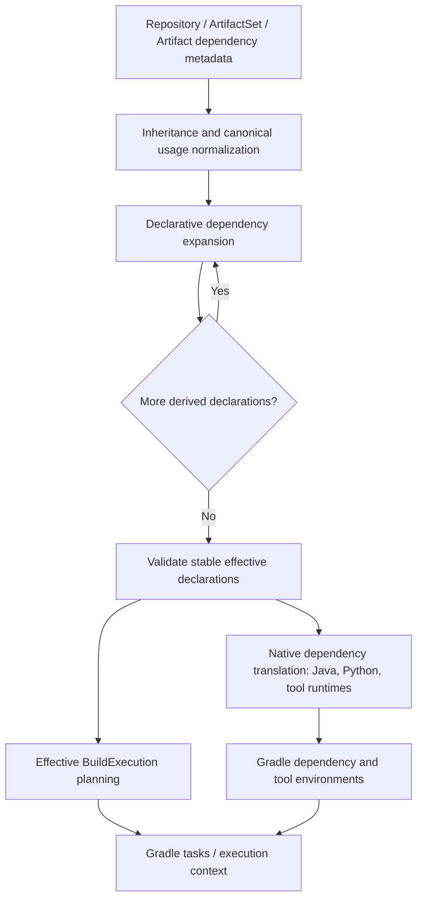

The fixed-point operation must be deterministic, prevent unbounded self-reinsertion and explain the provenance of derived declarations. **A source dependency retained as a terminal declaration is not an instruction to repeat expansion forever.** Preserve the original Modustro-level meaning where necessary; do not prematurely collapse everything to Java or Python.

### 2.7.2. Native dependencies versus executions


**Critical invariant:** A Modustro dependency expanding to **both** a Java and a Python requirement does **not** imply two invocations of each `BuildExecution` declared under that dependency. Tool provisioning and invocation planning are different operations:

- A target artifact with `TechnologyKinds: [java, python]` may need Java and Python dependency payloads for native output production.
- A single tool execution receives both target technology kinds and can generate two source trees in one run.
- The actual tool implementation may run in Java, Python, Gradle itself or an external CLI, independently of target technology kinds.
- When two runs are desired, declare two executions (different IDs or different phase variants under the agreed rules) and give them their own configuration and output ownership.

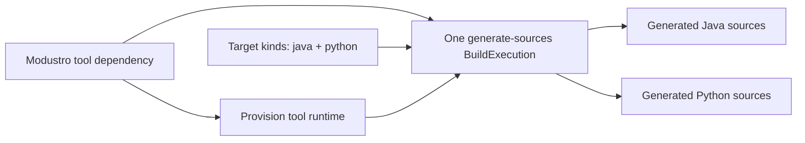

The dependency evaluator/translator should not guess a tool's supported target technologies solely from the coordinate's `DependencyKind`. It resolves and supplies the implementation/runtime and lets the registered execution contract interpret `TechnologyKinds` and tool configuration.

### 2.7.3. Usage Contract Metadata and Invocation Requirements
#### 2.7.3.1. Schema-based extension


A new usage must be declarable without editing a hardcoded Core enum. The registration supplies a stable usage ID and a schema for the passed data. Where the contract is executable, it additionally indicates default phase and how to find an implementation capable of handling the usage. Provider invocation receives a normalized validated context and must return at least sufficient requirements/output information for safe planning.

**Illustrative general representation — NOT final wire names:**

```yaml
UsageContract:
  UsageId: execute:database_migration_validation
  DataSchema: urn:example:database-migration-validation:1
  DefaultPhase: VERIFY_PREPARATION
  ProviderCategory: execute:database_migration_validation
```

**Illustrative consumer:**

```yaml
Dependencies:
  - DependencyKind: modustro
    Items:
      - ArtifactId: example.database-migration-tool
        Usages:
          - execute:database_migration_validation:
              - BuildExecutionId: validate-migrations
                Skip: false
                Configuration:
                  MigrationDirectory: src/product/migrations
                  ValidateChecksums: true
```

The `Configuration` shape is validated by that external contract's schema; Builder Core does not acquire `MigrationDirectory` or `ValidateChecksums` as hardcoded fields. Implementations can still use standard common execution fields. If the new usage is a non-executable binding type, its schema describes its binding payload rather than forcing a list of executions.

#### 2.7.3.2. Execution is still supplied by a discoverable provider


**Extensibility boundary:** a schema alone provides structural validation but cannot implement previously unknown actions. To actually execute, the matching provider/runtime must be discoverable. No new Core switch or global enum member is needed if contract discovery already supports the category.

### 2.7.4. CPDiscovery Extension Points and Specialized Factories
Previous architectural discussion identified three roles that should remain separate if retained as factories:

| Candidate provider role | Logical purpose |
|---|---|
| `AIiDeclarativeDependencyExpanderFactory` | Expand normalized declarative dependencies, without Gradle objects |
| `AIiNativeDependencyTranslatorFactory` | Turn effective portable dependencies into Java/Python-native dependency requirements |
| `AIiBuildOutputProducerFactory` | Supply portable producer plans for requested `BuildOutputType`s |

These identifiers are **candidate contract names**, not assertions that source files with exactly these interfaces are already implemented. An executable usage may require a further discovery/invocation binding, but avoid creating a factory for each individual tool or writing a generic plugin framework before real use. Prefer an extensible registry mapping category/usage ID to a schema and a compatible provider, with a simple standard fallback.

In the existing `AIiCategoryProviderFactory<I,C>`, `getImplementationInterfaceType()` and `getContextInterfaceType()` identify typed interfaces; `createInstance(String aCategory, C aContext)` receives the requested category because one provider may support several categories. Keep category dispatch separate from `ProviderId` selection and from build tool artifact coordinates.


**Specialized metadata discovery recommendation (added):** `AIiBuildMetadataResolverFactory` is a **new proposed SPI**, not an existing class. It should return an `AIiBuildMetadataResolver` reading tool-published metadata including the supported `UsageId` set, per-usage `ConfigurationSchema` / invocation data schema, `DefaultPhase`, and compatible execution handler reference. The general `AIiCategoryProviderFactory` and registry already exist; no distinct generic service-discovery framework is needed. See §3.5.3 for the descriptor-level details.

### 2.7.5. Python/Java parity and standalone generators


Defs/SDO code generation exists with standalone technology-specific implementations; the Python implementation must remain usable without running Gradle or Java. The Gradle integration can invoke a standalone Python generator, or a standalone Java generator, using an execution contract. Do **not** confuse the tool runtime with the target's output technologies.

When generated source directories such as `src/product/java.gen` and `src/product/python.gen` are involved, they remain **derived outputs**, never hand-edited source-of-truth files. Tool configuration and naming profiles govern generation. `TechnologyKinds` should always come from the **processed** artifact's effective metadata, not from an arbitrary default based on whether the tool was published as a wheel or JAR.

### 2.7.6. Dependency usages and native mapping limitations


`bind:product_annotation_processor` is a useful counterexample to an overly simple distinction between "static" and "build". It attaches a tool to Java's native compiler-managed annotation processing, which invokes executable code but does **not** declare a standalone Modustro `BuildExecution`. Similarly, `bind:develop_implementation` can place a framework in a test environment while a separate `execute:unit_test` actually runs tests. The two roles can coexist on the same dependency.

Python-native dependency translation must retain intended semantics or explicitly report unsupported uses. Do not satisfy a distinct portable usage by silently transforming it into another usage, or mapping it to `NO_OP` as a false indication of support.

---

## 2.8. External Inputs, Publication, Documentation and Security


### 2.8.1. Keep inputs and outputs separate


`InputSubscriptions` represent external content consumed by a build. `OutputPublications` represents publishing the finished build outputs. The existing model includes native binary/source/documentation outputs, snapshot/release endpoints, provider adapters, credential profiles, publishing order, failure policy and retry/timeout/progress settings. These remain **portable operation/policy concepts**, not equivalent to usage IDs or build phases.

Build-tool executions may generate files later published by `OutputPublications`. The selected operation must not require publication credentials during a local compile or test merely because a publication endpoint is configured.

### 2.8.2. Publishing as a phase with a final verification boundary


The new ordered pair is:


A `VERIFY_PUBLISHING` execution can check accessible object storage payloads, Maven/Python package visibility, schema sites or docs sites. It does not promise rollback when publication already partially succeeded. Respect intrinsic publication ordering (equal `PublishingOrder` may run concurrently), `FailurePolicy`, retries and finalization behavior, and make verification idempotent where practical.

### 2.8.3. Repository-level docs-site example


A docs-site operation can belong to **Repository** execution scope, even when contributing content and schema inputs originate in child artifacts. A repository-only contract must not be cloned per artifact by inheritance. Distinguish `docs_site_content` contribution capabilities from `publication_of_docs_site` or a specific docs-site production/publication execution.

**Illustrative repository-level tool declaration:**

```yaml
Dependencies:
  - DependencyKind: modustro
    Items:
      - ArtifactId: example.docs-site-tool
        Usages:
          - execute:documentation_generation:
              - BuildExecutionId: generate-docs-site
                Phase: PACKAGE
                Configuration:
                  IncludeArtifactDocs: true
```

Actual publication remains separately configured under the `OutputPublications` model. This example does not assert the public existence of `execute:documentation_generation` today.

### 2.8.4. Credentials and reproducibility


Store secret identifiers/credential-profile references rather than resolved secret strings in durable execution plans. Tool adapters resolve authorized secrets only for the action that needs them. Provenance logging must redact credentials and confidential inputs even when showing inheritance chains. Be explicit about network access, environment-dependent inputs and result-cache eligibility. Snapshot/release boundaries and publication-finalization rules remain unchanged unless deliberately revised.

---

# 3. YAML Descriptor Reference

This chapter groups settings by their place in the YAML descriptor hierarchy. It distinguishes a setting's *declaration location* from the effective owner of an operation. Descriptor field tables reflect the reviewed canonical schemas; executable usage metadata and all expanded examples illustrate the agreed target schema, which has not yet been implemented in the current parser.

## 3.1. Descriptor Hierarchy and Shared Metadata

The canonical source-repository hierarchy is `modustro-source-repository.yml` → `modustro-artifact-set.yml` → `modustro-artifact.yml`. A Version Scope groups artifacts that share version and dependency semantics. Repository/ArtifactSet/Artifact metadata may be inherited, normalized and overridden according to each property's policy. The physical source file where a setting appears need not be the scope of its eventual execution.

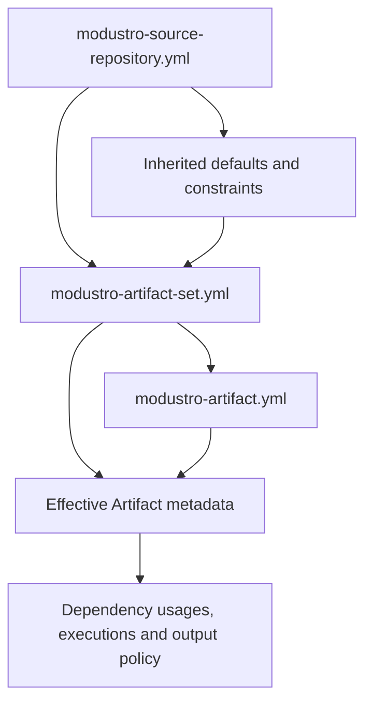

The common top-level settings supported in the reviewed canonical YAML schemas include `GroupId`, `Version`, `CredentialProfiles`, `Dependencies`, `DependencyConstraints`, `EnvironmentRequirements`, `NestedGradleSettingsBuildPolicy`, `OutputPublications`, `ArtifactPublicationFinalizationActions`, and `VersionScopePublicationFinalizationActions`. The exact allowed fields and required values depend on descriptor kind and its referenced schemas. `InputSubscriptions` may also occur in the relevant nested descriptor objects or defaults overlay. See the dedicated subsections below rather than assuming that every setting is valid at every scope.

## 3.2. Source Repository Descriptor (`modustro-source-repository.yml`)

**Canonical structural key:** `SourceRepository`.

| Location | Schema field | Meaning |
|---|---|---|
| `SourceRepository` | `Id` | Required source-repository identifier |
| `SourceRepository` | `Name`, `Visibility` | Optional repository identity/presentation metadata |
| `SourceRepository` | `InputSubscriptions` | Source-repository-level external input subscriptions |
| Descriptor root | `GroupId`, `Version` | Shared group/version metadata, subject to the version-scope rules |
| Descriptor root | `CredentialProfiles` | Credential profile definitions/references |
| Descriptor root | `Dependencies`, `DependencyConstraints` | Inherited dependency declarations and constraints (see §3.5) |
| Descriptor root | `EnvironmentRequirements` | Constraints on execution environments |
| Descriptor root | `NestedGradleSettingsBuildPolicy` | Policy currently used by the Gradle integration; a host-specific setting |
| Descriptor root | `OutputPublications`, finalization fields | Inherited publication configuration |

**Illustrative structural fragment:**

```yaml
SourceRepository:
  Id: example-repository
  Name: Example repository
GroupId: eu.example
Dependencies: []
```

Source: `modustro-source-repository_1.yamldef.schema.json`. The fragment intentionally shows only a few properties; it is not a complete build configuration.

## 3.3. ArtifactSet Descriptor (`modustro-artifact-set.yml`)

**Canonical structural key:** `ArtifactSet`.

| Location | Schema field | Meaning |
|---|---|---|
| `ArtifactSet` | `TechnologyKinds` | Technologies inherited or refined by descendants |
| `ArtifactSet` | `Name`, `Description`, `Version` | Descriptive information and optional version context |
| `ArtifactSet` | `InputSubscriptions` | Subscriptions applicable at this level |
| Descriptor root | `GroupId`, `Version` | Inheritable group/version context |
| Descriptor root | `Dependencies`, `DependencyConstraints` | Dependencies inherited by contained artifacts |
| Descriptor root | `EnvironmentRequirements`, `CredentialProfiles` | Environment and credential policy |
| Descriptor root | `NestedGradleSettingsBuildPolicy` | Gradle isolation behavior |
| Descriptor root | `OutputPublications`, finalization fields | Publication and finalization definitions |

A dependency-defined tool execution may be inherited from this descriptor by multiple child artifacts. The **effective execution scope**, not the ArtifactSet file where the declaration was written, determines collision checks and actual invocation ownership. See §2.2 and §3.5.

```yaml
ArtifactSet:
  TechnologyKinds: [java, python]
Dependencies: []
```

Source: `modustro-artifact-set_1.yamldef.schema.json`. The displayed values are a structural example, not a substitute for the full schema.

## 3.4. Artifact Descriptor (`modustro-artifact.yml`)

**Canonical structural key:** `Artifact`.

| Location | Schema field | Meaning |
|---|---|---|
| `Artifact` | `TechnologyKinds` | Required effective technology list in the reviewed schema |
| `Artifact` | `Name`, `Description`, `Version`, `VariantId` | Artifact metadata, version and optional variant selection |
| `Artifact` | `InputSubscriptions` | Artifact-level external subscriptions |
| Descriptor root | `GroupId`, `Version` | Group and version metadata |
| Descriptor root | `Dependencies`, `DependencyConstraints` | Artifact-local dependencies, executions and constraints |
| Descriptor root | `EnvironmentRequirements`, `CredentialProfiles` | Environment constraints and credentials |
| Descriptor root | `NestedGradleSettingsBuildPolicy` | Gradle-specific isolation policy |
| Descriptor root | `OutputPublications`, finalization fields | Output publication and finalization policy |

Each effective artifact is a separate execution scope for artifact-scoped tools. Inherited executions with the same `BuildExecutionId` across distinct artifacts are not collisions.

```yaml
Artifact:
  TechnologyKinds: [java, python]
  Name: Example library
Dependencies: []
```

Source: `modustro-artifact_1.yamldef.schema.json`. The artifact coordinate/identity is determined by the complete model and its surrounding hierarchy, not merely this fragment.

## 3.5. Dependencies

This subsection is the canonical descriptor reference for `Dependencies`, `DependencyConstraints`, `DependencyKind`, `Items`, `Usages`, executable tool contracts, their metadata and validation, concrete `BuildExecutions`, inheritance, graph edges and worked examples. Concepts that are independent of descriptor syntax are introduced in Chapter 2.

**Structural shape of dependency groups (target model):**

```yaml
Dependencies:
  - DependencyKind: modustro
    ItemsInheritancePolicy: merge_missing_items
    Items:
      - GroupId: eu.example
        ArtifactId: example.codegen.tool
        VersionRequirement:
          Exact: 1.1-SNAPSHOT
        Usages:
          - bind:product_implementation
          - execute:source_generation:
              - BuildExecutionId: generate-example
                Configuration:
                  Mode: default
```

`Dependencies` are not synonymously *build tools*. A dependency may provide an API, a runtime component, a compiler-managed processor, a test framework, or an executable build tool; a single dependency can have several usages. `DependencyConstraints` express nonconsuming version constraints under related grouping rules. A tool that supplies multiple executable usages advertises their contract metadata separately rather than requiring its consumers to duplicate its coordinates.

### 3.5.1. Usage Items and Their Scalar/Structured Representations


**Architectural rule.** The descriptor accepts a list of usages. A usage item can be a simple scalar identifying a non-execution binding contract, or a mapping with one usage-contract identifier as its key and a list of `BuildExecutions` as its value. The concrete extensible schema may permit additional structured usage kinds with their own payload shapes. Executable usages require a collection of execution declarations; a generic constraint such as “every mapping contains BuildExecutions” is not imposed on unrelated future usages.

```yaml
Usages:
  - bind:develop_implementation
  - execute:unit_test:
      - BuildExecutionId: validate-metadata
        Phase: VERIFY_PREPARATION
        Skip: false
        Configuration:
          TestGroups: [metadata]
      - BuildExecutionId: unit-tests
        Configuration:
          TestGroups: [unit]
```

**YAML note.** Both `bind:develop_implementation` and the mapping key `execute:unit_test:` are valid *unquoted* YAML. A colon inside an unquoted scalar does not create a key/value separator when it is not followed by YAML separation whitespace. The **final** colon in `execute:unit_test:` *does* end the mapping key. Quotation marks are optional, not the preferred style.

#### 3.5.1.1. Backward-compatible scalar interpretation


**Target compatibility rule.** Legacy scalar usages are accepted as aliases of the corresponding registered `bind:` usage contracts. Canonical normalized metadata must retain both scalar binding usages and structured `execute:` usages. Semantic uniqueness is determined after inheritance and phase-variant expansion; raw YAML array uniqueness alone is insufficient.

### 3.5.2. Usage Naming and Binding/Execution Contracts


#### 3.5.2.1. Binding Contracts Versus Executable Contracts
The current preferred convention is `namespace:name`, consistent with CPDiscovery category naming. `static` is rejected because some dependencies are required at runtime, while some binding mechanisms invoke code during a build (e.g. Java annotation processors). `product:` versus `develop:` is rejected as the discriminator between nonexecuted and executed usages because that is a **separate dimension**. `bind:` is the preferred working prefix, although alternatives such as `attach:` or `use:` were considered and the public spelling is not yet formally frozen. The preferred **`execute:`** prefix identifies executable tool contracts (replacing the earlier provisional `build:` prefix).

#### 3.5.2.2. Binding Usages and Java Configuration Mapping
**Proposed normalized binding usage IDs (existing ten meanings retained):**

| Canonical binding usage contract | Java Gradle configuration |
|---|---|
| `bind:product_api` | `api` |
| `bind:product_implementation` | `implementation` |
| `bind:product_compile_only` | `compileOnly` |
| `bind:product_compile_only_api` | `compileOnlyApi` |
| `bind:product_runtime_only` | `runtimeOnly` |
| `bind:product_annotation_processor` | `annotationProcessor` |
| `bind:develop_implementation` | `testImplementation` |
| `bind:develop_compile_only` | `testCompileOnly` |
| `bind:develop_runtime_only` | `testRuntimeOnly` |
| `bind:develop_annotation_processor` | `testAnnotationProcessor` |

These mappings express the Java adapter behavior required for the canonical binding usages. Python adapters must preserve each usage's intended semantics and reject unsupported mappings rather than silently returning `NO_OP`. Legacy spellings and their migration mapping are recorded in Temporary Appendix C.

#### 3.5.2.3. Standard and Custom Executable Usage Contracts
**Proposed executable usage IDs:** `execute:source_generation`, `execute:unit_test`, `execute:integration_test`, and potentially `execute:documentation_generation`, `execute:source_processing`, or third-party custom contracts. The latter names beyond the first three are illustrations, not an exhaustively approved public registry.

#### 3.5.2.4. Source Generation Versus Source Processing

`execute:source_generation` and `execute:source_processing` need not be synonyms. They can remain **distinct optional contracts**, if they genuinely expose different configuration/data schemas and expected outcomes:

| Contract | Illustrative responsibility | Examples |
|---|---|---|
| `execute:source_generation` | Derive new source files from definitions, schemas or another model | Defs/SDO generation, producing Java and Python classes from schema inputs |
| `execute:source_processing` | Transform, filter, normalize, copy or otherwise prepare existing source/resource trees | Token substitution, preprocessing existing templates, resource transforms, source-file normalization |

The boundary can overlap: a template transformer may both process input files and generate new files. The choice of usage is determined by the metadata and schema provided for that tool, not by a hardcoded name-based heuristic in Builder Core. **Do not add a special `source_processing` usage merely to rename an implementation detail of `source_generation`.** Keep both contracts only if tool authors need distinct documented contracts and schemas. They are *not* equivalent to the broader `source_native_processing` **capability**, which can require both kinds of activity and other source-preparation work.

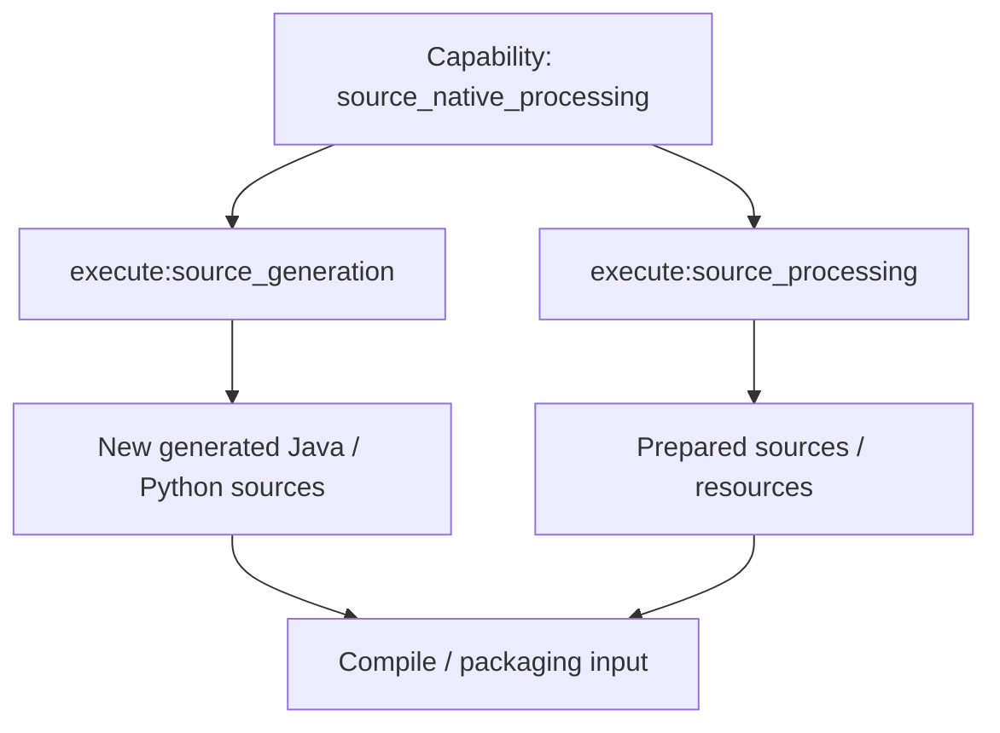

These usage names remain extensible contract examples, not a closed list hardwired into Core.

### 3.5.3. Usage Contract Metadata, Data Schemas and Registration


**Architectural rule.** Users/tool authors can define new usage contracts. Their identifiers must not be limited to a Builder Core enum or hardcoded dispatch switch. At the contract level, the critical declarative requirement is a schema describing the data passed to the usage/tool, so the Builder can validate input and provide a stable invocation contract. For executable usages the contract additionally supplies an optional/default phase and a way to resolve the implementation handling the contract.

#### 3.5.3.1. Schema versus runtime implementation


A schema is sufficient to **describe and validate** an arbitrary new usage; it does not magically supply executable behavior. Execution is delegated to a tool implementation/adapter resolved through the extensibility mechanism. No Builder Core code change or new enum member should be necessary for an additional usage when a compatible handler is supplied. One provider may support multiple usage categories.

#### 3.5.3.2. Proposed contract-registration example


**Illustrative contract metadata — not a finalized descriptor schema:**

```yaml
UsageContract:
  UsageId: execute:custom_schema_check
  PayloadSchema: urn:example:modustro:usage:custom-schema-check:1
  DefaultPhase: VERIFY_PREPARATION
  InvocationCategory: execute:custom_schema_check
```

This is **contract-registration metadata**, not an execution. `PayloadSchema` is the logical schema for the handed-off data. The exact published field names, schema-registration location, and whether the schema describes only `Configuration` or the entire tool-specific invocation payload remain implementation-schema decisions. Builder-managed fields (`BuildExecutionId`, `Phase`, `Skip`, references) have common schema semantics; the tool's own fields stay tool-specific. Prefer a shared, typed context plus a schema-validated tool-specific configuration object rather than forcing all tools into a universal parameter list.

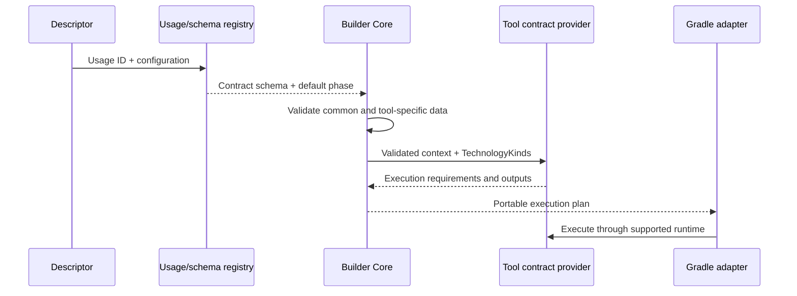

#### 3.5.3.3. Build-tool Metadata Discovery Through CPDiscovery

**Target architecture — proposed specialized factory.** The existing general CPDiscovery contract in `pub.lib.General` already supplies `AIiCategoryProviderFactory<I,C>`, the `AIiCategoryProviderRegistry`, `(factoryInterface, category, providerId)` selection, and Java/Python discovery mechanisms. The reviewed Modustro sources did **not** expose a dedicated **build-tool metadata resolver factory**. The current `AIcArtifactDirectoryMetadataResolver` resolves the descriptor hierarchy; it is not a CPDiscovery factory for a resolved tool's advertised usage contracts. The `AIcGlobalPublicationDeployMetadataResolver` is unrelated to tool usage metadata.

Introduce a specialized factory such as **`AIiBuildMetadataResolverFactory`** (working name), derived from the existing generic `AIiCategoryProviderFactory<AIiBuildMetadataResolver, AIiBuildMetadataResolutionContext>`. The selected resolver reads metadata published by a resolved build-tool artifact and returns a normalized, typed model. **One tool artifact may advertise many usage contracts** with separate schemas, default phases, providers and configuration formats. Builder must discover those descriptions from the tool rather than guessing the complete set of possible usage IDs from an enum.

The default provider can read declarative descriptors packaged with the tool; implementations needing custom formats may register a specialized metadata resolver in CPDiscovery. A registered factory is not required *for every tool*: a standard resolver can read all supported metadata manifests. The tool artifact's version/identity is part of metadata provenance; the registry category (for example `metadata:build_tool`) chooses a metadata resolver, not the usage itself. In particular, `ProviderId`, `UsageId`, and `ArtifactId` remain distinct identities.

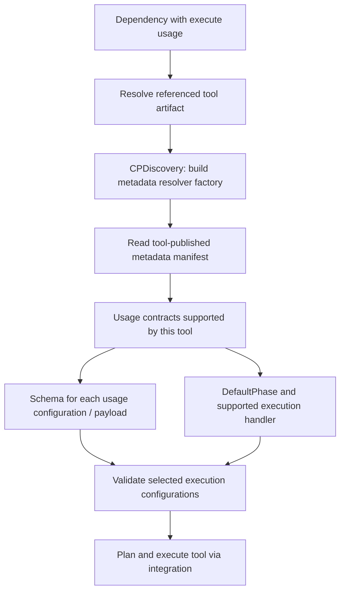

**Crucial resolution rule:** discovering metadata must not require first *executing* the tool. The dependency evaluator resolves enough of the tool's distributable or published metadata to read its usage contracts, then plans the executable runtime. This prevents circular discovery between “what does this tool support?” and “how do we run it?”

#### 3.5.3.4. Metadata Manifest for a Tool Supporting Multiple Usages

**Illustrative tool-provided metadata only — field names not frozen:**

```yaml
BuildToolMetadata:
  ToolId: example.codegen.tool
  UsageContracts:
    - UsageId: execute:source_generation
      ConfigurationSchema: urn:example:tool:source-generation-config:1
      InvocationDataSchema: urn:example:tool:source-generation-invocation:1
      DefaultPhase: PREPARE
      HandlerCategory: execute:source_generation
    - UsageId: execute:source_processing
      ConfigurationSchema: urn:example:tool:source-processing-config:1
      InvocationDataSchema: urn:example:tool:source-processing-invocation:1
      DefaultPhase: PREPARE
      HandlerCategory: execute:source_processing
```

The common execution envelope (`BuildExecutionId`, `Phase`, `Skip`, `NeedsBuildExecutions`, ordering collections and effective scope/target technologies) is defined by Builder. Tool metadata supplies **per-usage** configuration and invocation payload schemas. Those schemas are independently versioned and may differ even for two usages supported by the same tool. The resolver returns metadata, not an already executed instance or a Gradle task. The tool's supported usages are a **set of declared contracts**, not every arbitrary category that happens to share the `execute:` prefix.

A `ConfigurationSchema` validates author-supplied settings under `Configuration`, whereas an `InvocationDataSchema` describes the data exchanged at invocation time, including tool-specific values beyond the common Builder context. They may coincide for a simple tool. Distinguishing them avoids pretending that a schema for a user configuration object automatically describes every runtime input. The precise public names and wire representation remain to be standardized.

#### 3.5.3.5. Contract Resolution and Conflict Policy

Resolving a tool-specific usage must verify that the referenced tool **actually declares support** for that `UsageId`. The metadata resolver can enumerate the tool's advertised usage contracts, while CPDiscovery selects a compatible metadata resolver and executable handler. A usage known globally but not supported by the chosen artifact must fail with a diagnostic naming the artifact/version and available usage IDs.

When two metadata providers claim conflicting schemas or defaults for the **same tool, version and usage ID**, do not choose one based on loading order. Report the conflicting identities, schemas and origins. When two different tools support the same usage contract, this is not a conflict: their tool-specific `ConfigurationSchema`s and execution implementations may differ **only within the shared usage contract's required invocation semantics**. Common contract fields and their schema remain consistent; specialization belongs to validated, tool-specific `Configuration` or an explicitly versioned contract. Each tool must validate its own configuration before invocation.

One metadata resolver may support many tool artifacts and one tool may support several usages; neither implies that one new CPDiscovery factory implementation must be generated for every tool or every usage. Keep the registry at the selected repository/domain resolution scope and use stable immutable snapshots as provided by CPDiscovery.

### 3.5.4. Binding, Provider Identification and Handler Discovery


**Architectural rule.** CPDiscovery distinguishes a factory implementation interface, a **category** and a **provider ID**. A usage ID such as `execute:source_generation` may be the discovery category; it is not itself a provider ID, and it is not a tool artifact coordinate. A separate tool artifact dependency supplies the concrete tool. Several tools may implement the same usage contract. Likewise, one adapter/factory may handle multiple categories.

The current architectural direction is a repository-scoped provider selection with a known standard fallback (`algites-standard`, with fallback enabled by default and explicitly disableable); per-ArtifactSet or per-Artifact provider overrides may be considered later where a real requirement exists, particularly for output producers. This provider-selection convention must not be confused with `BuildExecutionId`, which identifies an occurrence of a tool operation.

Do not create a separate plugin loading framework or independent classloader for every declared artifact. Use the existing dependency resolution, provider discovery, and tool runtime mechanisms. A build tool's implementation language (Java/Python/etc.) is distinct from the technology kinds of the **target** artifact.

### 3.5.5. Dependency Identity, Versions, Inheritance and Required Outputs


A dependency item continues to specify `DependencyKind` (`modustro`, `java`, `python`), coordinates, version requirement, optional variant, usages, and `RequiredBuildOutputTypes` as appropriate. `ItemsInheritancePolicy` retains membership semantics such as `merge_missing_items` versus `remove_missing_items`. For a surviving same-identity dependency the legacy `Usages` and required output types have merge/union semantics; executable usages require the richer rules in §3.5.7.

The same tool may be referenced at one coordinate and run several times with distinct configurations. Duplicate tool **coordinates** are not required to represent multiple invocations. Native resolution of a tool runtime must be isolated from product runtime packaging unless a binding usage explicitly requires both.

---

### 3.5.6. BuildExecution Declarations and Tool Invocation


#### 3.5.6.1. BuildExecution Placement Under Tool Usages
**Architectural rule.** A top-level list such as `BuildOperations` is not required. An executable usage holds one or more `BuildExecutions` **under the dependency that provides the tool**, enabling one resolved tool to run many times without duplicating its coordinate/version declaration. The earlier speculative `Stage` property is rejected; use `Usage` and independently overridable `Phase`.

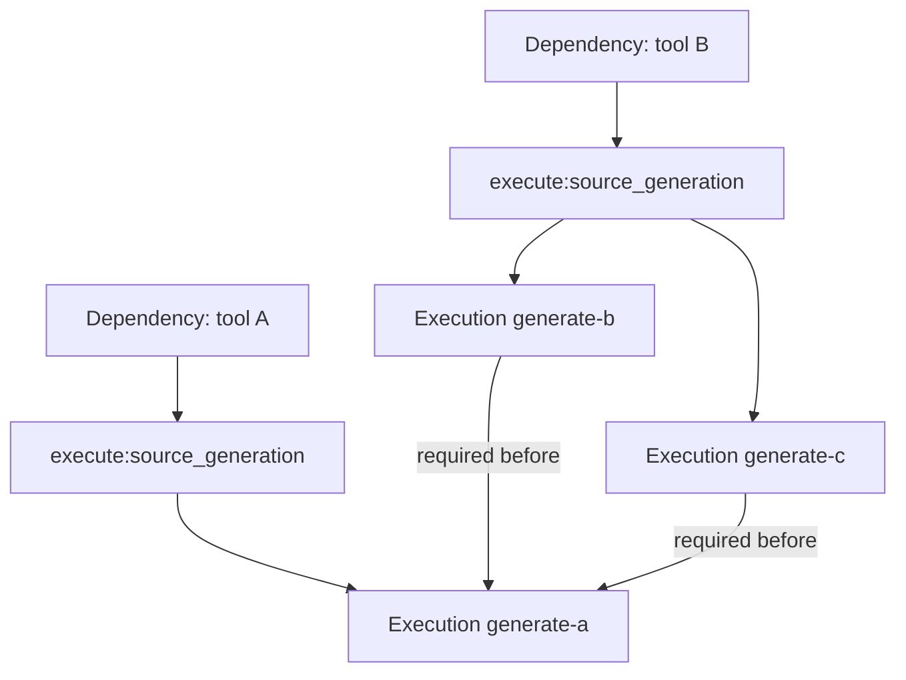

The arrows from B/C to A mean that **A depends on B and C**, so B/C may run in parallel before A. Reversing `NeedsBuildExecutions` reverses the edge direction. The descriptor's nesting expresses *ownership*, while Gradle uses one independently schedulable task per execution.

#### 3.5.6.2. Common execution properties


| Property | Meaning | Default/inheritance |
|---|---|---|
| `BuildExecutionId` | Logical name of execution/variant family within an effective tool-usage declaration | Required; stable for inheritance |
| `Phase` | Requested Modustro phase for this variant | Inherit if present, else usage `DefaultPhase` |
| `Skip` | Explicitly disable a declared execution | Inherit if present, else `false` |
| `Configuration` | Tool-specific schema-validated input | Inherit as a whole; an explicit value atomically replaces it |
| `NeedsBuildExecutions` | Executions that must be included before this one | Inherit, else empty; explicit list replaces full list |
| `MustRunAfterNotSkippedExecutions` | Obligatory order *if* the referenced execution is not skipped | Inherit, else empty; explicit list replaces full list |
| `PreferRunAfterNotSkippedExecutions` | Advisory order, not correctness-critical | Inherit, else empty; explicit list replaces full list |

All the names above other than legacy source fields are **proposed schema fields**. Do not implicitly deep-merge `Configuration`: tool-specific JSON/YAML objects may have arrays, interdependent options, sentinel values or custom semantics unknown to Core. Likewise, `Needs...: []` explicitly clears inherited requirements. **Unspecified** and **explicit empty** are not equivalent. Whether `null` is legal as an explicit reset value is a distinct schema decision and is not implied by this manual.

**Minimal execution:**

```yaml
- BuildExecutionId: unit-tests
```

The usage definition supplies a default phase and tool/schema defaults, where available. `Skip` defaults to `false`. A tool-specific configuration may legitimately be empty when the contract allows it.

#### 3.5.6.3. Target technologies are mandatory invocation context


**Architectural rule.** Always pass the effective `TechnologyKinds` of the **processed artifact** to a build-tool execution. The target technology set is not deduced from the language in which the generator/test tool was implemented.

##### 3.5.6.3.1. Example execution context


**Illustrative normalized invocation data:**

```yaml
InvocationContext:
  BuildExecutionId: generate-definitions
  EffectivePhase: PREPARE
  ExecutionScope:
    Kind: ARTIFACT
    Identity: path/to/artifact
  TechnologyKinds: [java, python]
  ArtifactDirectory: /workspace/path/to/artifact
  ProductSourceDirectories:
    - /workspace/path/to/artifact/src/product/java
    - /workspace/path/to/artifact/src/product/python
  GeneratedSourceDirectories:
    - /workspace/path/to/artifact/src/product/java.gen
    - /workspace/path/to/artifact/src/product/python.gen
  BuildOutputDirectory: /workspace/run/artifact/bld
  Configuration:
    GenerateInterfaces: true
```

These are example *data elements*, not a finalized wire API or prescribed filesystem layout. The tool environment may need other fields: tool coordinate, artifact identity, profile, credentials as **references**, dependency inputs, output locations, logging/progress, and cancellation. The Builder supplies all known contextual directory paths even if their contents have not yet been produced. Existence of a path does **not** imply availability of a compiled class, wheel, JAR or published payload.

##### 3.5.6.3.2. Distinguishing tool implementation from target languages


A single tool invocation may generate both Java and Python sources; it is **not** cloned merely because a dependency has Java and Python targets. Conversely, two explicitly declared executions may request separate language-specific runs. The tool interprets target technologies and its configuration; the Builder should not duplicate executions as a side effect of dependency translation.

#### 3.5.6.4. Tool-specific validation and runtime responsibilities


Builder validates descriptor structure, known usage schemas, effective IDs, graph references, phase constraints and declared input/output relationships when available. The tool validates its own *actual* prerequisites. For example, a test runner may receive `ArtifactDirectory` and `BuildOutputDirectory` in `VERIFY_PREPARATION`, yet fail because a test requires a JAR that has not been built. A generic Builder cannot infer the existence requirements of every custom configuration key.

If a tool *declares* a required JAR produced only during `PACKAGE`, Builder can reject an earlier-phase placement statically. If it only receives a directory path and performs an internal lookup, runtime failure is appropriate; avoid an elaborate, speculative universal filesystem precondition language.

#### 3.5.6.5. Output visibility and repeatability


Tools should disclose stable declared output roots/files and any known inter-execution data dependencies when practical. Gradle can then model inputs/outputs, task caching, invalidation, and producer ownership. Outputs produced during `PREPARE` are not automatically Modustro `BuildOutputTypes`; they may be internal intermediates. Two potentially concurrent executions must not write the same physical files without explicit coordination. A tool may also emit noncacheable or externally dependent results; the adapter must declare that accurately rather than promising caching without evidence.

#### 3.5.6.6. Comparison with Maven plugin executions


The mental model resembles Maven's `plugin` and `execution`: a plugin/tool is identified and resolved once, while executions have their own IDs, configuration and lifecycle placement; Maven also exposes test runners such as Surefire and Failsafe with different conventional phases. The Modustro design differs deliberately: **tools are ordinary dependencies with executable usages**, not a wholly separate Maven-like plugin dependency subsystem. Tool execution IDs are additionally scoped by effective Modustro phase/scope for validation, while inheritance can form multiple phase variants in one execution family. This is a conceptual analogy, **not** an instruction to adopt Maven's exact plugin merging rules.

**Example:** one TestNG/pytest-capable tool may run a metadata suite before compilation and a package-based suite after packaging, even though their usage contract or implementation is shared. The phase is an execution property; Maven-style lifecycle placement is not an extra hardcoded `Stage` field.


---

### 3.5.7. BuildExecution Inheritance, Phase Variants and Override Rules


#### 3.5.7.1. Inheritance goals


A tool execution defined at ArtifactSet should be reusable by descendant artifacts, overridable locally, movable between phases, and switchable off through `Skip`. It should also be possible to expand a single inherited execution family into **multiple phase variants** while inheriting a common configuration and dependency list.

The central distinction is between a **logical execution family** (a tool usage plus `BuildExecutionId`) and an **effective invocation variant** (a specific effective phase). `Phase` remains a normal *overridable property* of an execution; it is **not** frozen into the inheritance identity. Phase is, however, a discriminator when selecting and validating multiple effective variants.

| Operation | Identity used |
|---|---|
| Inherit a tool's execution declaration | Dependency identity + usage ID + `BuildExecutionId` |
| Override all variants in that family | Same identity; omit `Phase` in the override |
| Override one variant | Same identity plus a specified existing `Phase` |
| Detect executable collisions | Effective scope + effective phase + `BuildExecutionId` across *all tools/usages* |
| Resolve execution references | Effective scope + effective phase + referenced ID only |

Thus two tools may use `generate-a` in **different** phases or two artifacts may use it in the **same** phase; two distinct tools using `generate-a` in **one** phase for **one** effective scope are invalid. A single usage may declare two `generate-a` variants in different phases.

#### 3.5.7.2. Property merge rules


For a surviving matching execution family, ordinary properties (`Phase`, `Skip`) are inherited fieldwise. If `Configuration` appears at a narrower level, it replaces the **entire** inherited configuration. Every dependency/order reference collection is similarly replaced as a whole if explicitly specified, never automatically unioned with its inherited list. This is intentionally different from merge-only sets of simple dependency usages.

**Example — change phase without losing configuration:**

```yaml
# ArtifactSet declaration
Usages:
  - execute:unit_test:
      - BuildExecutionId: unit-tests
        Phase: VERIFY_COMPILATION
        Configuration:
          IncludeGroups: [unit]
          MaxParallelForks: 2
```

```yaml
# Artifact override under the same dependency and usage
Usages:
  - execute:unit_test:
      - BuildExecutionId: unit-tests
        Phase: VERIFY_PACKAGING
        Skip: false
```

The effective execution is still `unit-tests`, now in `VERIFY_PACKAGING`, with the inherited full configuration.

#### 3.5.7.3. Generic override applies to every phase variant


When one effective family contains variants of `generate-a` in `PREPARE` and `VERIFY_PREPARATION`, a phase-less local override applies to **both**:

```yaml
Usages:
  - execute:source_generation:
      - BuildExecutionId: generate-a
        Skip: true
```

To disable only one variant:

```yaml
Usages:
  - execute:source_generation:
      - BuildExecutionId: generate-a
        Phase: VERIFY_PREPARATION
        Skip: true
```

The same rules apply to `Configuration` and the three execution-reference collections. A phase-less `NeedsBuildExecutions: []` clears inherited needs on **all** variants; phase-specific clearing affects only the selected variant.

When the same inheritance layer contains a generic override and phase-specific overrides of the same family, apply generic changes first and phase-specific changes second, **independent of YAML ordering**. Two contradictory generic patches at one layer or two independently defined variants for exactly the same `(tool, usage, ID, phase)` are invalid rather than order-dependent.

#### 3.5.7.4. Expansion into multiple phases


**Example — inherited implicit configuration, expanded locally:**

```yaml
# ArtifactSet, usage default PREPARE; Phase is intentionally absent
Usages:
  - execute:source_generation:
      - BuildExecutionId: generate-a
        NeedsBuildExecutions: [generate-b]
        Configuration:
          InputMode: canonical
          OutputMode: generated
```

```yaml
# Artifact, two explicitly named variants
Usages:
  - execute:source_generation:
      - BuildExecutionId: generate-a
        Phase: PREPARE
      - BuildExecutionId: generate-a
        Phase: VERIFY_PREPARATION
```

Both variants inherit `Configuration` and `NeedsBuildExecutions` unless explicitly overridden. There is **no** accidental extra third invocation of the implicit/default phase: the explicit multi-variant declaration refines/expands the inherited logical family.

#### 3.5.7.5. Move versus append: a deterministic, limited rule


##### 3.5.7.5.1. The inherited one-to-one case versus multiple variants


A phase override alone is ambiguous in principle: does it move the inherited invocation or add another? The following resolution was accepted as an initial practical rule:

1. If an inherited family has **one** phase variant and a child declares **one** variant of that ID at a **different** phase, interpret it as **moving** the inherited invocation.
2. If the child explicitly declares **multiple** variants of the same ID at distinct phases, interpret this as **expansion** to those variants (with inherited common properties).
3. If an inherited family already has multiple variants and a child targets **one existing phase**, override only that variant.
4. If an inherited family has multiple variants and the child names a **new** phase without an unambiguous target to move, reject the declaration as **ambiguous**, with a diagnostic describing the existing variants and requiring an explicit variant operation/declaration. Do not guess.

##### 3.5.7.5.2. Ambiguity is a validation error, not a heuristic


These rules resolve the agreed ordinary cases without introducing a second public execution ID. An explicit `AddVariant`/`MoveVariant`/`RemoveVariant` facility is **not yet specified**; if truly needed it should be designed as a deliberate extension, not implemented by accidental list-order behavior. A phase-less override is a **generic property patch**, not an instruction to create another default-phase instance when variants already exist.

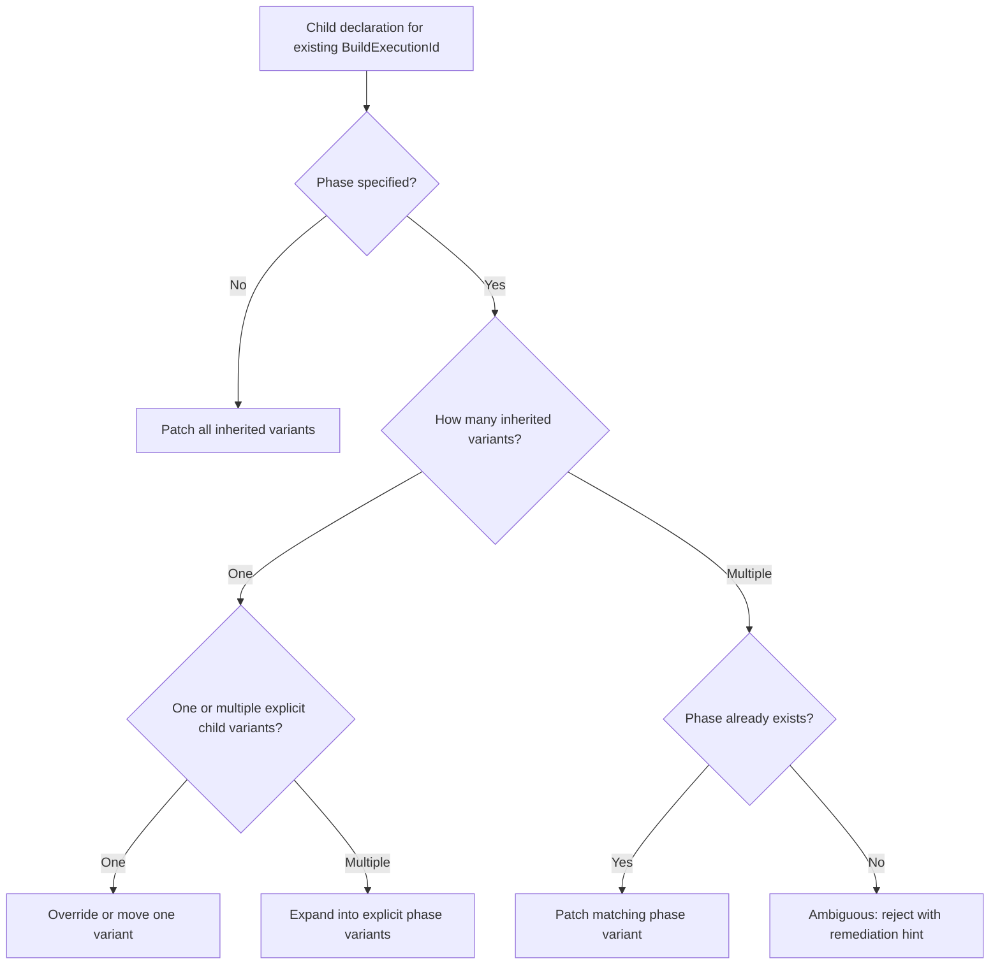

#### 3.5.7.6. Phase defaulting


A contract's `DefaultPhase` fills in a phase **only when no inherited/explicit effective phase applies**. It is not a lower bound and should not be used to suppress valid tests/generators in earlier phases. For instance, TestNG can run against already-built dependencies or configuration data before the current artifact's sources have been compiled; some Python tests may require packaged wheels and must therefore run later. Tool-specific input requirements, not the category label, decide feasibility.

#### 3.5.7.7. Explicit and implicit skip


`Skip: false` is the default. The user-defined distinction is:

- **Explicit skip:** the declared/effective invocation is selected by the current build intent but is explicitly marked `Skip: true`; it remains a known effective declaration and is deliberately not executed.
- **Implicit skip:** the invocation is not included for the currently requested build graph/phase scope; it is not executed even if its configuration says `Skip: false`.
- **Not skipped:** an invocation selected for the current build whose effective `Skip` is not `true`.

These have the same consequence **for conditional order edges**: the skipped target does not impose an execution-order constraint. They differ for reporting and diagnostics. `UP-TO-DATE`, `FROM-CACHE`, and other satisfied selected tasks are not classified as implicit skips; their results count as satisfying dependencies as permitted by the build engine.

`Skip` is distinct from deleting a declaration: skipped variants must remain visible to configuration validation and diagnostics. In particular, two same-phase/same-scope/same-ID declarations from different tools must not become an acceptable effective model merely because one currently has `Skip: true`; report the structural collision instead.

---

### 3.5.8. Usage DefaultPhase and Per-execution Phase Override


**Proposed default mapping** (illustrative until contract registration is finalized):

| Usage contract | Example `DefaultPhase` |
|---|---|
| `execute:source_generation` | `PREPARE` |
| `execute:unit_test` | `VERIFY_COMPILATION` |
| `execute:integration_test` | `VERIFY_PACKAGING` |
| `execute:custom_schema_check` | `VERIFY_PREPARATION` |
| `execute:documentation_generation` | To be defined by its registered contract |

Omitting `Phase` selects the inherited value or the contract default. A declared `Phase` **may be earlier or later** than the usage default. For example, an integration test that checks a remote service without using this artifact's built package could run at `VERIFY_RESOLUTION`. Conversely, Python tests run against an installed wheel may need `VERIFY_PACKAGING` even if semantically unit tests. Do **not** implement `effectivePhase >= defaultPhase` as a generic rule.

### 3.5.9. Execution Relationship Fields and Conditional Ordering


#### 3.5.9.1. The three execution relationships


**Architectural rule.** The following identifiers are the agreed preferred names. All refer to IDs of executions within the *same effective execution scope and effective phase*.

| Property | Meaning | Gradle analogue | Pulls referenced execution into execution plan? |
|---|---|---|---|
| `NeedsBuildExecutions` | This execution requires those executions | `dependsOn` | **Yes**, subject to `Skip` validation |
| `MustRunAfterNotSkippedExecutions` | If the referenced execution is not skipped, it must finish first | `mustRunAfter` | **No** |
| `PreferRunAfterNotSkippedExecutions` | Ordering preference only; may be ignored | `shouldRunAfter` | **No** |

`MustRunAfterNotSkippedExecutions` deliberately uses **NotSkipped**, not `Active`, `Scheduled`, or `InBuildGraph`. The identifier expresses the contractual distinction: a referenced execution is not executed if skipped **explicitly** by `Skip: true` or **implicitly** because it was not selected for the present invocation. Both have the same ordering effect. The two skip types are retained separately for reporting. `MustRunAfter...` is still *mandatory order* for two non-skipped executions, not a command that makes the referenced one run.

```yaml
Usages:
  - execute:source_generation:
      - BuildExecutionId: generate-a
        NeedsBuildExecutions: [generate-b]
        MustRunAfterNotSkippedExecutions: [generate-c]
        PreferRunAfterNotSkippedExecutions: [generate-d]
        Configuration:
          Mode: combined
```

Here `generate-b` is required; `generate-c` only constrains the order if it would run anyway; `generate-d` merely provides a preference. With `Skip: false` on A and the required B available, omitting C/D from the selected build must not pull them in.

#### 3.5.9.2. Candidate model versus selected execution graph


Distinguish the *effective declared model* from the *selected executable graph*:

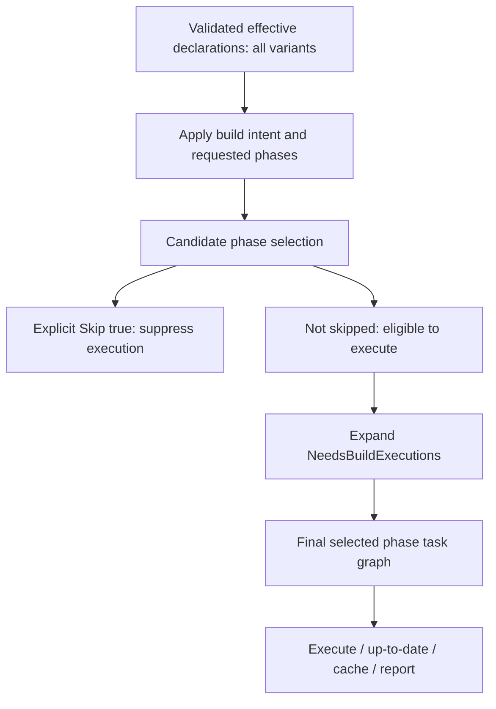

`Skip: true` is evaluated even when present in the candidate phase graph; it is not a deletion of the declaration. Implicit skip means an execution not included for the current operation or selected subset. For conditional order edges, **both** kinds of skipped reference have no effect. A selected task marked `UP-TO-DATE`/`FROM-CACHE` is *not* an implicit skip for these semantics: its logical execution is part of the plan and may satisfy a prerequisite without rerunning actions.

An explicitly skipped variant **cannot** be forcibly run by another execution's `NeedsBuildExecutions`. If a non-skipped selected execution needs it, fail with an actionable configuration error. An implicitly omitted prerequisite, by contrast, is drawn into the graph by a valid same-phase `Needs...` edge unless its deliberate exclusion/intent conflicts with the invocation policy.

#### 3.5.9.3. Mandatory dependency versus mandatory order


```mermaid
flowchart LR
    B[generate-b] -->|Needs: required inclusion| A[generate-a]
    C[generate-c] -.->|Must run first if not skipped| A
    D[generate-d] -.->|Prefer first if not skipped| A
```

The difference is operationally important. `mustRunAfter` **does not imply** `dependsOn` in Gradle: invoking only task A does not invoke task C. Likewise `shouldRunAfter` is advisory and may be relaxed when ordering would create a cycle or when parallel execution renders it impractical. Neither may be relied upon for source-to-source dependencies. When B produces data consumed by A, `NeedsBuildExecutions` or explicit producer/consumer input wiring must express the requirement.

The `Prefer...` edge is a scheduler *hint* rather than necessarily an execution-speed optimization; it can for example schedule quick feedback checks ahead of long tests. Core should not turn that hint into a blocking correctness condition.

#### 3.5.9.4. Only one phase and one effective scope per reference


A dependency reference is a **simple ID** by design, e.g. `NeedsBuildExecutions: [generate-b]`. It is looked up only in the containing invocation's phase and scope. If `generate-b` exists in `PREPARE` but A is in `VERIFY_PREPARATION`, the reference fails; no cross-phase qualified reference syntax is required or silently interpreted. This keeps unqualified names deterministic.

The entire effective model can contain `generate-b` in multiple phases and scopes. That is valid, but each reference remains local to the current phase/scope. Do not auto-join across source repository artifacts even if their IDs match.

#### 3.5.9.5. DAG validation and parallel execution


Cycles in the **required** and **mandatory-order** portions of a single phase graph are invalid. The Builder should report the complete cycle path with declaration origins. `Prefer...` does not make an otherwise valid graph invalid solely because the preference cannot be honored; record/diagnose a preference cycle if useful, and allow the backend to ignore such edges according to its semantics.

If B and C are independent and both required before A, the backend may run B and C in parallel; parallelism is permitted, **not guaranteed**. Actual execution depends on the number of workers, tool behavior, task inputs/outputs, cache, build domains, and Gradle parallel execution settings. A Gradle task per independently schedulable invocation exposes these opportunities without creating a second Modustro scheduler.

#### 3.5.9.6. Full-source example: B and C then A


```yaml
Dependencies:
  - DependencyKind: modustro
    Items:
      - GroupId: eu.algites.lib.xxx
        ArtifactId: pub.tool.General_some.build.tool.A
        VersionRequirement:
          Exact: "1.1-SNAPSHOT"
        Usages:
          - bind:product_implementation
          - execute:source_generation:
              - BuildExecutionId: generate-a
                NeedsBuildExecutions: [generate-b, generate-c]
                Configuration:
                  SomeBuildToolASomethingSpecific1: xxx
                  SomeBuildToolASomethingSpecific2: yyy

      - GroupId: eu.algites.lib.xxx
        ArtifactId: pub.tool.General_some.build.tool.B
        VersionRequirement:
          Exact: "1.1-SNAPSHOT"
        Usages:
          - execute:source_generation:
              - BuildExecutionId: generate-b
                Configuration:
                  SomeBuildToolBSomethingSpecific1: aaa
                  SomeBuildToolBSomethingSpecific2: bbb
              - BuildExecutionId: generate-c
                Configuration:
                  SomeBuildToolBSomethingSpecific1: ppp
                  SomeBuildToolBSomethingSpecific2: qqq
```

```mermaid
flowchart TB
    B[Tool B / generate-b] --> A[Tool A / generate-a]
    C[Tool B / generate-c] --> A
    A --> SOURCES[Generated source inputs]
    SOURCES --> COMPILE[Subsequent compilation or packaging]
```

Notice that tool B is declared **once** but executes twice under separate configurations. No independent `Stage`, top-level `BuildOperations`, or duplicate dependency coordinate is necessary.

---

### 3.5.10. Complete Dependency and BuildExecution Examples


#### 3.5.10.1. Same execution ID across different artifacts


A repository/ArtifactSet default can define `generate-sources` without any `Phase` and two artifacts may both inherit it. The effective instances are separate because the **execution owner** is different:

```text
ARTIFACT path/library-one / PREPARE / generate-sources
ARTIFACT path/library-two / PREPARE / generate-sources
```

This is valid and **not** a repository-global ID collision. The same ID **within one scope but different phases** is also valid when variant semantics permit it. Only same scope, same effective phase, same ID across distinct tool declarations is invalid.

#### 3.5.10.2. Re-enable one previously skipped phase variant


**Parent:**

```yaml
Usages:
  - execute:source_generation:
      - BuildExecutionId: generate-a
        Phase: PREPARE
      - BuildExecutionId: generate-a
        Phase: VERIFY_PREPARATION
```

**Intermediate layer, disable both:**

```yaml
Usages:
  - execute:source_generation:
      - BuildExecutionId: generate-a
        Skip: true
```

**Artifact, enable only second:**

```yaml
Usages:
  - execute:source_generation:
      - BuildExecutionId: generate-a
        Phase: VERIFY_PREPARATION
        Skip: false
```

Effective outcome: `generate-a` in `PREPARE` is explicitly skipped, but `generate-a` in `VERIFY_PREPARATION` is not. All other inherited tool configuration remains unless overridden. Validate all phase-local references, including those inherited by the re-enabled variant.

#### 3.5.10.3. A dynamic usage defined by a third-party tool


A third party publishes a validated usage contract `execute:custom_schema_check` with configuration schema and a compatible provider. The project declares it beneath the providing tool dependency. The Builder resolves the schema by usage ID/category, validates `Configuration`, supplies target `TechnologyKinds` and directories, and lets the tool produce a plan for the selected phase. **No change to `AInDependencyUsage` and no new Core switch case should be needed.** The implementation must nonetheless be installed/discoverable and allowed to run.

#### 3.5.10.4. Unit test before compilation


```yaml
Usages:
  - execute:unit_test:
      - BuildExecutionId: check-generator-metadata
        Phase: VERIFY_PREPARATION
        Configuration:
          TestSuite: metadata-validation
      - BuildExecutionId: regular-java-unit-tests
        Configuration:
          TestSuite: ordinary-unit-tests
```

The first run uses the same test contract before the current artifact's compilation, provided the tool's own runner/test code is available and it needs no future outputs. The second uses the usage's default phase (`VERIFY_COMPILATION`). `DefaultPhase` is **not** a minimum. If the first test needs freshly compiled classes, it will fail unless the relevant producer requirement was declared and the phase adjusted.

#### 3.5.10.5. Integration test without package and unit test after package


```yaml
Usages:
  - execute:integration_test:
      - BuildExecutionId: remote-service-smoke-test
        Phase: VERIFY_RESOLUTION
        Configuration:
          EndpointProfile: sandbox

  - execute:unit_test:
      - BuildExecutionId: python-wheel-unit-tests
        Phase: VERIFY_PACKAGING
        Configuration:
          RunAgainstInstalledDistribution: true
```

This emphasizes that **test classification, phase placement and actual prerequisites are independent**. The names of configuration properties are illustrative: their semantics belong to the relevant test-runner schema.

#### 3.5.10.6. Execution not selected for a partial build


For a build requested only through `PREPARE`, `regular-java-unit-tests` may be configured with `Skip: false`, yet it is **implicitly skipped** because its `VERIFY_COMPILATION` phase is not requested. An execution in `PREPARE` with `MustRunAfterNotSkippedExecutions: [other-preparation]` only observes whether `other-preparation` is actually selected/non-skipped **within PREPARE**. It cannot name `regular-java-unit-tests` in another phase.

#### 3.5.10.7. Python and Java in a single source-generation execution


```yaml
TechnologyKinds: [java, python]
Dependencies:
  - DependencyKind: modustro
    Items:
      - ArtifactId: example.multi-language-defs-generator
        Usages:
          - execute:source_generation:
              - BuildExecutionId: definitions-to-sources
                Configuration:
                  InputDirectory: src/product/yamldefs
```

The tool receives `TechnologyKinds: [java, python]` and may produce both `java.gen` and `python.gen`. A Java/Python dependency expander must not clone the one `BuildExecutionId` simply because it resolved two downstream native build targets.

---

## 3.6. InputSubscriptions

`InputSubscriptions` describe external *inputs* used by the build and are independent of `Dependencies`' tool-execution usages. The canonical schemas permit input subscription declarations within the corresponding repository, ArtifactSet, or Artifact metadata and in repository-defaults overlays. A subscription identifies what is consumed, the applicable TechnologyKind, endpoint/subscription settings and optional credential profile.

**Important distinction:** selecting an input repository for resolving a tool is different from declaring that tool's `execute:` usage. Provisioning a dependency does not itself create an execution. Credential-bearing subscriptions must be resolved through the authorized credential path; a local build must not require unrelated publication secrets.

Source: `algites-input-subscriptions_1.yamldef.schema.json` and `algites-repository-defaults_1.yamldef.schema.json`. Consult those schemas for endpoint-specific fields rather than inferring upload capabilities from an input subscription.

## 3.7. OutputPublications, Output Types and Finalization

The current canonical descriptor spelling is **`OutputPublications`**, whereas `OutputPublishing` has been used in earlier conceptual discussions. Use the schema-defined spelling when authoring current descriptors; the future wire format must be reviewed before changing it.

`OutputPublications` selects configured output categories and publication endpoints for outputs the build has produced. Distinguish a `BuildOutputType` (the named product), an output producer (the plan to obtain it), an `execute:` tool invocation (an operation that might contribute inputs), and a publication endpoint (where the product is published).

Relevant settings include native binary/source/documentation publication, snapshot/release endpoint configurations, publishing order, failure and retry policy, timeout, progress and credential profiles. Finalization actions at publication/output/artifact/Version Scope level are separate typed metadata. See §2.8 for the portable publication semantics and §2.3 for the `PUBLISH` / `VERIFY_PUBLISHING` boundaries.

**Reference-note:** field nesting, case and named output selectors are governed by `modustro-builder-publications_1.yamldef.schema.json`; the brief description here is not a substitute for that schema.

## 3.8. Other Descriptor Settings and Configuration Schema Rules

`EnvironmentRequirements` may constrain the tools and runtime environment required by an artifact or source hierarchy. `CredentialProfiles` refer to reusable credential configurations, not to embedded secret values. `NestedGradleSettingsBuildPolicy` is a Gradle adapter setting, not a portable execution usage. Optional source-repository defaults overlays may supply `InputSubscriptions`, `OutputPublications`, `CredentialProfiles`, and publication finalization settings.

Descriptor parsers should retain source filename, hierarchy level, property path and, when possible, line number so effective-model validation can identify exactly which inherited or local value produced a conflict. Unknown executable usage payloads are interpreted through the metadata/schema discovery contract in §3.5.3, not through silent fallback to an existing built-in enum case.

---

# 4. Build Framework Integration

This chapter describes how an executable plan is integrated with the active build framework. The portable descriptor contract does not depend on Gradle types; Gradle is the current production integration. Other build backends may be supported later without moving Gradle task APIs into Builder Core.

## 4.1. Gradle Adapter, Task DAG and Incremental Builds


### 4.1.1. One Gradle task per independently executable operation


**Architectural rule.** Represent each effective selected `BuildExecution` as an independently schedulable Gradle task (or equivalent mechanism when its contract genuinely demands one). A logical lifecycle/phase task aggregates these concrete tasks. Do not combine all executions in one imperative `Task.doLast` loop, invent a second concurrency scheduler inside the task, or require a Gradle plugin implementation inside every standalone Java/Python tool.

**Illustrative Gradle mapping of B/C before A:**

```kotlin
val generateB = tasks.register("generate-b", ToolBTask::class.java)
val generateC = tasks.register("generate-c", ToolBTask::class.java)
val generateA = tasks.register("generate-a", ToolATask::class.java) {
    dependsOn(generateB, generateC)
}
```

A/B/C tool classes above are *fictional examples*. A real adapter maps execution IDs and scopes to collision-free native task names; an ID alone need not be globally unique across all projects. Tasks may invoke a standalone tool's Java API, Python API or CLI. Python Defs/SDO generator implementations do **not** become dependent on Gradle or Java simply because Gradle invokes them.

### 4.1.2. Gradle's three ordering APIs


| Gradle method | Forces referenced task into graph | Ordering | Modustro relation |
|---|---|---|---|
| `dependsOn` | Yes | Required prerequisite must complete/satisfy outcome before dependent task | `NeedsBuildExecutions` |
| `mustRunAfter` | No | Mandatory when both tasks execute/are in graph | `MustRunAfterNotSkippedExecutions` |
| `shouldRunAfter` | No | Advisory; can be ignored when needed | `PreferRunAfterNotSkippedExecutions` |

A task can be satisfied from the build cache, be `UP-TO-DATE`, or have its actions skipped for Gradle-specific reasons while remaining a **selected** prerequisite. The adapter must not equate those states to an omitted Modustro execution.

### 4.1.3. Per-phase graphs and repository-wide phase barriers


The Gradle adapter must register selected operations in their effective **phase-specific** task groups. It cannot express cross-phase Modustro `Needs...` references because such references are invalid. Phase tasks should not capture a downstream later-phase task accidentally through native task input dependencies. If this occurs, fail plan validation or correct the wiring rather than silently defeating the phase controller's barriers.

```mermaid
flowchart TB
    subgraph Prep[PREPARE: phase task]
        B[generate-b]
        C[generate-c]
        A[generate-a]
        B --> A
        C --> A
    end
    BAR[Repository-wide PREPARE barrier]
    A --> BAR
    BAR --> VP[VERIFY_PREPARATION: phase task]
    VP --> VB[Checks of generated source outputs]
```

The global phase barrier is an **inter-invocation** property of the current controller, not a need to add ten parallel Gradle `dependsOn` chains within every tool. For work in a single phase, Gradle owns actual scheduling and can exploit independent tasks.

### 4.1.4. Incrementality and generated-source ownership


A tool adapter should declare stable inputs, execution configuration, referenced tool version/implementation, output roots, and known environment influences to Gradle. Distinct executions must not silently share writable output trees; a generated source has one responsible producer. If a tool produces outputs outside supported Gradle input/output modelling or depends on external state, mark caching appropriately. `WorkerExecutor` is possible for truly internal parallel work but is **not** a replacement for independent tasks in the agreed execution graph.

## 4.2. CI Integration, Build Invocation and Bootstrap


The Gradle adapter is the only intended production backend for the current milestone. Its Settings and Project plugins should ultimately provide the necessary build wiring from effective descriptors, avoiding an indefinite dependency on large, externally applied governance build scripts.

GitHub Actions is an orchestration environment **above** that adapter. It should select a build operation, obtain permitted credentials, provide invocation context, and collect results. It should not independently reimplement descriptor interpretation, dependency-role semantics, or output/publication policies already owned by Builder.

Bootstrap and CI are integration concerns. Neither the existence of an external bootstrap nor the use of GitHub Actions changes the portable responsibilities of Builder Core.

---

# Appendix A. Compact Reference for Descriptor Authors


**Canonical execution placement (proposed):**

```yaml
Dependencies:
  - DependencyKind: modustro
    Items:
      - ArtifactId: example.some-tool
        Usages:
          - bind:product_implementation
          - execute:source_generation:
              - BuildExecutionId: generate-a
                Phase: PREPARE
                Skip: false
                NeedsBuildExecutions: [generate-b]
                MustRunAfterNotSkippedExecutions: [generate-c]
                PreferRunAfterNotSkippedExecutions: [generate-d]
                Configuration:
                  OutputLanguage: java
```

All referenced `generate-b`/`generate-c`/`generate-d` executions must be **defined in the same effective scope and phase**; `generate-b` must not be explicitly skipped if `generate-a` executes. The relevant usage contract's schema defines what `OutputLanguage` means and whether it is valid. Inheritance may override any common property and may define multiple phase variants with the same ID.

---

# Appendix B. Terminology


| Term | Definition |
|---|---|
| Usage contract | Extensible, schema-described semantics for applying a dependency; binding or executable |
| BuildExecution family | Inherited declaration group identified by tool/usage and `BuildExecutionId` |
| BuildExecution variant | One effective phase-specific invocation of a logical family |
| Execution scope | Actual owner of the operation (e.g. Artifact, Repository), not necessarily where configured |
| DefaultPhase | Usage contract's default placement if no inherited or explicit phase applies |
| Explicit skip | Selected/in-scope declaration deliberately disabled by effective `Skip: true` |
| Implicit skip | Execution outside the current selected work/phase graph despite an effective `Skip: false` |
| Phase barrier | Completion of selected work across build domains before the next Modustro phase starts |
| Capability | Named requirement/ability independent of a tool's particular usage declaration |
| BuildOutputType | Named producible or dependency-consumable artifact output |
| Native dependency translator | Component mapping portable effective declarations to technology-specific dependency requirements |
| Provider category | CPDiscovery routing category, potentially coinciding with a usage contract ID, distinct from `ProviderId` |

---

# Temporary Appendix C. Implementation Status, Conformance and Migration

**TEMPORARY — remove when target contracts and integration are implemented and verified.** The normative reference is Chapters 1–4; this appendix preserves implementation-state observations, legacy behavior and the migration plan without scattering migration steps throughout the target specification.

## C.1. Builder 1.1 Source State


**Current implementation (reviewed baseline):** The repository already separates `core/intf`, `core/impl`, `runtime`, and `gradle`. Its Core is largely independent of Gradle API. The compiled Settings/Project integration and reusable publication infrastructure already exist.

**Transition work:** A few Gradle-specific concepts remain in Core, notably `AInGradleBuildPhase`, `AIcGradlePhaseController`, `AInNestedGradleSettingsBuildPolicy`, and portions of Java dependency-role and version mapping. The agreed ten-phase portable model must supersede the currently implemented six-phase Gradle naming, without moving Gradle task execution into Core. Conversely, some portable metadata interpretation remains in the Gradle-side resolver. Existing governance scripts still supply substantial build wiring. These facts are implementation gaps relative to the architectural rules above; they are not reasons to create a new universal backend framework.

The reference chapters specify the intended ownership boundary. It does **not** assert that the Core/Gradle separation has already been fully migrated or that every existing descriptor has passed end-to-end Gradle integration testing.

## C.2. Existing Governance Scripts and Gradle Migration


**Current implementation, reviewed 17 Nov 2026:**

- `pub.gov.Algites/gradle/tool/repository/modustro-phase-controller.sh` implements six ordered invocations (`resolve`, `prepare`, `compile`, `verify`, `package`, `publish`).
- `modustro-build-phase-tasks.gradle.kts` registers six phase-aggregation tasks; `verify` currently collects `check`, `compile` collects `classes`/`testClasses`, `package` collects `assemble`/`buildPython`.
- `modustro-root-build.gradle.kts` still contains substantial native source, dependency, output, test and publication wiring.
- A portable `AInGradleBuildPhase` enum currently exposes six Gradle task names despite being under Core Intf; this is a known separation issue.

**Transition work:** Make the ten portable phases, usage schema/handler registry, execution graph and diagnostics real first, then migrate working Gradle and bootstrap mappings incrementally. Preserve existing publication and source-generation parity tests; do not edit generated `java.gen`/`python.gen` sources manually.

---

## C.3. Existing Java TestNG Execution


**Current implementation:** `modustro-root-build.gradle.kts` applies `java-library` for Java technology kinds, maps `src/develop/java` and relevant resources into Gradle's `test` source set and configures `tasks.withType<Test>().configureEach { useTestNG() }`. Java usages such as `develop_implementation` map to Gradle `testImplementation`. Standard Gradle `test` participates in `check`. `modustroVerifyPhase` aggregates `check` across eligible projects and included domains; Java `modustroBuild` also explicitly depends on `check` where wired.

This is a conventional native TestNG integration rather than a currently configurable Modustro `BuildExecution`. A future adapter may map the TestNG tool contract to one or more Gradle `Test` tasks with configurable include/exclude groups, suites, forks and test JVM settings.

## C.4. Existing Python pytest Preview


**Current implementation:** An experimental Python verification path already exists in `modustro-root-build.gradle.kts`, but it is **opt-in**. The property/environment setting `MODUSTRO_ENABLE_NATIVE_PYTHON_TESTS` defaults to `false` in the reviewed script. With the flag enabled and suitable `src/develop/python/test_*.py` tests present:

- `prepareModustroPythonTestEnvironment` provisions an isolated virtual environment.
- It builds/installs the artifact's wheel and local dependency wheels, installs external requirements (including `pytest>=8,<10`) via supported public indexes, and prepares paths for integration tests.
- `testModustroPython` executes Python's pytest module against `src/develop/python` with `-q` and a JUnit XML report (`python-test-results.xml`).
- `check` is configured to depend on the Python test task; Java `Test` tasks can receive the prepared Python interpreter path through environment variables.
- Credential-bearing private Python index subscriptions are explicitly not supported by this preview runner; do not silently reinterpret this as production-complete verification.

### C.4.1. Why the current Python preview conflicts with verification-before-package


**Phase concern:** This runner depends on already **built wheels**, although the old six-phase verify boundary comes before package. The native task graph can therefore cause packaging as a test prerequisite before the logical `PACKAGE` phase. The ten-phase migration should place wheel-installation tests in `VERIFY_PACKAGING` or provide a separate Python source-based test mode for earlier verification. Merely renaming the phase task cannot fix the dependency.

## C.5. Legacy Testing Compatibility and Rollout


Keep current Java TestNG `check` behavior and Python opt-in runner working until equivalent explicit executions are covered by parity tests. Do not silently execute *both* the legacy default test task and a newly configured `execute:unit_test` for the same suite. Establish a clear transition/ownership policy, then migrate the hardcoded Python enable flag and Java default TestNG wiring into registered usage contracts. The exact fallback policy for artifacts declaring no explicit test executions is an implementation decision and should be documented when selected.

---

## C.6. Conformance, Tests and Incremental Migration


### C.6.1. Core schema and normalization tests


Tests for the new model should cover at least:

1. Legacy simple usages remain parseable and normalize to their new registered binding contract identities without semantic regression.
2. Unquoted YAML `execute:unit_test:` mapping keys parse correctly; incorrect payload shapes fail with schema paths.
3. New usage IDs register using externally supplied schemas and discover a matching provider without requiring a hardcoded enum constant.
4. A dependency can have both a binding usage and an executable usage; neither accidentally changes the other's runtime closure.
5. A tool declared once can contain two distinct executions with different configs; a tool may support more than one usage category.
6. No single execution is duplicated because its target has both Java and Python TechnologyKinds.
7. `Configuration` replaces atomically; `Needs...: []` clears inherited values; unmentioned fields inherit.
8. Generic phase-less patches apply to all existing phase variants; a phase-specific patch applies only to one.
9. Single-variant phase change moves; explicit multi-variant declaration expands; inherited multi-variant plus ambiguous new phase yields an actionable error.
10. `Skip` inherits, defaults false, can be re-enabled for one variant, and does not erase the declaration.
11. `BuildExecutionId` can repeat across separate effective artifact scopes or across phases, but cannot collide in the same scope/phase across tools.
12. Explicit skip and implicit skip both suppress conditional ordering; Gradle `UP-TO-DATE` is not interpreted as implicit skip.
13. `Needs...` forces inclusion (unless target is explicitly skipped and this is an error); conditional edges do not force inclusion.
14. A same-phase reference cannot resolve to another phase; unknown targets fail even for optional order references.
15. Required/mandatory-order cycles fail with full path; impossible advisory preferences do not invalidate an otherwise sound build.
16. Provenance tracks origin of inherited dependencies and phase-specific overrides; diagnostics include at least one concrete fix.
17. A repository-only docs-site execution stays repository scoped and is not cloned for each artifact.
18. Tool-specific input paths may be known before files exist; declared impossible future-phase producer requirements are rejected where statically knowable.

### C.6.2. Integration tests


- Exercise two independent Gradle tasks B/C followed by A, including actual parallel capability where supported and no shared output collisions.
- Ensure Gradle `dependsOn`, `mustRunAfter`, `shouldRunAfter` correspond to the three declared edge types, including skipped/nonselected targets.
- Verify execution scope namespacing of native Gradle tasks and inclusion of isolated build domains.
- Verify all ten lifecycle barriers and `--through`/partial-build behavior without a later-phase task executing prematurely via an implicit native dependency.
- Run Java TestNG and Python pytest both through existing legacy paths and new configured executions; prevent duplicate runs during transition.
- For Python, test source-based early verification separately from installed-wheel verification, and verify the `MODUSTRO_ENABLE_NATIVE_PYTHON_TESTS=false` default until rollout changes.
- Verify standalone Python Defs/SDO codegen without Gradle/Java; verify Java equivalents; verify a multi-language target gets the correct context without duplicate runs.
- Validate publication endpoints/credentials are not required for nonpublishing builds and that `VERIFY_PUBLISHING` reports partial remote publication failures truthfully.
- Test Gradle task input/output fingerprints, source root ownership, caching/up-to-date behavior, and failure/diagnostic propagation.

### C.6.3. Incremental implementation sequence


1. Define the normalized, dynamic usage-ID and schema registry, preserving a compatibility loader for the ten legacy strings.
2. Add common `BuildExecution` structures and effective inheritance/variant resolution, including provenance and `Skip`.
3. Introduce the ten portable ordered phase identities and map them to the existing Gradle phase controller/tasks.
4. Implement phase-local execution graph validation and actionable diagnostics **before runtime task registration**.
5. Integrate one small real source-generation tool scenario: A needs B and C, B/C independent, repeated use of B with different configuration; confirm tasks, caching and output paths.
6. Add the dynamic contract/provider bridge and native tool-runtime provisioning, using the target artifact's effective `TechnologyKinds`.
7. Migrate Java TestNG and opt-in Python pytest verification; resolve package-before-verification inversion by splitting source-based and installed-wheel test modes.
8. Move remaining hardcoded native dependency mappings toward appropriate adapters without breaking Gradle-free Core semantics or bootstrap.
9. Extend Gradle cross-domain phase barrier tests, publication verification, docs-site and schema-site scenarios.
10. Maintain parity tests for legacy descriptors, nested settings, input subscriptions, snapshot/release output publishing and finalization before removal of old paths.

Avoid simultaneously rewriting all source generators, every dependency handler, and publishing adapters. Each migration step should produce a buildable, testable checkpoint.

### C.6.4. Separation of responsibilities remains testable


Core has portable schema, inheritance, capability, dependency, phase and graph semantics; it **must not** import Gradle APIs or launch Gradle. Gradle owns the task graph, native dependency configurations, worker scheduling, toolchain provisioning, and invocation barriers. A new usage implementation can be discovered without extending a closed Core enum. If a proposed abstraction does not correspond to a real configuration or execution requirement, defer it.

---

## C.7. Historical Implementation Details Relocated from Normative Chapters

**TEMPORARY — reviewed source state and transitional terminology.** The following source-derived paragraphs and tables are deliberately preserved here rather than being treated as normative architecture requirements.

### C.7.1. Old six-phase controller

**Current implementation:** The governance phase controller presently uses six phases (`RESOLVE`, `PREPARE`, `COMPILE`, `VERIFY`, `PACKAGE`, `PUBLISH`) and launches each phase as a separate Gradle invocation across isolated build domains.

### C.7.2. Old Gradle barriers

**Current implementation:** `gradle/tool/repository/modustro-phase-controller.sh` launches each of six phases in a separate Gradle invocation. `modustro-build-phase-tasks.gradle.kts` collects matching tasks in all projects and isolated included build domains. Successful completion forms the repository-wide barrier before the next invocation. This must be extended to the ten-phase model rather than silently collapsing it into ordinary per-project Gradle task order.

### C.7.3. Current built-in capability catalog

**Current implementation (reviewed `AIcBuiltinTechnologyKindDefinitions`):** Java and Python each define the same three capability IDs, while Modustro defines three other IDs. There are **six distinct IDs** and **nine technology/capability registrations**:

### C.7.4. Current hardcoded capability prerequisite rule

The current `AIcBuiltinCapabilityDemandPlanner` hardcodes only two prerequisite sets: `java:generation_of_native_documentation` and `python:generation_of_native_documentation` both require their technology's `source_native_processing` and `dependency_resolution`. This is **not** a complete general execution dependency language.

### C.7.5. Existing closed usage enum/parser

**Current implementation.** The reviewed `algites-dependencies_1.yamldef.schema.json` defines `Usages` as a unique array of ten enum strings and `AIcDependencyDefinition.usages()` as `Set<AInDependencyUsage>`. Neither type can retain execution configuration, multiple phase variants, or arbitrary usage contracts. The schema and effective model require migration; `uniqueItems` on the *raw list* is not a substitute for semantic uniqueness after inheritance.

### C.7.6. Transitional bootstrap

The universal bootstrap remains a necessary transitional mechanism for building and publishing the Builder itself. Its existence does not justify moving bootstrap-specific Gradle or shell orchestration into Core. Migration must preserve a working, independently testable bootstrap path until the new Gradle integration is capable of replacing it.

### C.7.7. Legacy-to-target Java binding mapping

| Legacy usage (accepted during transition) | Proposed canonical usage | Existing Java Gradle mapping |
|---|---|---|
| `product_api` | `bind:product_api` | `api` |
| `product_implementation` | `bind:product_implementation` | `implementation` |
| `product_compile_only` | `bind:product_compile_only` | `compileOnly` |
| `product_compile_only_api` | `bind:product_compile_only_api` | `compileOnlyApi` |
| `product_runtime_only` | `bind:product_runtime_only` | `runtimeOnly` |
| `product_annotation_processor` | `bind:product_annotation_processor` | `annotationProcessor` |
| `develop_implementation` | `bind:develop_implementation` | `testImplementation` |
| `develop_compile_only` | `bind:develop_compile_only` | `testCompileOnly` |
| `develop_runtime_only` | `bind:develop_runtime_only` | `testRuntimeOnly` |
| `develop_annotation_processor` | `bind:develop_annotation_processor` | `testAnnotationProcessor` |

The mapping shown is **current Java behavior for legacy strings**; the `bind:` spellings are proposed normalization, not currently implemented. Python cannot simply mirror every Java configuration one-to-one. Its handler must preserve portable intent and report unsupported semantics rather than silently mapping several distinct meanings to `NO_OP` or an incorrect Python equivalent.

---

# Temporary Appendix D. Decisions, Provisional Details and Source Inventory

**TEMPORARY — remove after the naming and registration contracts are frozen and their implementation has been verified.** Historical rationale and unresolved design/implementation details are recorded here, not as permanent descriptor reference sections.

## D.1. Agreed architectural decisions


| Topic | Agreed outcome |
|---|---|
| Binding versus executable use | Two different usage contract kinds; do not conflate with product/develop |
| Usage identifiers | Common `namespace:name` convention; unquoted YAML permitted |
| Extensibility | New usage IDs and payload schemas without hardcoded Core enum entries |
| Execution location | Under the relevant dependency usage; no separate top-level `BuildOperations` |
| Execution identity | `BuildExecutionId` is stable independently of `Phase`; multiple variants can share ID in different phases |
| Execution owner | Effective artifact/repository/etc. scope; inheritance origin is not the owner |
| Uniqueness | No duplicate effective `(scope, phase, ID)` from different tools/usages |
| Inheritance | Fieldwise generic common properties, atomic configuration/list replacement, phase-specific overrides, documented ambiguity handling |
| `Skip` | Explicitly configurable, inherits, defaults `false`, does not delete declaration |
| Phase defaults | Contract `DefaultPhase`, overridable both earlier and later, not a minimum |
| Lifecycle | `RESOLVE` → `VERIFY_RESOLUTION` → `PREPARE` → `VERIFY_PREPARATION` → `COMPILE` → `VERIFY_COMPILATION` → `PACKAGE` → `VERIFY_PACKAGING` → `PUBLISH` → `VERIFY_PUBLISHING` |
| Execution references | Only within the **same effective phase and scope** |
| Required edge | `NeedsBuildExecutions` |
| Conditional mandatory ordering | `MustRunAfterNotSkippedExecutions` |
| Advisory ordering | `PreferRunAfterNotSkippedExecutions` |
| Explicit/implicit skip | Both suppress conditional ordering; differ in diagnostics |
| Tool invocation context | Always include processed artifact's effective `TechnologyKinds` and contextual paths |
| Language independence | Tool runtime technology can differ from processed artifact technology; Python generators need no Gradle/Java dependency |
| Tool and output planning | BuildExecution, Capability, BuildOutputType, Usage are distinct roles |
| Validation | Before execution, retain provenance, precise cause and actionable repair hints |
| Gradle | Individual tasks and native DAG; preserve cross-domain phase barriers; no second custom scheduler |
| Tests | Configurable tool executions; separate unit and integration test contracts with distinct default phases, both freely overridable |

## D.2. Naming and wire-format details not fully frozen


The preferred binding prefix is **`bind:`**, rather than `static:`, `simple:`, `product:` or `develop:`. The prefix remains **provisional** until all legacy usages and native technology handlers are audited. The preferred executable usage prefix is now **`execute:`**, replacing the earlier provisional `build:` spelling. The three execution reference properties in §3.5.9.1 reflect the latest agreed names.

The exact published metadata schema for usage registration, schema-revision identity, provider selection and tool/runtime invocation has not been frozen. The sample fields `UsageContract`, `DataSchema`, `ProviderCategory`, `PayloadSchema`, `TestRoots`, etc. are intentionally marked **illustrative**. They must not be copied unexamined into a production descriptor schema.

## D.3. Limited open design questions


- **New variant after already multi-variant inheritance:** exact explicit add/move/remove syntax, if and when needed. Presently ambiguous cases fail rather than guess; ordinary one-to-one move and explicit multi-variant expansion are supported by the agreed rules.
- **Usage registry publication:** location and versioning of schema artifacts, how a tool advertises one or more supported usage categories, and how standardized defaults are registered. The requirement is *dynamic and schema-driven*, not a particular hardcoded file format.
- **Provider selection scopes:** repository-level selection and standard fallback are the current direction; broader overrides are deferred until needed.
- **Native task collision/graph preflight:** how the Gradle adapter identifies an implicit edge to a later phase across heterogeneous plugins and included builds.
- **Output and failure contracts:** standardized declared inputs, output-root ownership, environment isolation, retry/timeout/failure policy reuse, and cache eligibility for tools; only behavior described as agreed elsewhere is normative.
- **Testing compatibility rollout:** how default Java `check`/TestNG and opt-in Python pytest behave when no explicit test execution is declared, and the switch-off point for legacy runner wiring.
- **Non-executable structured usages:** the extensible schema may support a structured binding payload, without forcing execution fields on every usage.
- **Multi-technology dependencies:** precise rules for selecting native Java/Python artifacts and resolving missing output kinds remain the responsibility of the declarative expander and native translators, not an implicit cloning rule for executions.

These questions are not reasons to undo the agreed execution model; they are implementation details requiring tests and concrete examples.

## D.4. Reviewed implementation source inventory (17 November 2026)


The following paths supplied implementation evidence for the **Current implementation** statements above. These are source locations, not claims of new commits or installed features.

| Repository | Source | Relevant facts |
|---|---|---|
| `pub.pltf.Modustro` | `platform/builder/core/impl/src/product/java/eu/algites/pltf/modustro/builder/catalog/AIcBuiltinTechnologyKindDefinitions.java` | Six distinct built-in capability IDs and eight output kinds (including virtual Python distribution) |
| `pub.pltf.Modustro` | `platform/builder/core/impl/src/product/java/eu/algites/pltf/modustro/builder/capability/AIcBuiltinCapabilityDemandPlanner.java` | Existing prerequisite graph hardcodes documentation generation's source/dependency prerequisites |
| `pub.pltf.Modustro` | `platform/builder/core/intf/src/product/java/eu/algites/pltf/modustro/builder/model/dependency/AInDependencyUsage.java` | Closed legacy ten-value enum |
| `pub.pltf.Modustro` | `platform/builder/core/intf/src/product/yamldefs/eu/algites/tool/build/yamldefs/algites-dependencies_1.yamldef.schema.json` | Current simple `Usages` array schema |
| `pub.pltf.Modustro` | `platform/builder/core/intf/src/product/java/eu/algites/pltf/modustro/builder/model/dependency/AIcDependencyDefinition.java` | Currently stores usages as an enum set |
| `pub.pltf.Modustro` | `platform/builder/core/intf/src/product/java/eu/algites/pltf/modustro/builder/model/build/AInGradleBuildPhase.java` | Current six-phase Gradle task enum in Core Intf |
| `pub.gov.Algites` | `gradle/tool/repository/modustro-root-build.gradle.kts` | Native dependency usage mappings, Java TestNG, Python pytest preview, build output wiring |
| `pub.gov.Algites` | `gradle/tool/repository/modustro-build-phase-tasks.gradle.kts` | Current six phase aggregation tasks |
| `pub.gov.Algites` | `gradle/tool/repository/modustro-phase-controller.sh` | Six separate ordered Gradle invocations and cross-domain barriers |
| `pub.gov.Algites` | `README.md`, section *Native Python verification — Phase 0 preview* | `MODUSTRO_ENABLE_NATIVE_PYTHON_TESTS` default false and preview constraints |

For future implementation, re-review these sources against the checked-out snapshot before treating them as a live source-of-truth. No existing repository source files are modified by this documentation revision.

---


