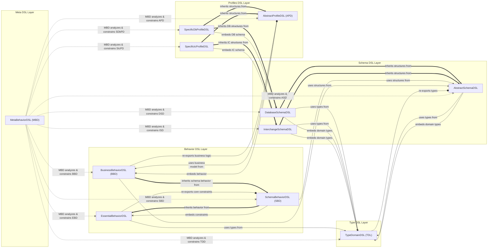
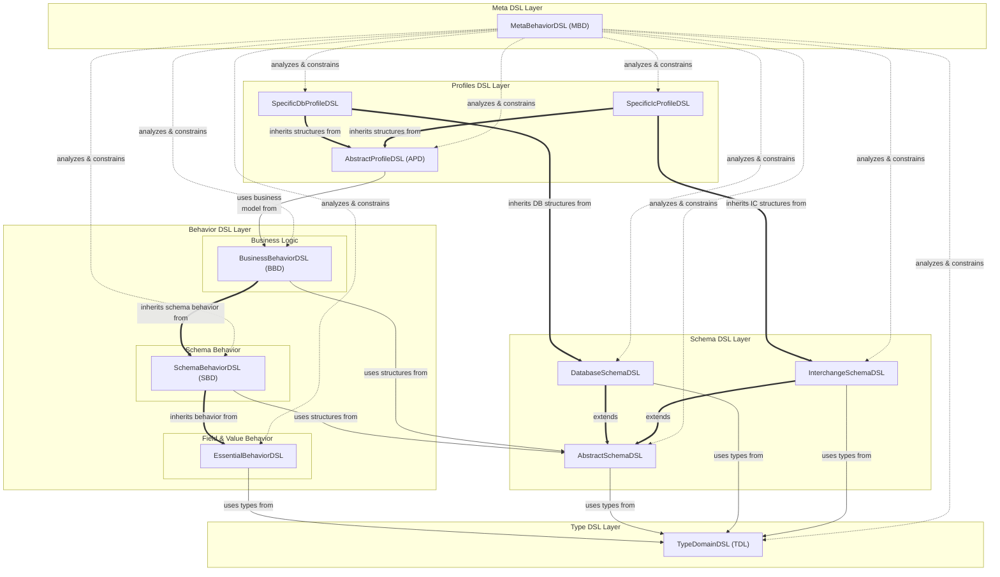
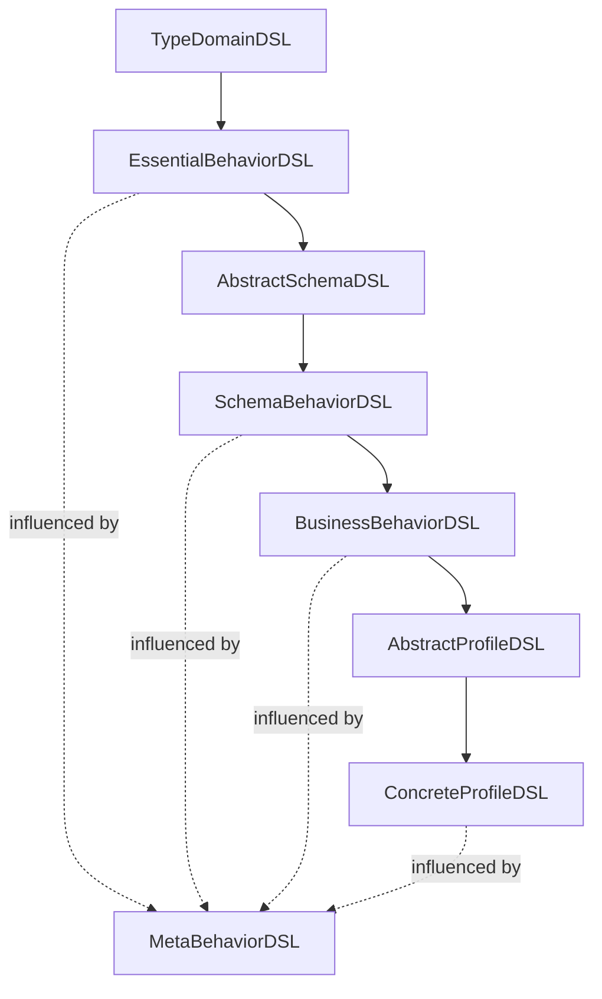
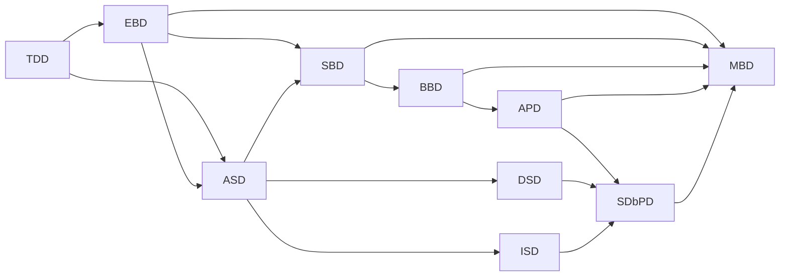
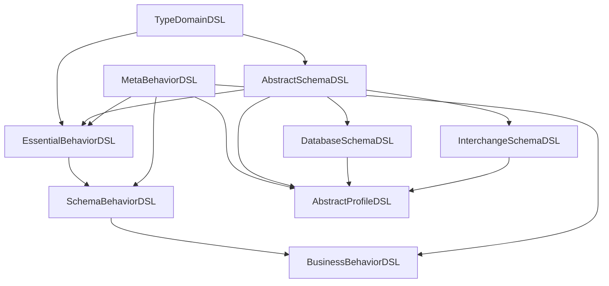
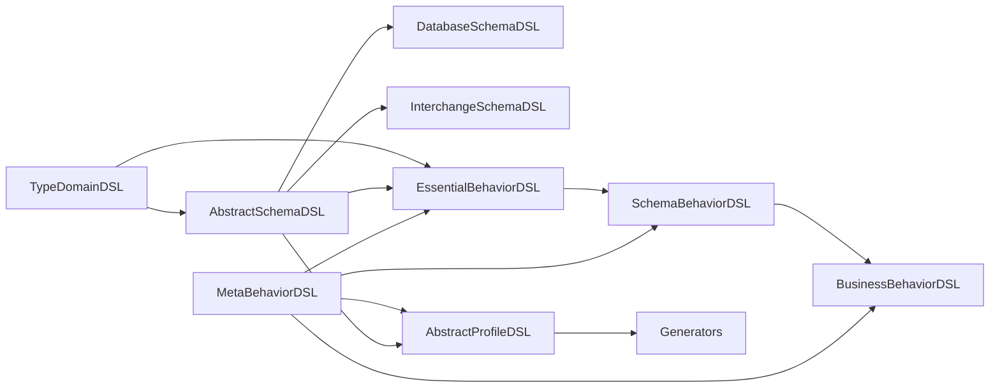
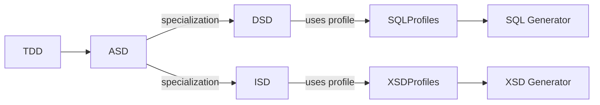
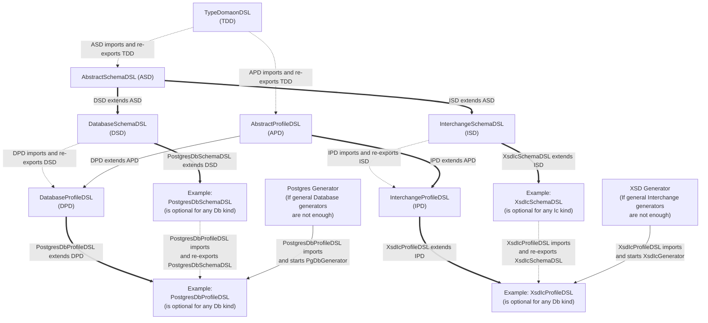
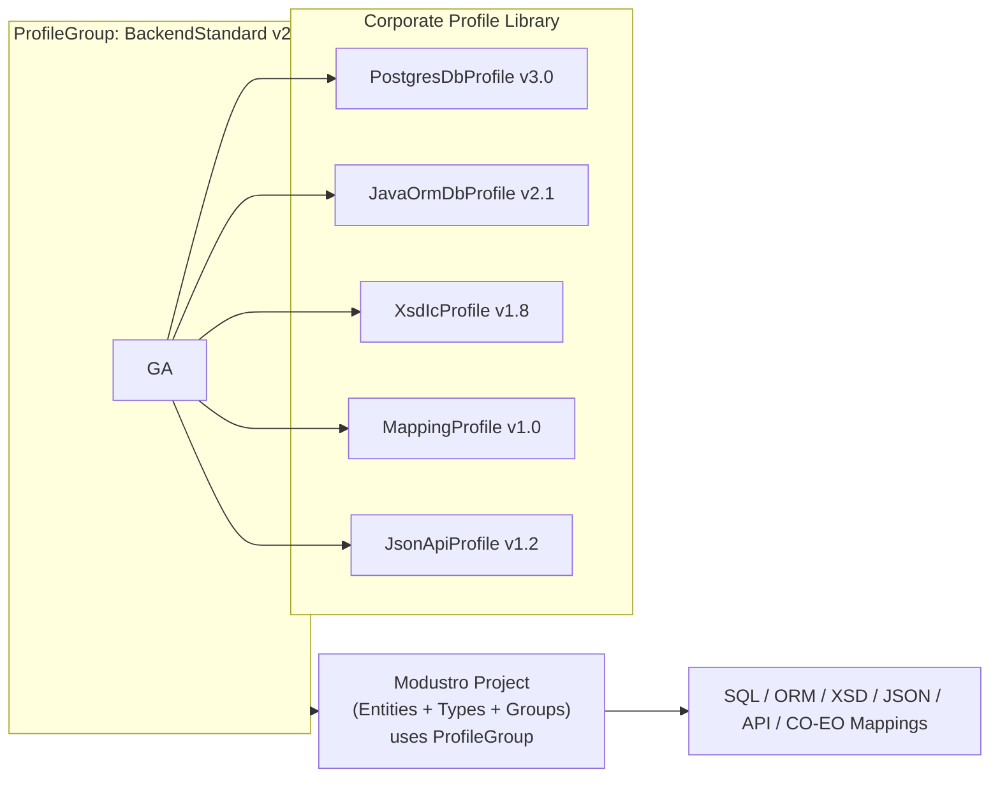

# Modustro DSL Concept – Version 1.2

## 1. Introduction
Modustro introduces a comprehensive ecosystem of interconnected domain-specific languages (DSLs) designed to model data, schemas, behavior, constraints, and generator profiles in a unified, extensible way.  
Rather than creating a monolithic language, Modustro decomposes responsibilities into layered DSLs—each dedicated to a specific abstraction level.  
This modular structure enables:

- clear separation of concerns,
- easier evolution of the modeling stack,
- maintainable generators,
- extensibility for future profiles, database engines, and interchange formats,
- easier onboarding for users (learn only what they need).

Version **1.2** refines terminology and formalizes relations between the different DSL families.

---

## 2. Overview of DSL Architecture
Modustro DSLs form a **five‑layer architecture**:

1. **Type Layer** – reusable type domains (TDD)
2. **Schema Layer** – abstract schema + specializations (ASD, DSD, ISD)
3. **Behavior Layer** – validation, invariants, rules (EBD, SBD, BBD)
4. **Profile Layer** – output targets: SQL engines, XSD, JSON, etc. (APD)
5. **Meta Layer** – cross‑DSL compatibility, lowering rules, capability declarations (MBD)

Every layer builds on top of the previous one, ensuring consistency across the whole modeling pipeline.

---

### 2.1 TypeDomainDSL (TDD)
**Purpose:** Define reusable, named *type domains* that can be referenced from schema-level fields.

TDD models include:
- **Primitive type definitions** - primitive types used in the Type definitions string, number, boolean
- **Type definitions** – consisting from primitive type + abstract behavior e.g., `Email`, `UUID`, `Price`, `String100`
- **Constraints** – min/max length, ranges, regex patterns
- **Annotations** - custom meta-properties of various structures
@TODO - clarify what should be this one and is it here correctly? - **Primitive adapters** – mapping abstract types to primitive categories (string, number, boolean)
- **Base categories** – numeric, textual, temporal, enumerated
- **Inter-domain composition** – domain types can be built from other domain types (e.g., `Address = Street + City + Zip`)

TDD is the “type factory” of the whole Modustro ecosystem.

---

### 2.2 AbstractSchemaDSL (ASD)
**Purpose:** Define a technology‑agnostic schema-level structure of entities, fields, and relationships.

ASD provides:
- **Entity** – top-level schema objects
- **Field** – referencing TDD types or other entities (abstract)
@TODO - complete description - **DomainValueField** - ?????
    - **EntityReferenceField** – foreign-key-like semantic structure
- **Multiplicity rules** – optional, required, 1:1, 1:n, n:n
- **Logical naming** – stable identifiers independent of any target system
- **Physical naming proposals** – optional rules for derived names
- **Abstract constraints** – cardinality, required fields, default values

ASD is the backbone for both database schemas and interchange schemas.

---

### 2.3 DatabaseSchemaDSL (DSD)
**Purpose:** Specialize ASD for relational and NoSQL database engines.  
DSD brings structural elements needed for SQL and DB-specific generators:

- **Tables / Collections**
- **Columns** with concrete DB types
- **Primary and Foreign Keys**
- **Unique constraints**
- **Indices**
- **Sequences / identity strategies**
- **Column definitions using abstract DB types** (database-neutral),
  DB-specific physical type mapping is handled exclusively by profiles (APD descendants)
- @TODO: Clarify move to ASD at least not null or other simple constraint - **Check constraints**

This DSL does **not** perform generation; it only defines the model from which SQL generators operate.

---

### 2.4 InterchangeSchemaDSL (ISD)
**Purpose:** Model structures intended for data transfer formats such as XSD, JSON Schema, Avro, OpenAPI.

ISD supports:
@TODO: Clarify - **InterchangeEntity**
@TODO: Add description - **InterchangeField** (**Elements / Properties**) - ?????
@TODO: Clarify - **InterchangeType**
@TODO: Clarify - **InterchangeConstraint**
@TODO: Clarify move to ASD - **Ordering rules** (XSD-specific)
@TODO: Clarify move to ASD, not here - **Optionality / nullability**
@TODO: Clarify move to ASD - **Nillable vs absent**
- **Choice / group constructs**
- **Message envelopes**
@TODO: Clarify move to ASD at least simple constraints - **Value constraints (enum, pattern, ranges)**

ISD is deliberately technology-agnostic; XSD constraints are handled by profiles.

---

### 2.5 EssentialBehaviorDSL (EBD)
**Purpose:** Define minimal constraint metadata that bridges TDD and ASD.  
EBD provides:

- **Field-level invariants** – min/max/range
- **Type-level invariants** – e.g., regex for email
- **Simple relationship constraints**
- **Basic value rules** (must be positive, must not be empty)

EBD forms the baseline for consistency checking across all DSLs.

---

### 2.6 SchemaBehaviorDSL (SBD)
**Purpose:** Provide schema‑specific advanced behavior:

- DSD-specific constraints (e.g., FK must match PK type)
- ISD-specific constraints (XSD nillable rules, JSON patterns)
- Complex invariants across multiple entities
- Precondition logic for generators

SBD is built on ASD + EBD.

---

### 2.7 BusinessBehaviorDSL (BBD)
**Purpose:** Provide DDD-style behavior modeling (future extension):

- Aggregates & invariants
- Commands & events
- Domain policies
- Message-based patterns

BBD does **not** participate in core schema generation; it is optional.

---


### 2.8 MetaBehaviorDSL (MBD)
**Purpose:** Centralize cross‑DSL and cross‑profile meta‑behavior that cannot be expressed inside a single schema or behavior DSL.  
MBD operates **on top of** TDD, ASD, EBD, SBD, BBD and the profile DSLs.

Typical responsibilities:

- **Compatibility Matrix**
  - declares which constraints and features are *fully supported*, *partially supported* (with degradation), or *unsupported* for each target profile (e.g., XSD, JSON Schema, Oracle, PostgreSQL, Protobuf…)
  - distinguishes between *compile‑time enforceable* constraints and those that require *runtime validation* in generated DTOs/services
- **Semantic Lowering Rules**
  - specifies how rich abstract concepts (e.g., `decimal(10,2)`, `pattern`, complex multiplicities) are downgraded to simpler constructs in limited targets (e.g., Protobuf, older SQL dialects)
  - decides when to introduce *helper artifacts* (e.g., join tables, wrapper elements) to preserve semantics
- **Cross‑DSL Consistency Rules**
  - ensures that ISD multiplicity does not contradict ASD multiplicity
  - validates that DSD/ISD realizations are semantically compatible with TDD/EBD constraints
- **Profile Capability Declarations**
  - each profile can declare which constraint categories it can handle natively
  - MBD uses this to drive warnings / errors / informational messages in Modustro Studio
- **Error & Warning Policies**
  - governs how Modustro Studio reports incompatibilities to the user (error vs. warning vs. informational hint)
  - enables configuration of *strict* vs *permissive* modes per project

MBD does **not** introduce new user‑visible business concepts; instead, it acts as a **meta‑layer** that interprets and validates models produced by the other DSLs against concrete technology profiles.

---
### 2.9 AbstractProfileDSL (APD)
**Purpose:** Define attachable profiles that adapt ASD-derived schemas to specific output targets.

Profiles include:
- **Activation rules** (profile enabled for entity or entire model)
- **Override features** (e.g., override DB type, XSD order, JSON field name)
- **Profile context configuration** (e.g., indentation, versioning)
- **Validation logic** (profile compatibility checks)

@TODO - clarify what should be mentioned here from the old model, having following points:
Meta-language for defining behavior and structure of profiles:
- Profile metadata
- Capability matrices
- UI profile tabs
- Validation and support checks
- Mapping configuration hooks

Concrete profiles (e.g. OracleDbProfileDSL) inherit from APD.

---

### 2.10 Concrete Profile DSLs
Derived by combining APD with a Schema DSL:
- **XsdIcProfileDSL** (APD + ISD)
- **JsonIcSchemaProfileDSL** (APD + ISD)
- **AvroIcProfileDSL** (APD + ISD)
- **PostgresDbProfileDSL** (APD + DSD)
- **OracleDbProfileDSL** (APD + DSD)
- **JavaOrmProfileDSL** (APD + ASD)
- **TypeScriptProfileDSL** (APD + ASD)

---

## 3. Relationships Between DSLs

The Modustro DSL ecosystem follows a structured and predictable dependency hierarchy.

---

### 3.1. Examples of Hierarchy vs Dependency (B)

#### 3.1.1 Hierarchy Example
- TDD is the base for all types.
- EBD adds generic behavioral rules (nullability, multiplicity…).
- ASD builds structural entities and fields.
- SBD models relationships and constraints between schema objects.
- BBD adds business-level domain logic.
- APD and SDbPD specialize schemas for profiles.
- MBD supervises meta-consistency.

#### 3.1.2 Dependency Example
- SBD depends on ASD (needs entities) and EBD (needs behavior).
- BBD depends on SBD (needs relationships) and ASD (structures).
- Profiles depend on either DSD or ISD.
- MBD depends on everything below because it enforces compatibility.

---

#### 3.1.3 Unified Hierarchy + Dependency Diagram (C)

```mermaid
flowchart TD
    Description:
    A1 ==> |"AINHERITANCE-LIKE RELATIONSHIPS\n(conceptual design, thick arrows)"|B
    A2 --> |"TECHNICAL RELATIONSHIPS — IMPORT / USE\n(MPS import/use, thin arrows)"|C
    A3 --x |"TECHNICAL RELATIONSHIPS — EMBEDDING\n(MPS runtime dependency, x instead arrow)"|D
    A4 --> |"A4 is used and re-exported by E\n(MPS exported languages, o instead arrow)"|E
    A5 -.-X |"A5 influences F meta-behavior\n(MPS import/use without re-export, dashed arrows)"|F
```






---

#### 3.1.4 Hierarchical Diagram


---

#### 3.1.5 Dependency Diagram



---


### 3.1 Hierarchical Mermaid Diagram



---

### 3.2 Dependency Mermaid Diagram



---

### 3.3 Generator / Profile Pipeline Diagram



---

## 4. Example Syntax for Each DSL

### 4.1 TypeDomainDSL (TDD) – Example

```tdd
domain Email {
    base String;
    pattern "[A-Za-z0-9._%+-]+@[A-Za-z0-9.-]+\.[A-Za-z]{2,}";
}

domain Price {
    base Decimal;
    min 0;
    scale 2;
}
```

---

### 4.2 AbstractSchemaDSL (ASD) – Example

```asd
entity Customer {
    field id       : UUID required;
    field name     : String100 required;
    field email    : Email optional;
    field address  : Address optional;
}

relation CustomerAddress {
    from Customer.address
    to   Address.id
    type one_to_one optional;
}
```

---

### 4.3 DatabaseSchemaDSL (DSD) – Example

```dsd
table Customer as entity Customer {
    column id    uuid primary;
    column name  varchar(100) not null;
    column email varchar(255);
}

foreign_key fk_customer_address {
    table Customer;
    column address_id;
    references Address(id);
}
```

---

### 4.4 InterchangeSchemaDSL (ISD) – Example

```isd
message CustomerMessage {
    element Customer {
        id        : Uuid;
        name      : String100;
        email     : Email nillable;
        address   : Address optional;
    }
}
```

---

### 4.5 Behavior DSL Examples (EssentialBehaviorDSL / SchemaBehaviorDSL / BusinessBehaviorDSL)

EssentialBehaviorDSL (EBD)
```ebd
const REGEXP_FOR_EMAIL_BASIC = "^[^\\s@]+@[^\\s@]+\\.[^\\s@]+$" 
const REGEXP_FOR_EMAIL_STRICT = "^[A-Za-z0-9._%+-]+@[A-Za-z0-9.-]+\\.[A-Za-z]{2,}$";
const REGEXP_FOR_EMAIL_RFC_FULL = "(?:[a-z0-9!#$%&'*+/=?^_`{|}~-]+(?:\\."[ +
                                  "a-z0-9!#$%&'*+/=?^_`{|}~-]+)*|" +
                                  "\"(?:[\\x01-\\x09\\x0b\\x0c\\x0e-\\x7f]|" +
                                  "\\\\[\\x01-\\x09\\x0b\\x0c\\x0e-\\x7f])*\")@" +
                                  "(?:(?:[a-z0-9](?:[a-z0-9-]*[a-z0-9])?\\.)+" +
                                  "[a-z0-9](?:[a-z0-9-]*[a-z0-9])?|" +
                                  "\\[(?:(?:25[0-5]|2[0-4][0-9]|[01]?[0-9][0-9]?)\\.){3}" +
                                  "(?:25[0-5]|2[0-4][0-9]|[01]?[0-9][0-9]?|" +
                                  "[a-z0-9-]*[a-z0-9]:" +
                                  "(?:[\\x01-\\x09\\x0b\\x0c\\x0e-\\x7f])+)\\])" 
constraint Customer.email {
    require(Customer.email length max 100);
    require(Customer.email fulfills regexp REGEXP_FOR_EMAIL_RFC);
}
```

SchemaBehaviorDSL (SBD)
```sbd
schema_rule CustomerTable {
    require(Customer.id primary_key);
    require(Customer.name not_null);
}
```

BusinessBehaviorDSL (BBD)
```bbd
invariant Customer {
    rule "Email must be present when Address is used" {
        require(email exists OR address not exists);
    }
}
```


---

### 4.6 Profile DSL Examples (APD + Concrete Profiles)

```apd
profile XsdIcProfile for CustomerMessage {
    namespace "http://example.org/customer/v1";
    ordering  lexicographical;
    element_form qualified;
}
```

```apd
profile OracleDbProfile for CustomerTable {
    map String100 to VARCHAR2(100 CHAR);
    map UUID       to RAW(16);
}
```

---
[[CONFIRMED]]
## 5. DSL Flow: From Domain Types → Schema → Profiles → Generators

### 5.1 The Modustro modeling process

The Modustro modeling pipeline proceeds in following major stages:

1. **Specify general profile settings for profiles used on project** (PostgresDbProfile, JavaOrmDbProfile or XsdIcProfile common settings)
2. **Define Entity groups** in ASD (Database schema entities, subgroups of them, Interchange Schema entities, subgroups of them, )
3. **Define Entities and their relations** in ASD (Customer, Product…)
4. **Group entities** into:
    - DSD group/groups → for SQL generation
    - ISD group/groups → for XSD/JSON/OpenAPI generation
    - every ASD can be in one, second or both groups
5. **Attach profiles to groups and or individual entities** (PostgresDbProfile, JavaOrmDbProfile to entities supporting DB, XsdProfile to entities supporting XSD…)
6. **Define types** in TDD (Email, Price, UUID…)
7. **Use types in ASD entity fields** (Customer.Email, Product.Price…)
8. **Complete entities** by specifying custom properties for entity profiles
9. **Run generators** to produce concrete outputs

The "SchemaDSL" layer is practically used only in background by the "ProfileDSL" layers, which then steers the vizualization to the user 
and control of the structure definitions, provided in background by the schemaDSL capabilities.

The global profile settings must be able to be also saved and loaded separately from the project, to allow the simple synchronization 
of the profiles across multiple projects

### 5.2 Diagram of Schema-Profile DSL Relations



[[/CONFIRMED]]

## 5.3 Potential Drawbacks and Mitigations

This chapter summarizes potential limitations of the Modustro profile-driven modeling approach and provides mitigation strategies.  
Although the architecture is powerful, scalable, and highly flexible, several practical risks need to be taken into account.

---

### 5.3.1 Hidden Intermediate SchemaDSL Layers (Debugging Complexity)

**Problem**  
Because users work only with abstract ASD entities and profiles, the intermediate SchemaDSL layers (DSD, ISD, or profile-specific schema DSLs) remain hidden.  
This may complicate debugging when:

- a SQL column name is unexpectedly different,
- XSD generation creates unexpected structure,
- ORM annotation strategy differs from user assumptions,
- profile-driven default values override user expectations.

Users see the final outputs but not the intermediate “effective schema” transformations.

**Mitigations**

- Provide an optional **“Show Effective SchemaDSL”** view to inspect generated DSD/ISD structures.
- Add **Profile Preview Panels**, such as:
    - *Effective SQL Entity View*
    - *Effective XSD View*
    - *Effective ORM View*
- Display inline explanations of which properties originate from which profile (e.g. “Property added by XsdIcProfile”).
- Add validation warnings for questionable auto-generated defaults.

---

### 5.3.2 Over-Automation and Unexpected Defaults

**Problem**  
Profile-driven modeling automatically fills many properties.  
If automation is too aggressive, users may struggle with:

- implicit rules they didn’t expect,
- default type mappings conflicting with existing legacy systems,
- naming conventions hidden behind profile logic,
- automatic constraints (not-null, sequence handling, maxLength…) being applied without explicit intent.

This may lead to “fighting the system” — the tool decides too much on behalf of the user.

**Mitigations**

- Every profile should support **explicit overrides**, where user-defined values take precedence.
- Introduce a dual-layer settings model:
    1. **Default profile values**
    2. **User-set explicit overrides** (always winning)
- Add “strict mode” / “lenient mode” toggles for profiles.
- Provide clear documentation of all profile defaults.

---

### 5.3.3 Conflicts When Multiple Profiles Are Applied to One Entity

**Problem**  
One abstract entity may have multiple profiles attached:

- PostgresDbProfile
- OracleDbProfile
- JavaOrmDbProfile
- XsdIcProfile

Each has its own rules for type mapping, constraints, naming, and structure.  
Conflicts may arise, for example:

- different maxLength constraints for the same field,
- incompatible enum strategies,
- different naming conventions for columns/elements,
- ORM vs XSD vs SQL semantics diverge.

Without a clear priority/override strategy, the “effective schema” may become inconsistent.

**Mitigations**

- Introduce a **profile priority system**:
    - base profiles (lowest priority),
    - tech-specific profiles,
    - explicit user overrides (highest priority).
- Add conflict detection:
    - “Warning: XSD and SQL profiles define conflicting maxLength for Email.”
- Provide conflict resolution UI with explanation of winning rules.
- Document a deterministic merge strategy for conflicts.

---

### 5.3.4 Pros and Cons of the Profile-Driven Approach

| Aspect | Pros | Cons |
|-------|------|------|
| **Unified abstract entity model** | One definition used across DB, XSD, JSON, ORM, API, etc. | Harder to debug without exposing intermediate schema layers. |
| **Automation & defaults** | Fast modeling, minimal boilerplate. | Unexpected defaults may cause confusion. |
| **Multiple profiles per entity** | Multi-platform output from one model; highly flexible. | Possible conflicts between profiles (naming, constraints, types). |
| **Hidden SchemaDSL layers** | Clean UX; users stay in ASD + Profiles only. | Harder introspection; needs “Effective View” modes. |
| **Plugin architecture** | Easy extension with new profiles/generators. | Higher complexity on Modustro implementation side. |
| **CO ↔ EO mapping possibilities** | Can generate mapping layers automatically. | May cause higher coupling if used unintentionally (DDD concerns). |

---

### 5.3.5 Summary

The Modustro profile-driven approach is powerful, practical, and architecturally elegant.  
Its main risks relate to transparency, debugging, and profile conflicts — all of which can be mitigated through:

- effective inspection tooling,
- override mechanisms,
- profile priority rules,
- conflict detection,
- documentation and preview features.

These mitigations ensure that Modustro remains both highly automated and fully predictable for the user.

## 5.4 Profile Reuse, Versioning and Corporate Standards

While Profiles in Modustro may be configured ad-hoc inside a project, large-scale usage in real organizations requires a structured and reusable approach.  
This chapter introduces reusable Profile artifacts, Profile Groups, versioning rules, and governance strategies that enable consistent modeling across teams, products, and entire enterprises.

---

### 5.4.1 Motivation for Reusable Profiles

In enterprise environments (banking, insurance, automotive, telco, government), organizations typically maintain their own:

- SQL naming conventions
- XML/XSD schema rules
- ORM strategies
- JSON and API naming rules
- Integration policies
- Security annotations
- Default field constraints
- Corporate data types (Email, Money, CountryCode, …)

Without reusable profile artifacts, each project would need to re-create these standards manually, leading to:

- inconsistency across teams
- duplicated work
- divergent schemas
- difficult governance
- integration friction

Reusable Profiles eliminate this fragmentation.

---

### 5.4.2 Profiles as Standalone Artifacts

Every Profile in Modustro can exist as an **independent stored unit**, not only as part of a project.  
Profiles can be saved, exported, versioned, reused, distributed across teams, or published into a shared repository.

A profile file typically contains:

- Profile name
- Profile version
- Profile type (Db, ORM, XSD, JSON, API, Mapping…)
- Custom property defaults
- Auto-generation rules
- Naming conventions
- Required Modustro version
- Optional organization metadata
- Optional digital signature

Example filenames:

```
Profile.PostgresDb.Default.v3.0.pfl.mdstr
Profile.JavaOrm.Hibernate.v2.1.pfl.mdstr
Profile.XsdIc.CorporateStandard.v1.9.pfl.mdstr
```

Profiles are thus portable, shareable, and composable.

---

### 5.4.3 Profile Groups

A **Profile Group** is a reusable collection of Profiles that work together as a unified modeling standard.

Examples:

**ProfileGroup “VW Backend Standard 2025”**
- PostgresDbProfile v3.0
- JavaOrmDbProfile v2.1
- XsdIcProfile v1.8
- MappingProfile v1.0
- JsonApiProfile v1.2

**ProfileGroup “Minimal Defaults”**
- PostgresDbProfile (default)
- JsonProfile (default)

Using a Profile Group:

- dramatically accelerates project startup
- enforces corporate consistency
- reduces configuration mistakes
- ensures schema compatibility across products
- provides predictable generator outputs

Profile Groups themselves are versioned:

```
ProfileGroup.BackendStandard.v2.0.pfg.mdstr
```

---

### 5.4.4 Workflow: Using Reusable Profiles in a Project

1. **Create new project**  
   Modustro asks:  
   *“Select a Profile Group or start with empty profiles.”*

2. **Load selected Profile Group**  
   All contained profiles become active for the project.

3. **Project entities use these profiles automatically**  
   Profiles populate:
    - naming rules
    - XSD/JSON/API conventions
    - SQL mappings
    - default property values

4. **User may add additional profiles**  
   e.g. KafkaAvroProfile, ProtobufProfile, MongoDbProfile.

5. **Optional updates**  
   Project can check for newer profile versions:
    - minor upgrades (safe)
    - major upgrades (with migration tool)

6. **Profiles guarantee deterministic generation**  
   No matter from which machine or team the project is built,
   the same profile inputs always lead to the same schema outputs.

---

### 5.4.5 Versioning Strategy

Modustro supports semantic versioning for Profiles and Profile Groups:

- **MAJOR** – breaking changes (naming conventions changed, generator logic changed)
- **MINOR** – additive changes (new settings, new defaults)
- **PATCH** – bugfixes (typo corrections, minor mapping fixes)

Projects store:

```
profile-group: VWBackendStandard v2.0
profile-group-hash: ab3f49e...
```

so they remain reproducible even after years.

---

### 5.4.6 Governance and Distribution

To support enterprise usage:

- Profiles can be published to a **central repository**, similar to Maven:
  ```
  modustro-profiles/org/acme/db/default/1.2.0/profile.pfl.mdstr
  ```
- Access control can restrict who may create/modify corporate profiles.
- Profiles may be **digitally signed**, enabling trust validation.
- Conflicting or outdated profile versions can be automatically detected.

This creates a governed, standardized modeling environment.

---

### 5.4.7 Example Diagram: Profile Library and Project Binding



---

### 5.4.8 Potential Risks and Mitigations

**Risk:** Too many profiles → complexity for new users  
**Mitigation:** Use Profile Groups; provide curated “recommended sets”

**Risk:** Divergence of corporate standards  
**Mitigation:** Use central repository + access control + signatures

**Risk:** Version conflicts  
**Mitigation:** Semantic versioning + upgrade assistant + diff view

**Risk:** Changing profiles may break existing generators  
**Mitigation:** Use MAJOR/MINOR/PATCH semantics and migration tooling

---

### 5.4.9 Summary

Reusable Profiles and Profile Groups enable:

- consistent modeling across projects
- extremely fast project initialization
- shared corporate rules
- deterministic code and schema generation
- easy governance and long-term maintainability

This approach elevates Modustro from a modeling tool to a full-scale, enterprise-ready **modeling ecosystem**.

---

## 6. Integration With Roadmap

This DSL architecture maps directly to the roadmap:

- **Wave 0.1**
  - Core DSL layer definitions (TDD + ASD)
  - Minimal behavior layer (EBD)
  - First generator prototype (plain SQL)

- **Wave 0.2**
  - DatabaseSchemaDSL + InterchangeSchemaDSL baseline
  - DatabaseProfileDSL + InterchangeProfileDSL baseline

- **Wave 0.3**
  - Simple specific profiles (Postgres, XSD base)
  - Profile groups loading from file and storing to file

- **Wave 1**
  - Extended schema behavior (SBD)
  - Multi-database support
  - Rich validation
  - XSD, JSON Schema generation

- **Wave 2**
  - Profile ecosystem expansion
  - Advanced constraints
  - GUI configuration of DSL elements

- **Wave 3**
  - BusinessBehaviorDSL (DDD concepts)
  - AI-assisted modeling
  - Large-scale multi-module support

---

## 7. Glossary

**DomainType**  
Reusable named type such as Email, UUID, Price.

**Entity (ASD - AbstractSchemaDSL)**  
A schema-level structural object.

**Profile (APD)**  
Output-specific configuration (e.g., XSD, Oracle).

**Invariant (EBD/SBD)**  
Rule that must always hold.

**Generator**  
A component that transforms DSL models into output artifacts (SQL, XSD, JSON Schema…).

**Schema**  
A defined structural collection of entities, fields, and relationships.

