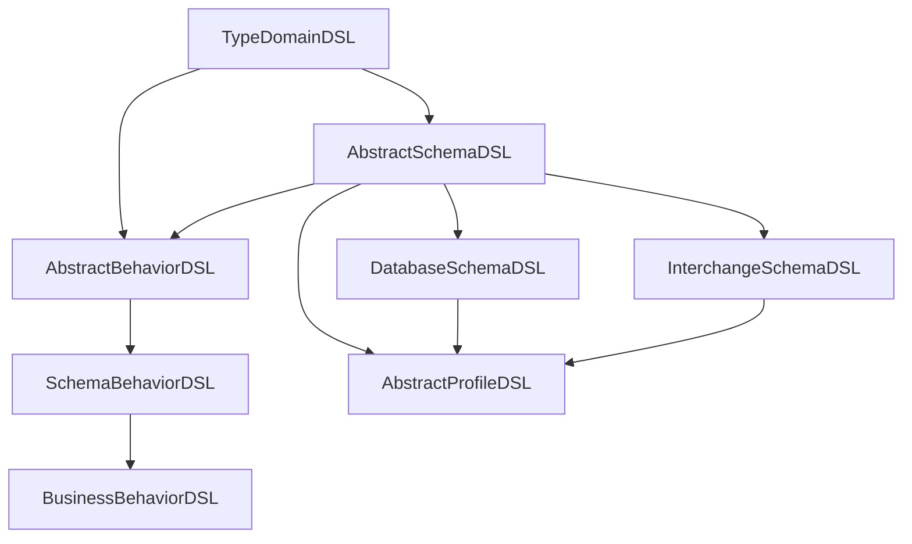
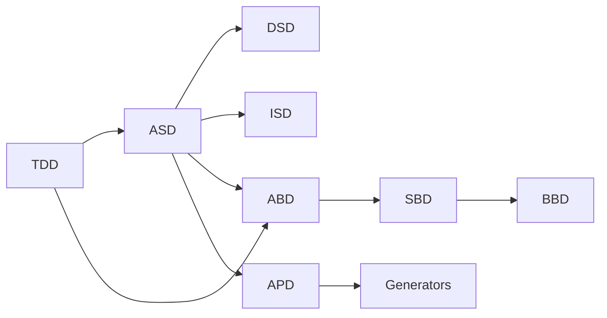
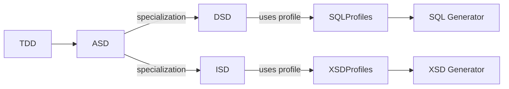
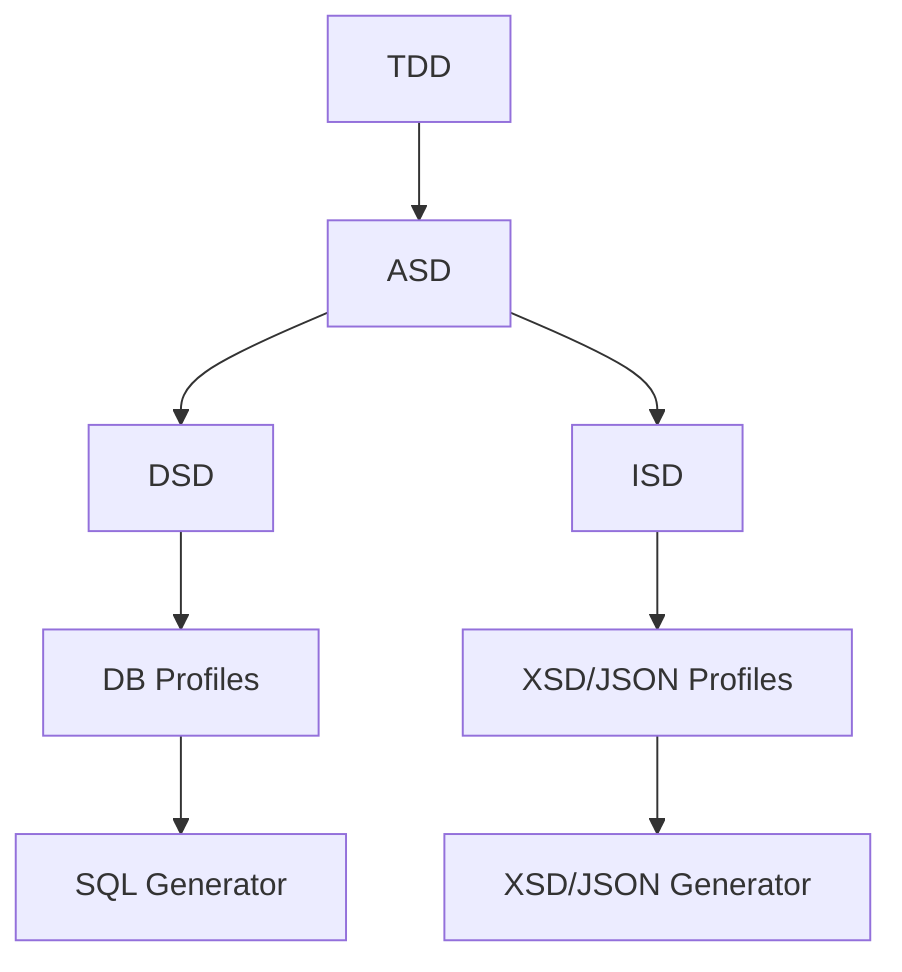

# Modustro DSL Concept – Version 1.2

## 1. Introduction
Modustro introduces a comprehensive ecosystem of interconnected domain-specific languages (DSLs) designed to model data, schemas, behavior, constraints, and generator profiles in a unified, extensible way.  
Rather than creating a monolithic language, Modustro decomposes responsibilities into layered DSLs—each dedicated to a specific abstraction level.  
This modular structure enables:

- clear separation of concerns,
- easier evolution of the modeling stack,
- maintainable generators,
- extensibility for future profiles, database engines, and interchange formats,
- easier onboarding for users (learn only what they need).

Version **1.2** refines terminology and formalizes relations between the different DSL families.

---

## 2. Overview of DSL Architecture
Modustro DSLs form a **four‑layer architecture**:

1. **Type Layer** – reusable type domains (TDD)
2. **Schema Layer** – abstract schema + specializations (ASD, DSD, ISD)
3. **Behavior Layer** – validation, invariants, rules (ABD, SBD, BBD)
4. **Profile Layer** – output targets: SQL engines, XSD, JSON, etc. (APD)

Every layer builds on top of the previous one, ensuring consistency across the whole modeling pipeline.

---

### 2.1 TypeDomainDSL (TDD)
**Purpose:** Define reusable, named *type domains* that can be referenced from schema-level fields.

TDD models include:
- **Primitive type definitions** - priomitive types used in the Type definitions string, number, boolean
- **Type definitions** – consisting from primitive type + abstract behavior e.g., `Email`, `UUID`, `Price`, `String100`
@TODO - clarify desciption - shouldn't this be "DomainValue" or in ASD?  - **DomainField** – composition of primitive and domain types
@TODO - complete desciption - shouldn't this be in ASD? **DomainObject** - ?????
@TODO - complete desciption - shouldn't this be in ASD? **DomainRelationship** - ?????
- **Constraints** – min/max length, ranges, regex patterns
- **Annotations** - custom meta-properties of various structures
@TODO - clarify what should be this one and is it here correctly? - **Primitive adapters** – mapping abstract types to primitive categories (string, number, boolean)
- **Base categories** – numeric, textual, temporal, enumerated
- **Inter-domain composition** – domain types can be built from other domain types (e.g., `Address = Street + City + Zip`)

TDD is the “type factory” of the whole Modustro ecosystem.

---

### 2.2 AbstractSchemaDSL (ASD)
**Purpose:** Define a technology‑agnostic schema-level structure of entities, fields, and relationships.

ASD provides:
- **Entity** – top-level schema objects
- **Field** – referencing TDD types or other entities (abstract)
@TODO - complete desciption - **DomainValueField** - ?????
    - **EntityReferenceField** – foreign-key-like semantic structure
- **Multiplicity rules** – optional, required, 1:1, 1:n, n:n
- **Logical naming** – stable identifiers independent of any target system
- **Physical naming proposals** – optional rules for derived names
- **Abstract constraints** – cardinality, required fields, default values

ASD is the backbone for both database schemas and interchange schemas.

---

### 2.3 DatabaseSchemaDSL (DSD)
**Purpose:** Specialize ASD for relational and NoSQL database engines.  
DSD brings structural elements needed for SQL and DB-specific generators:

- **Tables / Collections**
- **Columns** with concrete DB types
- **Primary and Foreign Keys**
- **Unique constraints**
- **Indices**
- **Sequences / identity strategies**
- **Column definitions using abstract DB types** (database-neutral),
  DB-specific physical type mapping is handled exclusively by profiles (APD descendants)
- @TODO: Clarify move to ASD at least not null or other simple constraint - **Check constraints**

This DSL does **not** perform generation; it only defines the model from which SQL generators operate.

---

### 2.4 InterchangeSchemaDSL (ISD)
**Purpose:** Model structures intended for data transfer formats such as XSD, JSON Schema, Avro, OpenAPI.

ISD supports:
@TODO: Clarify - **InterchangeEntity**
@TODO: Add description - **InterchangeField** (**Elements / Properties**) - ?????
@TODO: Clarify - **InterchangeType**
@TODO: Clarify - **InterchangeConstraint**
@TODO: Clarify move to ASD - **Ordering rules** (XSD-specific)
@TODO: Clarify move to ASD, not here - **Optionality / nullability**
@TODO: Clarify move to ASD - **Nillable vs absent**
- **Choice / group constructs**
- **Message envelopes**
@TODO: Clarify move to ASD at least simple constraints - **Value constraints (enum, pattern, ranges)**

ISD is deliberately technology-agnostic; XSD constraints are handled by profiles.

---

### 2.5 AbstractBehaviorDSL (ABD)
**Purpose:** Define minimal constraint metadata that bridges TDD and ASD.  
ABD provides:

- **Field-level invariants** – min/max/range
- **Type-level invariants** – e.g., regex for email
- **Simple relationship constraints**
- **Basic value rules** (must be positive, must not be empty)

ABD forms the baseline for consistency checking across all DSLs.

---

### 2.6 SchemaBehaviorDSL (SBD)
**Purpose:** Provide schema‑specific advanced behavior:

- DSD-specific constraints (e.g., FK must match PK type)
- ISD-specific constraints (XSD nillable rules, JSON patterns)
- Complex invariants across multiple entities
- Precondition logic for generators

SBD is built on ASD + ABD.

---

### 2.7 BusinessBehaviorDSL (BBD)
**Purpose:** Provide DDD-style behavior modeling (future extension):

- Aggregates & invariants
- Commands & events
- Domain policies
- Message-based patterns

BBD does **not** participate in core schema generation; it is optional.

---

### 2.8 AbstractProfileDSL (APD)
**Purpose:** Define attachable profiles that adapt ASD-derived schemas to specific output targets.

Profiles include:
- **Activation rules** (profile enabled for entity or entire model)
- **Override features** (e.g., override DB type, XSD order, JSON field name)
- **Profile context configuration** (e.g., indentation, versioning)
- **Validation logic** (profile compatibility checks)

@TODO - clarify what should be mentioned here from the old model, having following points:
Meta-language for defining behavior and structure of profiles:
- Profile metadata
- Capability matrices
- UI profile tabs
- Validation and support checks
- Mapping configuration hooks

Concrete profiles (e.g. OracleDbProfileDSL) inherit from APD.

---

### 2.9 Concrete Profile DSLs
Derived by combining APD with a Schema DSL:
- **XsdIcProfileDSL** (APD + ISD)
- **JsonIcSchemaProfileDSL** (APD + ISD)
- **AvroIcProfileDSL** (APD + ISD)
- **PostgresDbProfileDSL** (APD + DSD)
- **OracleDbProfileDSL** (APD + DSD)
- **JavaOrmProfileDSL** (APD + ASD)
- **TypeScriptProfileDSL** (APD + ASD)

---

## 3. Relationships Between DSLs

The Modustro DSL ecosystem follows a structured and predictable dependency hierarchy.

---

### 3.1 Hierarchical Mermaid Diagram



---

### 3.2 Dependency Mermaid Diagram



---

### 3.3 Generator / Profile Pipeline Diagram



---

## 4. Example Syntax for Each DSL

### 4.1 TypeDomainDSL (TDD) – Example

```tdd
domain Email {
    base String;
    pattern "[A-Za-z0-9._%+-]+@[A-Za-z0-9.-]+\.[A-Za-z]{2,}";
}

domain Price {
    base Decimal;
    min 0;
    scale 2;
}
```

---

### 4.2 AbstractSchemaDSL (ASD) – Example

```asd
entity Customer {
    field id       : UUID required;
    field name     : String100 required;
    field email    : Email optional;
    field address  : Address optional;
}

relation CustomerAddress {
    from Customer.address
    to   Address.id
    type one_to_one optional;
}
```

---

### 4.3 DatabaseSchemaDSL (DSD) – Example

```dsd
table Customer as entity Customer {
    column id    uuid primary;
    column name  varchar(100) not null;
    column email varchar(255);
}

foreign_key fk_customer_address {
    table Customer;
    column address_id;
    references Address(id);
}
```

---

### 4.4 InterchangeSchemaDSL (ISD) – Example

```isd
message CustomerMessage {
    element Customer {
        name      : String100;
        email     : Email nillable;
        address   : Address optional;
    }
}
```

---

### 4.5 Behavior DSL Examples (ABD / SBD)

```abd
invariant Customer {
    rule "Email must be present when Address is used" {
        require(email exists OR address not exists);
    }
}
```

```sbd
schema_rule CustomerTable {
    require(Customer.id primary_key);
    require(Customer.name not_null);
}
```

---

### 4.6 Profile DSL Examples (APD + Concrete Profiles)

```apd
profile XsdProfile for CustomerMessage {
    namespace "http://example.org/customer/v1";
    ordering  lexicographical;
    element_form qualified;
}
```

```apd
profile OracleProfile for CustomerTable {
    map String100 to VARCHAR2(100 CHAR);
    map UUID       to RAW(16);
}
```

---

## 5. DSL Flow: From Domain → Schema → Generators

The Modustro modeling pipeline proceeds in five major stages:

1. **Define types** in TDD (Email, Price, UUID…)
2. **Use them in ASD entities** (Customer, Product…)
3. **Specialize ASD** into:
   - DSD → for SQL generation
   - ISD → for XSD/JSON/OpenAPI generation
4. **Attach profiles** (OracleProfile, XsdProfile…)
5. **Run generators** to produce concrete artifacts

### Mermaid Flow Diagram



---

## 6. Integration With Roadmap

This DSL architecture maps directly to the roadmap:

- **Wave 0.1**
  - Core DSL layer definitions (TDD + ASD)
  - Minimal behavior layer (ABD)
  - First generator prototype (plain SQL)

- **Wave 0.2**
  - DatabaseSchemaDSL + InterchangeSchemaDSL baseline
  - Simple profiles (Oracle, XSD base)

- **Wave 1**
  - Extended schema behavior (SBD)
  - Multi-database support
  - Rich validation
  - XSD, JSON Schema generation

- **Wave 2**
  - Profile ecosystem expansion
  - Advanced constraints
  - GUI configuration of DSL elements

- **Wave 3**
  - BusinessBehaviorDSL (DDD concepts)
  - AI-assisted modeling
  - Large-scale multi-module support

---

## 7. Glossary

**DomainType**  
Reusable named type such as Email, UUID, Price.

**Entity (ASD)**  
A schema-level structural object.

**Profile (APD)**  
Output-specific configuration (e.g., XSD, Oracle).

**Invariant (ABD/SBD)**  
Rule that must always hold.

**Generator**  
A component that transforms DSL models into output artifacts (SQL, XSD, JSON Schema…).

**Schema**  
A defined structural collection of entities, fields, and relationships.

