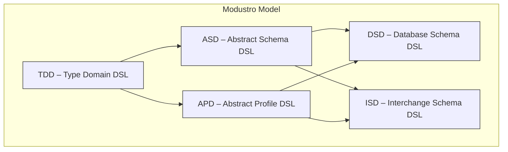
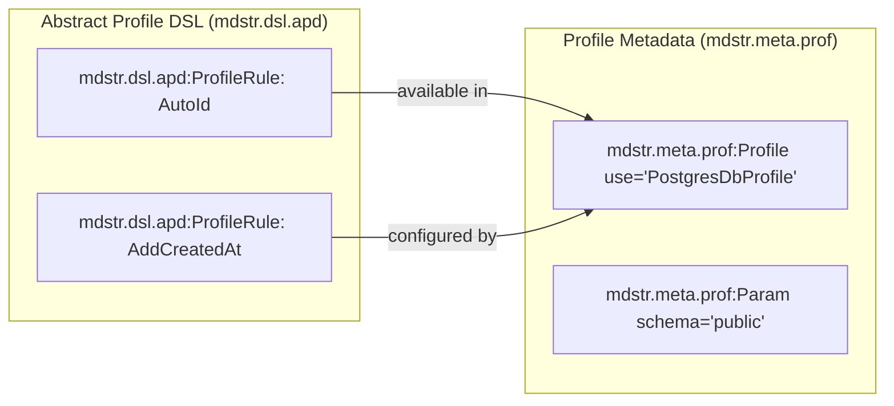

# Modustro Namespace Standard  
### Unified Namespace Architecture for Modustro Platform, Schemas, Profiles, Models & Generators  
Version 1.0

---

# 1. Purpose of This Standard

This document defines the **complete namespace architecture** for the Modustro Platform.  
It ensures:

- clean separation of concerns  
- guaranteed non‑collision of attributes  
- strong XML/XSD compatibility  
- clean Git diffing and AST mapping  
- robust identity and ordering metadata  
- scalability for future extensions  
- professional interoperability with tooling  

This standard applies to:

- **all Modustro DSLs** (TDD, ASD, DSD, ISD, APD, Profile DSLs, Schema DSLs)  
- **ModustroStudio** (editor)  
- **Modustro CLI tools**  
- **all generators**  
- **all project-level and model-level XML files**  

---

# 2. Namespace Hierarchy Overview

Modustro uses a modular, layered namespace system:

| Namespace                         | Prefix                        | Purpose                                                        |
|-----------------------------------|-------------------------------|----------------------------------------------------------------|
| **Platform namespace**            | `mdstr`                       | Global Modustro metadata, fallback attributes                  |
| **Model namespace**               | `mdstr.mdl`                   | Model identity, ordering, metadata used inside SchemaDSL & TDD |
| **Project namespace**             | `mdstr.meta.prj`              | Project configuration, settings, versioning, metadata          |
| **Type Domain DSL namespace**     | `mdstr.dsl.tdd`               | Domain type definitions, properties, domain metadata           |
| **Abstract Schema DSL namespace** | `mdstr.dsl.asd`               | Abstract schema structures, like Entities, Fields, etc.        |
| **Profile namespace**             | `mdstr.meta.prof`             | Profile definitions, profile rules, overrides                  |
| **Generator namespace**           | `mdstr.meta.gen`                   | Generator-related metadata, physical mappings                  |
| **(Reserved for future)**         | `mdstr.meta.ui`, `mdstr.meta.doc`, etc. | UI metadata, documentation metadata                            |

This allows clean separation and massive long-term flexibility.

---

# 3. Namespace URIs

Official URIs:

```
xmlns:mdstr="https://modustro.eu/xmldefs/platform"
xmlns:mdstr.mdl="https://modustro.eu/xmldefs/model"
xmlns:mdstr.meta.prj="https://modustro.eu/xmldefs/metadata/project"
xmlns:mdstr.meta.prof="https://modustro.eu/xmldefs/metadata/profile"
xmlns:mdstr.meta.gen="https://modustro.eu/xmldefs/metadata/generator"
```

All Modustro tools must treat these URIs as identifiers for semantic processing.

---

# 4. Model Namespace (mdstr.mdl)

This is the most important namespace in the entire platform.

It defines:

- **unique identity** of every AST element  
- **logical ordering** for stable generation  
- **metadata relevant for SchemaDSL, TDD, Profiles, and DSD/ISD**  

Mandatory attributes:

```
mdstr.mdl:elementGuid   (GUID, immutable)
mdstr.mdl:elementOrder  (lexicographic order key)
```

Example:

```xml
<mdstr.dsl.asd:Field
    mdstr.mdl:elementGuid="7b42edbb-ca92-45a7-a934-eafb7737fc2f"
    mdstr.mdl:elementOrder="hmf"
    name="email"
    type="Email"/>
```

All DSL elements MUST contain these two attributes.

---

# 5. Project Namespace (mdstr.meta.prj)

This namespace defines **project-level metadata**, stored in the Modustro Project File.

Recommended attributes:

```
mdstr.meta.prj:createdBy
mdstr.meta.prj:createdAt
mdstr.meta.prj:lastModifiedBy
mdstr.meta.prj:lastModifiedAt
mdstr.meta.prj:platformVersion
mdstr.meta.prj:modelVersion
mdstr.meta.prj:defaultProfiles
```

Example:

```xml
<mdstr.meta.prj:Project
    mdstr.meta.prj:createdBy="artur"
    mdstr.meta.prj:createdAt="2025-11-29"
    mdstr.meta.prj:platformVersion="1.0">
```

---

# 6. Profile Namespace (mdstr.meta.prof)

Used inside ProfileDSL and Profile Group Files.

Common metadata:

```
mdstr.mdl:elementGuid
mdstr.mdl:elementOrder
mdstr.meta.prof:overrides
mdstr.meta.prof:appliesTo
mdstr.meta.prof:profileVersion
```

Example:

```xml
<mdstr.meta.prof:ProfileRule
    mdstr.mdl:elementGuid="3f32f06e-2874-4b48-a2df-ecc23f6a28db"
    mdstr.mdl:elementOrder="mm"
    mdstr.meta.prof:appliesTo="Entity"
    rule="AddAutoId"/>
```

Guidelines:

- Profile rules MUST use model-level GUIDs.
- Profile-specific metadata goes in this namespace only.

---

# 7. Generator Namespace (mdstr.meta.gen)

Used ONLY by generators or metadata used by generators.

Typical attributes:

```
mdstr.meta.gen:physicalOrder
mdstr.meta.gen:quoted
mdstr.meta.gen:indexed
mdstr.meta.gen:sqlType
mdstr.meta.gen:precision
mdstr.meta.gen:scale
```

Example:

```xml
<mdstr.dsl.dsd:Table
    name="CUSTOMER"
    mdstr.meta.gen:physicalOrder="10"
    mdstr.meta.gen:quoted="false"/>
```

---

# 8. Type Namespace (`mdstr.dsl.tdd`)
### Modustro Platform Namespace for TypeDomainDSL (TDD)

The **Type Namespace** defines the XML metadata layer for the **TypeDomainDSL (TDD)** within the Modustro Platform.  
It isolates all domain type definitions from schema, project, profile, and generator structures, ensuring a clean, modular design.

This namespace is intended for:
- domain primitive types
- derived types
- type groups
- type constraints
- aliases and semantic wrappers

---

## 8.1 Namespace Prefix and URI

Official namespace declaration:

```
xmlns:mdstr.dsl.tdd="https://modustro.eu/xmldefs/dsl/TypeDomainDSL"
```

Prefix:

```
mdstr.dsl.tdd
```

Using a dedicated namespace ensures that domain type metadata does not collide with:
- model identity metadata (`mdstr.mdl`)
- project-level metadata (`mdstr.meta.prj`)
- profile metadata (`mdstr.meta.prof`)
- generator metadata (`mdstr.meta.gen`)

---

## 8.2 Elements Expected in the Type Namespace

The TypeDomainDSL may define the following elements, all of which belong in this namespace:

- **Types** — optional container element
- **Type** — definition of a domain type
- **TypeGroup** — grouping construct for related types
- **TypeAlias** — alternative names for reuse
- **TypeConstraints** — validation rules bound to a type
- **TypeConstraint** — individual constraint definition

These structure names reflect TDD concepts but must always live under the `mdstr.dsl.tdd` namespace.

---

## 8.3 Required Metadata (From Model Namespace)

All type elements MUST include the universal Modustro model metadata:

```
mdstr.mdl:elementGuid   (required, immutable GUID)
mdstr.mdl:elementOrder  (required, lexicographic ordering key)
```

Example:

```
<mdstr.dsl.tdd:Type
    name="Email"
    base="string"
    mdstr.mdl:elementGuid="59fdbf05-b9c8-4f32-bb7c-88d2a83f5a13"
    mdstr.mdl:elementOrder="m">
```

These attributes **never** belong to the `mdstr.dsl.tdd` namespace,  
because identity and ordering are global platform semantics.

---

## 8.4 Example Structure of the Type Namespace

```xml
<mdstr.dsl.tdd:Types>

    <mdstr.dsl.tdd:Type
        name="Email"
        base="string"
        mdstr.mdl:elementGuid="59fdbf05-b9c8-4f32-bb7c-88d2a83f5a13"
        mdstr.mdl:elementOrder="m">

        <mdstr.dsl.tdd:Constraints>
            <mdstr.dsl.tdd:Constraint
                name="emailFormat"
                regex="^[^@]+@[^@]+$"
                mdstr.mdl:elementGuid="8c9d8fe6-a4b7-41c7-a71f-a7acb4f1cbc5"
                mdstr.mdl:elementOrder="n"/>
        </mdstr.dsl.tdd:Constraints>

    </mdstr.dsl.tdd:Type>

    <mdstr.dsl.tdd:Type
        name="UUID"
        base="string"
        mdstr.mdl:elementGuid="fa30a0d3-c6ab-4e9e-8bd0-11fccfb5e735"
        mdstr.mdl:elementOrder="n"/>
</mdstr.dsl.tdd:Types>
```

---

## 8.5 Interaction with Other Namespaces

| Namespace       | Allowed in TDD? | Purpose |
|-----------------|-----------------|---------|
| `mdstr.mdl`     | **Required**     | element identity and ordering |
| `mdstr.dsl.tdd`    | **Primary**       | type definition metadata |
| `mdstr.meta.prof`    | Allowed          | profile rules applied to types |
| `mdstr.meta.gen`     | Allowed          | generator metadata (e.g., DB type mapping) |
| `mdstr.meta.prj`     | **Not allowed**  | project metadata belongs only in project files |
| `mdstr`         | Allowed sparingly | global annotations (deprecated, notes, etc.) |

---

## 8.6 Rationale for a Dedicated Type Namespace

A separate XML namespace is chosen for types because:

- domain types often exist independently from schemas
- types are shared across multiple models and modules
- profiles frequently override type behavior through rule-based mechanisms
- generators define type mappings (DB type, XSD type, JSON scalar type)
- keeping types in their own layer maintains a clean platform separation

TDD is a foundational layer of the Modustro ecosystem, so giving it an isolated namespace increases clarity, reusability, and maintainability.

---

# 9. DSL Namespaces (Full Chapter)

## 9.1 Purpose of DSL Namespaces
DSL namespaces define *structural* elements of Modustro models for each individual DSL (ASD, DSD, ISD, TDD, APD, …).  
Each DSL forms a semantic “sub-language” within the unified Modustro Model.  
Namespaces ensure:

- clear separation of DSL structures
- no naming collisions among DSLs
- modular extensibility
- clean XML schema validation
- precise tooling behavior (Studio, CLI, generators)

---

## 9.2 Namespace Design Principles

Each DSL receives its own namespace under the model root:

```
mdstr.dsl.<dsl-prefix>
```

Examples:
```
mdstr.dsl.asd   – Abstract Schema DSL
mdstr.dsl.dsd   – Database Schema DSL
mdstr.dsl.isd   – Interchange Schema DSL
mdstr.dsl.tdd   – Type Domain DSL
mdstr.dsl.apd   – Abstract Profile DSL
```

While Modustro Global Metadata uses namespaces:
```
mdstr         – platform meta
mdstr.mdl     – model-level identity/order
mdstr.meta.prof    – profile application metadata
mdstr.meta.gen     – generator metadata
mdstr.meta.prj     – project metadata
```

---

## 9.3 Why Separate DSL Namespaces?

### Structural vs. Non-Structural Metadata

| Purpose | Namespace | Example |
|---------|-----------|---------|
| Define structure of the model (AST) | `mdstr.dsl.asd`, `mdstr.dsl.dsd`, etc. | `<mdstr.dsl.asd:Entity>` |
| Annotate with metadata | `mdstr.mdl` | `mdstr.mdl:elementGuid="…"` |
| Apply profiles | `mdstr.meta.prof` | `<mdstr.meta.prof:Profile use="PostgresDbProfile">` |
| Provide generator hints | `mdstr.meta.gen` | `mdstr.meta.gen:sqlType="VARCHAR"` |

---

## 9.4 Example – Database Schema DSL

```xml
<mdstr.dsl.dsd:Table
    name="CUSTOMER"
    mdstr.mdl:elementGuid="..."
    mdstr.mdl:elementOrder="m"
    mdstr.meta.gen:physicalOrder="10">

    <mdstr.dsl.dsd:Column
        name="id"
        type="UUID"
        mdstr.mdl:elementGuid="..."
        mdstr.mdl:elementOrder="n" />

</mdstr.dsl.dsd:Table>
```

---

## 9.5 Example – Abstract Schema DSL

```xml
<mdstr.dsl.asd:Entity
    name="Customer"
    mdstr.mdl:elementGuid="..."
    mdstr.mdl:elementOrder="m">

    <mdstr.dsl.asd:Field
        name="email"
        type="Email"
        mdstr.mdl:elementGuid="..."
        mdstr.mdl:elementOrder="n"/>
</mdstr.dsl.asd:Entity>
```

---

## 9.6 Mermaid Diagram – DSL Layering



---

## 9.7 Benefits of DSL Namespacing

- Crystal clear distinction between model structure and metadata
- Strong XSD validation per DSL
- Extensibility for future DSLs (GraphQL DSL, Protobuf DSL, …)
- Eliminates naming conflicts
- Supports modularity in Modustro Studio
- Simplifies generator processing

---

# 10. Platform Namespace (mdstr)

Top-level, general-purpose namespace for metadata not tied to a specific subsystem.  
This namespace SHOULD remain minimal to preserve clarity.

Examples:

```
mdstr:deprecated="true"
mdstr:note="Generated automatically"
```

Should rarely be used.

---

# 11. XML Header Example Combining All Namespaces

```xml
<mdstr.meta.prj:Project
    xmlns="https://modustro.eu/xmldefs/metadata/project"
    xmlns:mdstr="https://modustro.eu/xmldefs/platform"
    xmlns:mdstr.mdl="https://modustro.eu/xmldefs/model"
    xmlns:mdstr.dsl.tdd="https://modustro.eu/xmldefs/dsl/TypeDomainDSL"
    xmlns:mdstr.dsl.asd="https://modustro.eu/xmldefs/dsl/AbstractSchemaDSL"
    xmlns:mdstr.dsl.isd="https://modustro.eu/xmldefs/dsl/InterchangeSchemaDSL"
    xmlns:mdstr.dsl.dsd="https://modustro.eu/xmldefs/dsl/DatabaseSchemaDSL"
    xmlns:mdstr.meta.prj="https://modustro.eu/xmldefs/metadata/project"
    xmlns:mdstr.meta.prof="https://modustro.eu/xmldefs/metadata/profile"
    xmlns:mdstr.meta.gen="https://modustro.eu/xmldefs/metadata/generator"
    mdstr.meta.prj:platformVersion="1.0"
    mdstr.meta.prj:modelVersion="1.0">
```

---

# 12. Interaction Rules Between Namespaces

## 12.1 Model Namespace (mdstr.mdl)
- MUST appear on **every AST node**
- MUST implement GUID + Order attributes
- CANNOT be removed
- CANNOT be overridden by profiles or generators

## 12.2 Project Namespace (mdstr.meta.prj)
- Used only in project files
- Must not appear in schema nodes

## 12.3 Profile Namespace (mdstr.meta.prof)
- Must not override mdstr.mdl attributes
- Can introduce profile-specific semantics

## 12.4 Generator Namespace (mdstr.meta.gen)
- MUST NOT appear in project or profile files
- Used for generation pipeline metadata only

---

# 13. Validation Requirements

The Modustro Platform MUST validate:

- namespace correctness
- mandatory attributes (Guid + Order)
- uniqueness of Guid inside model
- uniqueness of OrderKey among siblings
- namespace placement rules
- XML schema (XSD) validation
- generator metadata presence where required

Invalid namespace placement must cause load failure.

---

# 14. Strategy for Future Extensions

Modustro reserves additional namespace modules:

```
mdstr.ui      – UI hints  
mdstr.doc     – documentation annotations  
mdstr.build   – build-specific metadata  
mdstr.ext.*   – extension namespaces for plugins  
```

All must follow the pattern:

```
https://modustro.eu/xmldefs/<module>
```

---

# 15. Benefits of Namespace Architecture

| Benefit | Description |
|--------|-------------|
| Modular Separation | Prevents mixing model, project, profile, generator metadata |
| Better XML Clarity | Metadata is grouped logically and semantically |
| Zero Collisions | Business-level attributes never conflict with Modustro system metadata |
| XSD-Friendly | Namespaces map cleanly onto XSD schemas |
| Git-Friendly | Consistent metadata formats reduce diff noise |
| Extensible | Future modules can be added without breaking existing models |
| Professional | Matches industry standards (XMI, MPS, JCR, W3C XML) |

---

# 16. Final Recommendation Summary

Modustro adopts **multi-namespace XML metadata** structured as:

```
mdstr         – global platform metadata
mdstr.mdl     – AST model metadata (GUID, Order)
mdstr.meta.prj     – project metadata
mdstr.meta.prof    – profile metadata
mdstr.meta.gen     – generator metadata
```

This provides a scalable and professional foundation for all DSLs, models, editors, generators, and future extensions.

---

# 17. Appendix: Example Full Model Element

```xml
<mdstr.dsl.asd:Field
    name="email"
    type="Email"
    nullable="false"

    mdstr.mdl:elementGuid="c8330b68-eacf-4f97-8c95-2deb8358f86f"
    mdstr.mdl:elementOrder="hmf"

    mdstr.meta.prof:profileOverride="default"
    mdstr.meta.gen:sqlType="VARCHAR"
    mdstr.meta.gen:precision="128"
/>
```

---

# 18. Appendix: Profile DSLs vs Profile Metadata

## 18.1 Purpose
Although both are called “profiles”, Modustro separates:

1. **Profile DSLs (APD / DPD / IPD)** → structural language describing rules
2. **Profile Metadata (mdstr.meta.prof)** → activation and configuration of rules

They must NOT share the same namespace.

---

## 18.2 Abstract Profile DSL – `mdstr.dsl.apd`

This defines **what a profile is** and **what rules it contains**:

```xml
<mdstr.dsl.apd:ProfileRule
    name="AutoId"
    appliesTo="Entity"
    action="AddGeneratedPrimaryKey"
    mdstr.mdl:elementGuid="..."
    mdstr.mdl:elementOrder="m" />
```

This is part of the **Modustro Model AST**.

- Versioned
- Structured
- Extensible
- Affects code generation and validation

---

## 18.3 Profile Metadata – `mdstr.meta.prof`

This defines **which profiles are active** in a given project and how they’re parametrized:

```xml
<mdstr.meta.prof:Profile use="PostgresDbProfile">
    <mdstr.meta.prof:Param name="schema" value="public"/>
</mdstr.meta.prof:Profile>
```

This is **not part of the AST**.  
It is configuration applied on top of the model.

---

## 18.4 Key Differences Table

| Aspect | Abstract Profile DSL (`mdstr.dsl.apd` or other Profile DSL) | Profile Metadata (`mdstr.meta.prof`) |
|--------|-------------------------------------------------------------|----------------------------------|
| Purpose | Define profile rules                                        | Activate profile on a project |
| Type | AST structure (DSL)                                         | Config metadata |
| Namespace | `mdstr.dsl.apd`, `mdstr.dsl.dpd`, `mdstr.dsl.ipd`, ...      | `mdstr.meta.prof` |
| Versioning | Yes                                                         | Optional |
| Applied to | DSL model                                                   | Project configuration |
| Example | Rule definition                                             | Enable profile for project |

---

## 18.5 Mermaid Diagram – Two-Layer Profile Architecture



---

## 18.6 Summary

- **Profile DSLs** = defines rules
- **Profile Metadata** = activates/parametrizes them
- Should *never* share a namespace
- Matches patterns from UML, XMI, MPS, EMF

---

# END OF DOCUMENT
