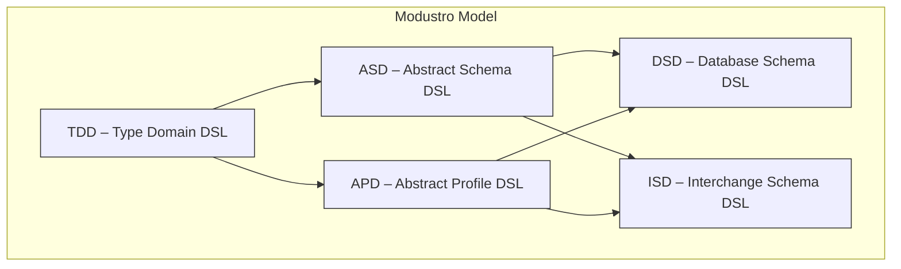
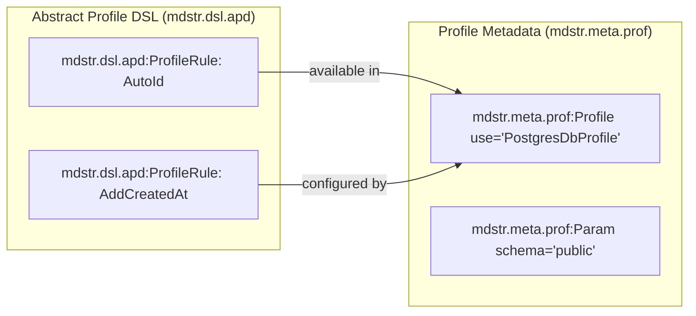

# Modustro Namespace Standard  
### Unified Namespace Architecture for Modustro Platform, Schemas, Profiles, Models & Generators  
Version 1.0

---

# 1. Purpose of This Standard

This document defines the **complete namespace architecture** for the Modustro Platform.  
It ensures:

- clean separation of concerns  
- guaranteed non‑collision of attributes  
- strong XML/XSD compatibility  
- clean Git diffing and AST mapping  
- robust identity and ordering metadata  
- scalability for future extensions  
- professional interoperability with tooling  

This document also standardizes all XML namespaces and prefix usage for the Modustro Platform and products.

It defines:

- core platform namespaces,
- DSL-specific namespaces,
- metadata namespaces (model, auditing),
- recommended prefix conventions,
- and rules for minimizing XML verbosity while keeping semantics clear.

This standard applies to:

- **all Modustro DSLs** (TDD, ASD, DSD, ISD, APD, Profile DSLs, Schema DSLs)  
- **ModustroStudio** (editor)  
- **Modustro CLI tools**  
- **all generators**  
- **all project-level and model-level XML files**  

---

# 2. Namespace URIs and prefixes

## 2.1. Namespace Hierarchy Overview

Modustro uses a modular, layered namespace system:

| Namespace                             | Prefix full                       | Prefix short | Purpose                                                                                             |
|---------------------------------------|-----------------------------------|--------------|-----------------------------------------------------------------------------------------------------|
| **Platform namespace**                | `mdstr`                           | `mdstr`      | Core platform namespace                                                                             |
| **Model namespace**                   | `mdstr.meta.mdl`                  | `mdl`        | Model identity, ordering, metadata used inside SchemaDSL & TDD                                      |
| **Project namespace**                 | `mdstr.meta.prj`                  | `prj`        | Project configuration, settings, versioning, metadata                                               |
| **Type Domain DSL namespace**         | `mdstr.dsl.tdd`                   | `tdd`        | Domain type definitions, properties, domain metadata                                                |
| **Abstract Schema DSL namespace**     | `mdstr.dsl.asd`                   | `asd`        | Abstract schema structures, like Entities, Fields, etc.                                             |
| **Database Schema DSL namespace**     | `mdstr.dsl.dsd`                   | `dsd`        | Database schema structures, like tables, Columns, etc.                                              |
| **Interchange Schema DSL namespace**  | `mdstr.dsl.isd`                   | `isd`        | Interchange schema structures, like Complex types, elements, etc.                                   |
| **Abstract Profile DSL namespace**    | `mdstr.dsl.apd`                   | `apd`        | Abstract profile namespace definitions, like Profile structures, general interfaces for plugins, etc. |
| **Database Profile DSL namespace**    | `mdstr.dsl.dpd`                   | `dpd`        | Database profile namespace definitions                                                              |
| **Interchange Profile DSL namespace** | `mdstr.dsl.ipd`                   | `ipd`        | Interchange profile namespace definitions                                                           |
| **Essential Behavior DSL namespace**  | `mdstr.dsl.ebd`                   | `ebd`        | Definition of essential behaviors for types                                                         |
| **Schema Behavior DSL namespace**     | `mdstr.dsl.sbd`                   | `sbd`        | Definition of schema behaviors for single entity field behaviors                                    |
| **Business Behavior DSL namespace**   | `mdstr.dsl.bbd`                   | `bbd`        | Definition of business behaviors impacting multiple entities                                        |
| **Meta Behavior DSL namespace**       | `mdstr.dsl.mbd`                   | `mbd`        | Definition of behaviors impacting the DSLs as they are                                              |
| **Profile namespace**                 | `mdstr.meta.prof`                 | `prof`       | Profile definitions, profile rules, overrides                                                       |
| **Generator namespace**               | `mdstr.meta.gen`                  | `gen`        | Generator-related metadata, physical mappings                                                       |
| **Audit namespace**                   | `mdstr.meta.audit`                | `audit`      | Auditing-related metadata                                                          |
| **(Reserved for future)**             | `mdstr.meta.ui`, `mdstr.meta.doc` | `doc`, `ui`  | UI metadata, documentation metadata apod                                                            |

This allows clean separation and massive long-term flexibility.

Short prefixes should be used always in the case the Modustro XML elements are used fully only within Modustro namespaces 
without any reference to any external namespaces. In the case some external namespaces are included, then the full prefix 
usage is recommended

---

## 2.2. Namespace URIs and prefixes

Official URIs:

```
xmlns:mdstr="https://modustro.eu/xmldefs/platform"
xmlns:mdstr.meta.mdl="https://modustro.eu/xmldefs/metadata/model"
xmlns:mdstr.dsl.tdd="https://modustro.eu/xmldefs/dsl/TypeDomainDSL"
xmlns:mdstr.dsl.asd="https://modustro.eu/xmldefs/dsl/AbstractSchemaDSL"
xmlns:mdstr.dsl.dsd="https://modustro.eu/xmldefs/dsl/DatabaseSchemaDSL"
xmlns:mdstr.dsl.isd="https://modustro.eu/xmldefs/dsl/InterchangeSchemaDSL"
xmlns:mdstr.dsl.apd="https://modustro.eu/xmldefs/dsl/AbstractProfileDSL"
xmlns:mdstr.dsl.dpd="https://modustro.eu/xmldefs/dsl/DatabaseProfileDSL"
xmlns:mdstr.dsl.ipd="https://modustro.eu/xmldefs/dsl/InterchangeProfileDSL"
xmlns:mdstr.dsl.ebd="https://modustro.eu/xmldefs/dsl/EssentialBehaviorDSL"
xmlns:mdstr.dsl.sbd="https://modustro.eu/xmldefs/dsl/SchemaBehaviorDSL"
xmlns:mdstr.dsl.bbd="https://modustro.eu/xmldefs/dsl/BusinessBehaviorDSL"
xmlns:mdstr.dsl.mbd="https://modustro.eu/xmldefs/dsl/MetaBehaviorDSL"
xmlns:mdstr.meta.prj="https://modustro.eu/xmldefs/metadata/project"
xmlns:mdstr.meta.prof="https://modustro.eu/xmldefs/metadata/profile"
xmlns:mdstr.meta.gen="https://modustro.eu/xmldefs/metadata/generator"
xmlns:mdstr.meta.audit="https://modustro.eu/xmldefs/metadata/auditing"
```

All Modustro tools must treat these URIs as identifiers for semantic processing.

---

## 2.3 Namespace Design Principles

Each DSL receives its own namespace under the model root:

```
mdstr.dsl.<dsl-prefix>
```

Examples:
```
mdstr.dsl.asd   – Abstract Schema DSL
mdstr.dsl.dsd   – Database Schema DSL
mdstr.dsl.isd   – Interchange Schema DSL
mdstr.dsl.tdd   – Type Domain DSL
mdstr.dsl.apd   – Abstract Profile DSL
```

While Modustro Global Metadata uses namespaces:
```
mdstr         – platform meta
mdstr.meta.mdl     – model-level identity/order
mdstr.meta.prof    – profile application metadata
mdstr.meta.gen     – generator metadata
mdstr.meta.prj     – project metadata
```

---

## 2.4 Why Separate DSL Namespaces?

### Structural vs. Non-Structural Metadata

| Purpose | Namespace | Example |
|---------|-----------|---------|
| Define structure of the model (AST) | `mdstr.dsl.asd`, `mdstr.dsl.dsd`, etc. | `<mdstr.dsl.asd:Entity>` |
| Annotate with metadata | `mdstr.meta.mdl` | `mdstr.meta.mdl:meGuid="…"` |
| Apply profiles | `mdstr.meta.prof` | `<mdstr.meta.prof:Profile use="PostgresDbProfile">` |
| Provide generator hints | `mdstr.meta.gen` | `mdstr.meta.gen:sqlType="VARCHAR"` |

---

## 2.5 Examples

Following chapters form some examples of the usage of the namespaces in specific XML texts:

### 2.5.1 Example – Database Schema DSL structure

```xml
<!-- This defines the global table list -->
<mdstr.dsl.dsd:TableList
	mdstr.meta.mdl:meGuid="fc12-438b-9921"
	mdstr.meta.mdl:meHlc="2025-03-01T09:30:55Z-7"
	mdstr.meta.audit:authorRef="AUTH-001">
	<mdstr.dsl.dsd:Table
		mdstr.meta.mdl:meGuid="fc12-438b-AX21"
		mdstr.meta.mdl:meHlc="2025-03-01T09:30:55Z-7"
		mdstr.meta.mdl:meAncestorGuid="fc12-438b-9926"
		mdstr.meta.audit:authorRef="AUTH-001">
		<!-- Order of the elements inside the Column element 
          is given by the meGuid of every subelement independently of their name -->
		<mdstr.dsl.dsd:TableName
			mdstr.meta.mdl:meGuid="cacc-8ffb"
			mdstr.meta.mdl:meHlc="2025-03-01T09:31:10Z-3"
			mdstr.meta.audit:authorRef="AUTH-001">CUSTOMER</mdstr.dsl.dsd:TableName>
		<mdstr.dsl.dsd:TableName
			mdstr.meta.mdl:meGuid="cacc-8ffc"
			mdstr.meta.mdl:meHlc="2025-03-01T09:31:11Z-1"
			mdstr.meta.audit:authorRef="AUTH-002">COMPANY_CUSTOMER</mdstr.dsl.dsd:TableName>

		<!-- this element cannot be here 
        <mdstr.meta.mdl:MeOrder
            mdstr.meta.mdl:meGuid="cacc-8ffe"
            mdstr.meta.mdl:meHlc="2025-03-01T09:31:10Z-3"
            mdstr.meta.audit:authorRef="AUTH-002">my</mdstr.meta.mdl:MeOrder>
        since it has the meGuid="cacc-8ffe" lexicographically higher than the next 
        item TableComment, which has meGuid="cacc-8ffd" and "cacc-8ffd" < "cacc-8ffe"
        so element with guid meGuid="cacc-8ffd" must be before the element with meGuid="cacc-8ffe"  
        -->
		<mdstr.dsl.dsd:TableComment
			mdstr.meta.mdl:meGuid="cacc-8ffd"
			mdstr.meta.mdl:meHlc="2025-03-01T09:31:10Z-3"
			mdstr.meta.audit:authorRef="AUTH-002">This is table customer</mdstr.dsl.dsd:TableComment>

		<mdstr.meta.mdl:MeOrder
			mdstr.meta.mdl:meGuid="cacc-8ffe"
			mdstr.meta.mdl:meHlc="2025-03-01T09:31:10Z-3"
			mdstr.meta.audit:authorRef="AUTH-002">my</mdstr.meta.mdl:MeOrder>
	</mdstr.dsl.dsd:Table>
</mdstr.dsl.dsd:TableList>

<mdstr.dsl.dsd:TableSpace
mdstr.meta.mdl:meGuid="TBLSPC-001A"
mdstr.meta.mdl:meHlc="2025-02-18T10:05:00Z-3"
mdstr.meta.audit:authorRef="AUTH-001">

<mdstr.dsl.dsd:TableSpaceName
	mdstr.meta.mdl:meGuid="TN-001A"
	mdstr.meta.mdl:meHlc="2025-02-18T10:05:00Z-3"
	mdstr.meta.audit:authorRef="AUTH-001">TBLSPACE_OLD</mdstr.dsl.dsd:TableSpaceName>

<mdstr.dsl.dsd:TableRefList
	mdstr.meta.mdl:meGuid="fc12-438b-99D1A"
	mdstr.meta.mdl:meHlc="2025-03-01T09:30:55Z-7"
	mdstr.meta.audit:authorRef="AUTH-001">
	<mdstr.dsl.dsd:TableRef
		mdstr.meta.mdl:meGuid="fc12-438b-9X21A"
		mdstr.meta.mdl:meHlc="2025-03-01T09:30:55Z-7"
		mdstr.meta.audit:authorRef="AUTH-001"
		mdstr.dsl.tdd:refMeGuid="fc12-438b-AX21">

		<!-- This element indicates, this table is no longer in the given tablespace list,
             but has been removed from this tablespace by the AUTH-002 at 2025-02-01T12:31:10Z-3 -->
		<mdstr.meta.mdl:MeRefRemoved
			mdstr.meta.mdl:meGuid="aa37-c41fQA"
			mdstr.meta.mdl:meHlc="2025-02-01T10:00:55Z-5"/>

		<mdstr.meta.mdl:MeOrder
			mdstr.meta.mdl:meGuid="cacc-8ffeQA"
			mdstr.meta.mdl:meHlc="2025-03-01T12:31:10Z-3"
			mdstr.meta.audit:authorRef="AUTH-002">my</mdstr.meta.mdl:MeOrder>

	</mdstr.dsl.dsd:TableRef>
</mdstr.dsl.dsd:TableRefList>

</mdstr.dsl.dsd:TableSpace>

<mdstr.dsl.dsd:TableSpace
	mdstr.meta.mdl:meGuid="TBLSPC-001"
	mdstr.meta.mdl:meHlc="2025-02-18T10:05:00Z-3"
	mdstr.meta.audit:authorRef="AUTH-001">

	<mdstr.dsl.dsd:TableSpaceName
		mdstr.meta.mdl:meGuid="TN-001"
		mdstr.meta.mdl:meHlc="2025-02-18T10:05:00Z-3"
		mdstr.meta.audit:authorRef="AUTH-001">TBLSPACE_MAIN</mdstr.dsl.dsd:TableSpaceName>

	<mdstr.dsl.dsd:TableRefList
		mdstr.meta.mdl:meGuid="fc12-438b-99D1"
		mdstr.meta.mdl:meHlc="2025-03-01T09:30:55Z-7"
		mdstr.meta.audit:authorRef="AUTH-001">
        <mdstr.dsl.dsd:TableRef
            mdstr.meta.mdl:meGuid="fc12-438b-9X21"
            mdstr.meta.mdl:meHlc="2025-03-01T09:30:55Z-7"
			mdstr.meta.audit:authorRef="AUTH-001"
			mdstr.dsl.tdd:refMeGuid="fc12-438b-AX21">

            <!-- this element cannot be here 
			<mdstr.meta.mdl:MeOrder
                mdstr.meta.mdl:meGuid="cacc-8ffeQ"
                mdstr.meta.mdl:meHlc="2025-03-01T09:31:10Z-3"
				mdstr.meta.audit:authorRef="AUTH-002">my</mdstr.meta.mdl:MeOrder>
            since it has the meGuid="cacc-8ffeQ" lexicographically higher than the next 
            item MeRelocated, which has meGuid="aa37-c41fQ" and "aa37-c41fQ" < "cacc-8ffeQ"
            so element with guid meGuid="aa37-c41fQ" must be before the element with meGuid="cacc-8ffeQ"  
            -->

            <!-- This element indicates, this table is no longer in the given tablespace list,
                 but has been moved to another tablespace, where the reference with the 
                 meGuid="fc12-438b-9X21W" has been created (see the tablespace TBLSPC-002), 
                 its author is the author of the relocation. So this table reference should 
                 not be visible to the user in the tablespace TBLSPC-001, only in the history of 
                 TBLSPC-001 this table should be visible as being moved by the AUTH-002 at 2025-03-01T12:31:10Z-3 -->
            <mdstr.meta.mdl:MeRelocated
                mdstr.meta.mdl:meGuid="aa37-c41fQ"
                mdstr.meta.mdl:meHlc="2025-03-02T10:00:55Z-5"
                mdstr.meta.mdl:meRelocatedToGuid="fc12-438b-9X21W"/>

			<mdstr.meta.mdl:MeOrder
				mdstr.meta.mdl:meGuid="cacc-8ffeQ"
				mdstr.meta.mdl:meHlc="2025-03-01T12:31:10Z-3"
				mdstr.meta.audit:authorRef="AUTH-002">my</mdstr.meta.mdl:MeOrder>

		</mdstr.dsl.dsd:TableRef>
    </mdstr.dsl.dsd:TableRefList>    

</mdstr.dsl.dsd:TableSpace>

<mdstr.dsl.dsd:TableSpace
mdstr.meta.mdl:meGuid="TBLSPC-002"
mdstr.meta.mdl:meHlc="2025-02-18T10:05:00Z-3"
mdstr.meta.audit:authorRef="AUTH-001">

<mdstr.dsl.dsd:TableSpaceName
	mdstr.meta.mdl:meGuid="TN-002"
	mdstr.meta.mdl:meHlc="2025-02-18T10:05:00Z-3"
	mdstr.meta.audit:authorRef="AUTH-001">TBLSPACE_SECONDARY</mdstr.dsl.dsd:TableSpaceName>

<mdstr.dsl.dsd:TableRefList
	mdstr.meta.mdl:meGuid="fc12-438b-99D1W"
	mdstr.meta.mdl:meHlc="2025-03-01T09:30:55Z-7"
	mdstr.meta.audit:authorRef="AUTH-001">
	<mdstr.dsl.dsd:TableRef
		mdstr.meta.mdl:meGuid="fc12-438b-9X21W"
		mdstr.meta.mdl:meHlc="2025-03-01T09:30:55Z-7"
		mdstr.meta.audit:authorRef="AUTH-001"
		mdstr.dsl.tdd:refMeGuid="fc12-438b-AX21">

		<mdstr.meta.mdl:MeOrder
			mdstr.meta.mdl:meGuid="cacc-8ffeW"
			mdstr.meta.mdl:meHlc="2025-03-01T09:31:10Z-3"
			mdstr.meta.audit:authorRef="AUTH-002">my</mdstr.meta.mdl:MeOrder>

	</mdstr.dsl.dsd:TableRef>
</mdstr.dsl.dsd:TableRefList>

</mdstr.dsl.dsd:TableSpace>

```
---

### 2.5.2 Mermaid Diagram – DSL Layering



---

## 2.6 Benefits of DSL Namespacing

- Crystal clear distinction between model structure and metadata
- Strong XSD validation per DSL
- Extensibility for future DSLs (GraphQL DSL, Protobuf DSL, …)
- Eliminates naming conflicts
- Supports modularity in Modustro Studio
- Simplifies generator processing

---

## 3. Core Platform Namespace (mdstr)

The root platform namespace:

- Prefix: `mdstr`
- Namespace URI:

```text
https://modustro.eu/xmldefs/platform
```

This namespace is mainly used for conceptual grouping and is **rarely used directly** in XML instances. Instead, individual sub-namespaces are used for model, DSLs, and metadata.

Top-level, general-purpose namespace for metadata not tied to a specific subsystem.  
This namespace SHOULD remain minimal to preserve clarity.

Examples:

```
mdstr:deprecated="true"
mdstr:note="Generated automatically"
```

Should rarely be used.

---

---

# 4. Metadata Namespaces (mdstr.meta.*)

## 4.1. Model Metadata Namespace (mdstr.meta.mdl)

The **model metadata** namespace:

- Prefix: `mdstr.meta.mdl` (documentation)
- Recommended runtime prefix: `mdl`
- Namespace URI:

```text
https://modustro.eu/xmldefs/metadata/model
```

Responsibilities:

- Model-level metadata applied to **any element** in the Modustro model:
    - `mdl:meGuid` – unique identifier of an element or property value node
    - `mdl:meHlc` – HLC timestamp of creation
- Optional future structural metadata:
    - relocation references, internal indexing keys, etc.

Important:

- Logical, user-visible properties (names, types, order, flags, …) are **not** carried as attributes in this namespace; they live as child elements in DSL namespaces, but reuse `mdl:*` attributes for identity and timestamps.

It defines:

- **unique identity** of every AST element  
- **logical ordering** for stable generation  
- **metadata relevant for SchemaDSL, TDD, Profiles, and DSD/ISD**  

Mandatory attributes:

```
mdstr.meta.mdl:meGuid   (XML attribute, immutable, GUID, immutable)
mdstr.meta.mdl:meHlc    (XML attribute, immutable, CFRD HLC field, denotes highest , immutable)
mdstr.meta.mdl:meAncestorGuid    (XML attribute, immutable, GUID, denotes reference to ancestor object - for example dsd:Table references asd:Entity, immutable)
mdstr.meta.mdl:MeOrder  (Optional XML element in the case the item is in list, generated by appending, last value based on highest HLC, lexicographic order key)
mdstr.meta.mdl:MeRelocated  (Optional XML element in the case the item is in list and relocated to another list, then the old place has the placeholder, XML element, generated by appending, multiple relocs mean conflict, which must be solved by AST merge)
```

Example:

```xml
  <mdstr.dsl.asd:FieldList
	mdstr.meta.mdl:meGuid="fc12-438b-9921e"
	mdstr.meta.mdl:meHlc="2025-03-01T09:30:55Z-7"
	mdstr.meta.mdl:meAncestorGuid="fc12-438b-9926f"
	mdstr.meta.audit:authorRef="AUTH-001">
        <mdstr.dsl.asd:Field
	mdstr.meta.mdl:meGuid="fc12-438b-9921"
	mdstr.meta.mdl:meHlc="2025-03-01T09:30:55Z-7"
	mdstr.meta.mdl:meAncestorGuid="fc12-438b-9926"
	mdstr.meta.audit:authorRef="AUTH-001">

	<mdstr.dsl.asd:FieldName
		mdstr.meta.mdl:meGuid="cacc-8ffb"
		mdstr.meta.mdl:meHlc="2025-03-01T09:31:10Z-3"
		mdstr.meta.audit:authorRef="AUTH-001">NAME</mdstr.dsl.asd:FieldName>
	<mdstr.dsl.asd:FieldName
		mdstr.meta.mdl:meGuid="cacc-8ffc"
		mdstr.meta.mdl:meHlc="2025-03-01T09:31:11Z-1"
		mdstr.meta.audit:authorRef="AUTH-002">FIRST_NAME</mdstr.dsl.asd:FieldName>

	<mdstr.dsl.asd:FieldType
		mdstr.meta.mdl:meGuid="cacc-8ffb1"
		mdstr.meta.mdl:meHlc="2025-03-01T09:31:10Z-3">UUID</mdstr.dsl.asd:FieldType>

	<mdstr.meta.mdl:MeOrder
		mdstr.meta.mdl:meGuid="cacc-8ffb2"
		mdstr.meta.mdl:meHlc="2025-03-01T09:31:10Z-3">my</mdstr.meta.mdl:MeOrder>

	<mdstr.meta.mdl:MeRelocated
		mdstr.meta.mdl:meGuid="aa37-c41d2"
		mdstr.meta.mdl:meHlc="2025-03-02T10:00:55Z-5"
		mdstr.meta.mdl:meRelocatedToGuid="TL2V001"/>
   </mdstr.dsl.asd:Field>
</mdstr.dsl.asd:FieldList>
```

All DSL elements MUST contain these two attributes.

---

## 4.2. Project Metadata Namespace (mdstr.meta.prj)

This namespace defines **project-level metadata**, stored in the Modustro Project File.

- Prefix: `mdstr.meta.prj` (documentation)
- Recommended runtime prefix: `prj`
- URI:

```text
https://modustro.eu/xmldefs/metadata/project
```

Used for:

- project-level metadata (platform version, project format version, etc.), when present.


Recommended attributes:

```
mdstr.meta.prj:createdAt
mdstr.meta.prj:lastModifiedAt
mdstr.meta.prj:platformVersion
mdstr.meta.prj:projectFormatVersion
mdstr.meta.prj:defaultProfiles
```

Example:

```xml
<mdstr.meta.prj:Project
    mdstr.meta.audit:authorRef="USR-GUID-001"
    mdstr.meta.prj:createdAt="2025-11-29"
    mdstr.meta.prj:platformVersion="1.0"
	mdstr.meta.prj:projectFormatVersion="1.0">

```

---

## 4.3. Auditing Metadata Namespace (mdstr.meta.audit)

The **auditing metadata** namespace:

- Prefix: `mdstr.meta.audit` (documentation)
- Recommended runtime prefix: `audit`
- Namespace URI:

```text
https://modustro.eu/xmldefs/metadata/auditing
```

Responsibilities:

- local author registry:
    - `<audit:Authors>`
    - `<audit:Author guid="AUTH-001" systemUser="..." machineName="..."/>`
- audit reference attributes:
    - `audit:authorRef` on elements and property values

Notes:

- Auditing is **orthogonal** to model semantics.
- Auditing metadata must never carry DSL-level data (names, types, etc.).
- Enterprises may further extend auditing via conventions (e.g., custom attributes), but such extensions remain internal.

---

## 4.4. Profile Metadata Namespace (mdstr.meta.prof)

Used inside ProfileDSL and Profile Group Files.

Common metadata:

```
mdstr.meta.mdl:meGuid
mdstr.meta.mdl:elementOrder
mdstr.meta.prof:overrides
mdstr.meta.prof:appliesTo
mdstr.meta.prof:profileVersion
```

Example:

```xml

    <mdstr.dsl.apd:ProfileRuleList
mdstr.meta.mdl:meGuid="fc12-438b-9921e"
mdstr.meta.mdl:meHlc="2025-03-01T09:30:55Z-7"
mdstr.meta.mdl:meAncestorGuid="fc12-438b-9926f"
mdstr.meta.audit:authorRef="AUTH-001">
       <mdstr.dsl.asd:ProfileRule
	mdstr.meta.mdl:meGuid="fc12-438b-9921"
	mdstr.meta.mdl:meHlc="2025-03-01T09:30:55Z-7"
	mdstr.meta.mdl:meAncestorGuid="fc12-438b-9926"
	mdstr.meta.audit:authorRef="AUTH-001">

	<mdstr.dsl.asd:ProfileRuleName
		mdstr.meta.mdl:meGuid="cacc-8ffb"
		mdstr.meta.mdl:meHlc="2025-03-01T09:31:10Z-3"
		mdstr.meta.audit:authorRef="AUTH-001">First profile rule</mdstr.dsl.asd:ProfileRuleName>
	<mdstr.dsl.asd:ProfileRuleName
		mdstr.meta.mdl:meGuid="cacc-8ffc"
		mdstr.meta.mdl:meHlc="2025-03-01T09:31:11Z-1"
		mdstr.meta.audit:authorRef="AUTH-002">Add automatically generated Profile Id</mdstr.dsl.asd:ProfileRuleName>

	<mdstr.dsl.asd:ProfileRuleType
		mdstr.meta.mdl:meGuid="cacc-8ffb1"
		mdstr.meta.mdl:meHlc="2025-03-01T09:31:10Z-3">AddAutoId</mdstr.dsl.asd:ProfileRuleType>

	<mdstr.dsl.asd:ProfileRuleAppliesTo
		mdstr.meta.mdl:meGuid="cacc-8ffb12"
		mdstr.meta.mdl:meHlc="2025-03-01T09:31:10Z-3">Entity</mdstr.dsl.asd:ProfileRuleAppliesTo>

	<mdstr.meta.mdl:MeOrder
		mdstr.meta.mdl:meGuid="cacc-8ffb2"
		mdstr.meta.mdl:meHlc="2025-03-01T09:31:10Z-3">my</mdstr.meta.mdl:MeOrder>

	<mdstr.meta.mdl:MeRelocated
		mdstr.meta.mdl:meGuid="aa37-c41d2"
		mdstr.meta.mdl:meHlc="2025-03-02T10:00:55Z-5"
		mdstr.meta.mdl:meRelocatedToGuid="TL2V001"/>
</mdstr.dsl.asd:ProfileRule>
</mdstr.dsl.apd:ProfileRuleList>

```

Guidelines:

- Profile rules MUST use model-level GUIDs.
- Profile-specific metadata goes in this namespace only.

---

## 4.5. Generator Metadata Namespace (mdstr.meta.gen)

- Prefix: `mdstr.meta.gen` (documentation)
- Recommended runtime prefix: `gen`
- URI:

```text
https://modustro.eu/xmldefs/generator
```

Used for:

- generator configurations in XML (if stored),
- generator-specific metadata and hints.

Typical attributes:

```
mdstr.meta.gen:physicalOrder
mdstr.meta.gen:quoted
mdstr.meta.gen:indexed
mdstr.meta.gen:sqlType
mdstr.meta.gen:precision
mdstr.meta.gen:scale
```

Example:

```xml
<mdstr.dsl.dsd:Table
    name="CUSTOMER"
    mdstr.meta.gen:physicalOrder="10"
    mdstr.meta.gen:quoted="false"/>
```

---

## 5. DSL Namespaces

Each Modustro DSL has its own namespace under:

```text
https://modustro.eu/xmldefs/dsl/*
```


#### 5.1 Purpose of DSL Namespaces
DSL namespaces define *structural* elements of Modustro models for each individual DSL (ASD, DSD, ISD, TDD, APD, …).  
Each DSL forms a semantic “sub-language” within the unified Modustro Model.  
Namespaces ensure:

- clear separation of DSL structures
- no naming collisions among DSLs
- modular extensibility
- clean XML schema validation
- precise tooling behavior (Studio, CLI, generators)

---

### 5.2 Abstract Schema DSL (ASD)

- Documentation prefix: `mdstr.dsl.asd`
- Recommended runtime prefix: `asd`
- URI:

```text
https://modustro.eu/xmldefs/dsl/AbstractSchemaDSL
```

Represents:

- entities, fields, relationships, common schema constructs independent of physical DB or transport formats.

### 5.3 Database Schema DSL (DSD)

- Documentation prefix: `mdstr.dsl.dsd`
- Recommended runtime prefix: `dsd`
- URI:

```text
https://modustro.eu/xmldefs/dsl/DatabaseSchemaDSL
```

Represents:

- tables, columns, indexes, constraints, DB-specific schema details.

### 5.4 Interchange Schema DSL (ISD)

- Documentation prefix: `mdstr.dsl.isd`
- Recommended runtime prefix: `isd`
- URI:

```text
https://modustro.eu/xmldefs/dsl/InterchangeSchemaDSL
```

Represents:

- XSD/JSON/OpenAPI-style transport schemas, message structures, external contract types.

## 5.5 Type Domain DSL (TDD)

#### Modustro Platform Namespace for TypeDomainDSL (TDD)

- Documentation prefix: `mdstr.dsl.tdd`
- Recommended runtime prefix: `tdd`
- URI:

```text
https://modustro.eu/xmldefs/dsl/TypeDomainDSL
```

Represents:

- domain types like `Email`, `Price`, `UUID`, `Money`, including base type, constraints, and metadata.

The **Type Namespace** defines the XML metadata layer for the **TypeDomainDSL (TDD)** within the Modustro Platform.  
It isolates all domain type definitions from schema, project, profile, and generator structures, ensuring a clean, modular design.

This namespace is intended for:
- domain primitive types
- derived types
- type groups
- type constraints
- aliases and semantic wrappers

---

### 5.5.1 Namespace Prefix and URI

Official namespace declaration:

```
xmlns:mdstr.dsl.tdd="https://modustro.eu/xmldefs/dsl/TypeDomainDSL"
```

Prefix:

```
mdstr.dsl.tdd
```

Using a dedicated namespace ensures that domain type metadata does not collide with:
- model identity metadata (`mdstr.meta.mdl`)
- project-level metadata (`mdstr.meta.prj`)
- profile metadata (`mdstr.meta.prof`)
- generator metadata (`mdstr.meta.gen`)

---

### 5.5.2 Elements Expected in the Type Namespace

The TypeDomainDSL may define the following elements, all of which belong in this namespace:

- **Types** — optional container element
- **Type** — definition of a domain type
- **TypeGroup** — grouping construct for related types
- **TypeAlias** — alternative names for reuse
- **TypeConstraints** — validation rules bound to a type
- **TypeConstraint** — individual constraint definition

These structure names reflect TDD concepts but must always live under the `mdstr.dsl.tdd` namespace.

---

### 5.5.3 Required Metadata (From Model Namespace)

All type elements MUST include the universal Modustro model metadata:

```
mdstr.meta.mdl:meGuid   (required, immutable GUID)
mdstr.meta.mdl:elementOrder  (required, lexicographic ordering key)
```

Example:

```
<mdstr.dsl.tdd:Type
    name="Email"
    base="string"
    mdstr.meta.mdl:meGuid="59fdbf05-b9c8-4f32-bb7c-88d2a83f5a13"
    mdstr.meta.mdl:elementOrder="m">
```

These attributes **never** belong to the `mdstr.dsl.tdd` namespace,  
because identity and ordering are global platform semantics.

---

### 5.5.4 Example Structure of the Type Namespace

```xml
<mdstr.dsl.tdd:Types>

    <mdstr.dsl.tdd:Type
        name="Email"
        base="string"
        mdstr.meta.mdl:meGuid="59fdbf05-b9c8-4f32-bb7c-88d2a83f5a13"
        mdstr.meta.mdl:elementOrder="m">

        <mdstr.dsl.tdd:Constraints>
            <mdstr.dsl.tdd:Constraint
                name="emailFormat"
                regex="^[^@]+@[^@]+$"
                mdstr.meta.mdl:meGuid="8c9d8fe6-a4b7-41c7-a71f-a7acb4f1cbc5"
                mdstr.meta.mdl:elementOrder="n"/>
        </mdstr.dsl.tdd:Constraints>

    </mdstr.dsl.tdd:Type>

    <mdstr.dsl.tdd:Type
        name="UUID"
        base="string"
        mdstr.meta.mdl:meGuid="fa30a0d3-c6ab-4e9e-8bd0-11fccfb5e735"
        mdstr.meta.mdl:elementOrder="n"/>
</mdstr.dsl.tdd:Types>
```

---

### 5.5.5 Interaction with Other Namespaces

| Namespace       | Allowed in TDD? | Purpose |
|-----------------|-----------------|---------|
| `mdstr.meta.mdl`     | **Required**     | element identity and ordering |
| `mdstr.dsl.tdd`    | **Primary**       | type definition metadata |
| `mdstr.meta.prof`    | Allowed          | profile rules applied to types |
| `mdstr.meta.gen`     | Allowed          | generator metadata (e.g., DB type mapping) |
| `mdstr.meta.prj`     | **Not allowed**  | project metadata belongs only in project files |
| `mdstr`         | Allowed sparingly | global annotations (deprecated, notes, etc.) |

---

### 5.5.6 Rationale for a Dedicated Type Namespace

A separate XML namespace is chosen for types because:

- domain types often exist independently from schemas
- types are shared across multiple models and modules
- profiles frequently override type behavior through rule-based mechanisms
- generators define type mappings (DB type, XSD type, JSON scalar type)
- keeping types in their own layer maintains a clean platform separation

TDD is a foundational layer of the Modustro ecosystem, so giving it an isolated namespace increases clarity, reusability, and maintainability.

---

## 5.6 Abstract Profile DSL (APD)

- Documentation prefix: `mdstr.dsl.apd`
- Recommended runtime prefix: `apd`
- URI:

```text
https://modustro.eu/xmldefs/dsl/AbstractProfileDSL
```

Represents:

- abstract profiling of schemas for specific targets:
    - DB profiles,
    - interchange profiles,
    - generator profiles.

---

## 6. Namespace Usage Rules

### 6.1 Attributes vs. elements

- Attributes from `mdl:` and `audit:` are used for:
    - identity,
    - timestamps,
    - auditing references,
    - internal structural metadata.
- Logical DSL properties must be elements in the appropriate DSL namespace (e.g. `TypeName` in TDD, `FieldName` in ASD).

### 6.2 Default namespace

Inside DSL root elements, a **default namespace** SHOULD be used:

```xml
<tdd:Type
    xmlns="https://modustro.eu/xmldefs/dsl/TypeDomainDSL"
    xmlns:mdl="https://modustro.eu/xmldefs/metadata/model"
    xmlns:audit="https://modustro.eu/xmldefs/metadata/auditing">
    <TypeName>...</TypeName>
    <TypeBase>...</TypeBase>
</tdd:Type>
```

Rules:

- All child elements *without prefix* belong to the DSL namespace of the parent (here: TDD).
- Metadata and other DSLs MUST use prefixes (`mdl:`, `audit:`, `asd:`, `dsd:`, …).

### 6.3 Prefix shortening

To reduce verbosity:

- In **documentation and examples**, long prefixes like `mdstr.dsl.tdd` may be used to emphasize structure.
- In **internal files**, short prefixes SHOULD be used:
    - `tdd`, `asd`, `dsd`, `isd`, `apd`, `mdl`, `audit`, `prj`, `gen`.

Constraint:

- Prefixes MUST be unique in the document.
- The short prefix SHOULD correspond to the last segment (e.g. `tdd` ↔ TypeDomainDSL).

### 6.4 JSON compatibility

For JSON renderings of the same model:

- Element and type names may be serialized with **namespace-qualified keys**, e.g.:

```json
{
  "tdd:Type": {
    "TypeName": "Email",
    "TypeBase": "string"
  }
}
```

- The prefix mapping (`tdd` → URI) must be part of the project-level metadata or the serialization context.

This ensures a round-trip between XML and JSON without losing namespace semantics.

---

## 7. Examples

### 7.1 Type definition with namespaces

```xml
<tdd:Type
    xmlns="https://modustro.eu/xmldefs/dsl/TypeDomainDSL"
    xmlns:tdd="https://modustro.eu/xmldefs/dsl/TypeDomainDSL"
    xmlns:mdl="https://modustro.eu/xmldefs/metadata/model"
    xmlns:audit="https://modustro.eu/xmldefs/metadata/auditing"
    mdl:meGuid="59fdbf05-b9c8-4f32-bb7c-88d2a83f5a13"
    mdl:meHlc="2025-02-18T10:00:00Z-3"
    audit:authorRef="AUTH-001">

    <TypeName
        mdl:meGuid="..."
        mdl:meHlc="2025-02-18T11:00:00Z-1"
        audit:authorRef="AUTH-001">
        Email
    </TypeName>

    <TypeBase
        mdl:meGuid="..."
        mdl:meHlc="2025-02-18T11:05:00Z-1"
        audit:authorRef="AUTH-001">
        string
    </TypeBase>

</tdd:Type>
```

## 7.2 Entity definition with ASD + model + audit

```xml
<asd:Entity
    xmlns="https://modustro.eu/xmldefs/dsl/AbstractSchemaDSL"
    xmlns:asd="https://modustro.eu/xmldefs/dsl/AbstractSchemaDSL"
    xmlns:mdl="https://modustro.eu/xmldefs/metadata/model"
    xmlns:audit="https://modustro.eu/xmldefs/metadata/auditing"
    mdl:meGuid="ENT-001"
    mdl:meHlc="2025-02-18T10:00:00Z-3"
    audit:authorRef="AUTH-001">

    <EntityName
        mdl:meGuid="..."
        mdl:meHlc="2025-02-18T10:02:00Z-3"
        audit:authorRef="AUTH-001">
        Customer
    </EntityName>

    <mdl:MeOrder
        mdl:meGuid="ORD-001"
        mdl:meHlc="2025-02-18T10:05:00Z-3"
        audit:authorRef="AUTH-001">
        m
    </mdl:MeOrder>

    <!-- Further properties (fields, documentation, etc.) -->

</asd:Entity>
```

---

## 7.3 XML Header Example Combining All Namespaces

```xml
<mdstr.meta.prj:Project
    xmlns="https://modustro.eu/xmldefs/metadata/project"
    xmlns:mdstr="https://modustro.eu/xmldefs/platform"
    xmlns:mdstr.meta.mdl="https://modustro.eu/xmldefs/metadata/model"
    xmlns:mdstr.dsl.tdd="https://modustro.eu/xmldefs/dsl/TypeDomainDSL"
    xmlns:mdstr.dsl.asd="https://modustro.eu/xmldefs/dsl/AbstractSchemaDSL"
    xmlns:mdstr.dsl.isd="https://modustro.eu/xmldefs/dsl/InterchangeSchemaDSL"
    xmlns:mdstr.dsl.dsd="https://modustro.eu/xmldefs/dsl/DatabaseSchemaDSL"
    xmlns:mdstr.meta.prj="https://modustro.eu/xmldefs/metadata/project"
    xmlns:mdstr.meta.prof="https://modustro.eu/xmldefs/metadata/profile"
    xmlns:mdstr.meta.gen="https://modustro.eu/xmldefs/metadata/generator"
    mdstr.meta.prj:platformVersion="1.0"
    mdstr.meta.prj:modelVersion="1.0">
```

---

## 7.4 Appendix: Example Full Model Element

```xml
<mdstr.dsl.asd:Field
    name="email"
    type="Email"
    nullable="false"

    mdstr.meta.mdl:meGuid="c8330b68-eacf-4f97-8c95-2deb8358f86f"
    mdstr.meta.mdl:elementOrder="hmf"

    mdstr.meta.prof:profileOverride="default"
    mdstr.meta.gen:sqlType="VARCHAR"
    mdstr.meta.gen:precision="128"
/>
```

---


# 8. Interaction Rules Between Namespaces

## 8.1 Model Namespace (mdstr.meta.mdl)
- MUST appear on **every AST node**
- MUST implement GUID + Order attributes
- CANNOT be removed
- CANNOT be overridden by profiles or generators

## 8.2 Project Namespace (mdstr.meta.prj)
- Used only in project files
- Must not appear in schema nodes

## 8.3 Profile Namespace (mdstr.meta.prof)
- Must not override mdstr.meta.mdl attributes
- Can introduce profile-specific semantics

## 8.4 Generator Namespace (mdstr.meta.gen)
- MUST NOT appear in project or profile files
- Used for generation pipeline metadata only

---

# 9. Validation Requirements

The Modustro Platform MUST validate:

- namespace correctness
- mandatory attributes (Guid + Order)
- uniqueness of Guid inside model
- uniqueness of OrderKey among siblings
- namespace placement rules
- XML schema (XSD) validation
- generator metadata presence where required

Invalid namespace placement must cause load failure.

---

# 10. Strategy for Future Extensions

Modustro reserves additional namespace modules:

```
mdstr.ui      – UI hints  
mdstr.doc     – documentation annotations  
mdstr.build   – build-specific metadata  
mdstr.ext.*   – extension namespaces for plugins  
```

All must follow the pattern:

```
https://modustro.eu/xmldefs/<module>
```

---

# 11. Benefits of Namespace Architecture

| Benefit | Description |
|--------|-------------|
| Modular Separation | Prevents mixing model, project, profile, generator metadata |
| Better XML Clarity | Metadata is grouped logically and semantically |
| Zero Collisions | Business-level attributes never conflict with Modustro system metadata |
| XSD-Friendly | Namespaces map cleanly onto XSD schemas |
| Git-Friendly | Consistent metadata formats reduce diff noise |
| Extensible | Future modules can be added without breaking existing models |
| Professional | Matches industry standards (XMI, MPS, JCR, W3C XML) |

---

# 12. Summary

Modustro adopts **multi-namespace XML metadata** structured as:

```
mdstr         – global platform metadata
mdstr.meta.mdl     – AST model metadata (GUID, Order)
mdstr.meta.prj     – project metadata
mdstr.meta.prof    – profile metadata
mdstr.meta.gen     – generator metadata
```

This standard provides a scalable and professional foundation for all DSLs, models, editors, generators, and future extensions.

This standard also ensures that:

- All Modustro-related XML is:
    - **unambiguous**,
    - **extensible**,
    - **merge-friendly**,
    - **aligned with the Conflict-Free Merge Standard**,
    - and **ready for multi-format serialization** (XML/JSON/etc.).

External tools are expected to:

- rely on **Model API** for semantics,
- use these namespaces only when they need to generate or inspect raw XML,
- and avoid depending on any implicit or undocumented namespace behavior.


---

# 13. Appendixes

## 13.1 Appendix: Profile DSLs vs Profile Metadata

### 13.1.1 Purpose
Although both are called “profiles”, Modustro separates:

1. **Profile DSLs (APD / DPD / IPD)** → structural language describing rules
2. **Profile Metadata (mdstr.meta.prof)** → activation and configuration of rules

They must NOT share the same namespace.

---

### 13.1.2 Abstract Profile DSL – `mdstr.dsl.apd`

This defines **what a profile is** and **what rules it contains**:

```xml
<mdstr.dsl.apd:ProfileRule
    name="AutoId"
    appliesTo="Entity"
    action="AddGeneratedPrimaryKey"
    mdstr.meta.mdl:meGuid="..."
    mdstr.meta.mdl:elementOrder="m" />
```

This is part of the **Modustro Model AST**.

- Versioned
- Structured
- Extensible
- Affects code generation and validation

---

### 13.1.3 Profile Metadata – `mdstr.meta.prof`

This defines **which profiles are active** in a given project and how they’re parametrized:

```xml
<mdstr.meta.prof:Profile use="PostgresDbProfile">
    <mdstr.meta.prof:Param name="schema" value="public"/>
</mdstr.meta.prof:Profile>
```

This is **not part of the AST**.  
It is configuration applied on top of the model.

---

### 13.1.4 Key Differences Table

| Aspect | Abstract Profile DSL (`mdstr.dsl.apd` or other Profile DSL) | Profile Metadata (`mdstr.meta.prof`) |
|--------|-------------------------------------------------------------|----------------------------------|
| Purpose | Define profile rules                                        | Activate profile on a project |
| Type | AST structure (DSL)                                         | Config metadata |
| Namespace | `mdstr.dsl.apd`, `mdstr.dsl.dpd`, `mdstr.dsl.ipd`, ...      | `mdstr.meta.prof` |
| Versioning | Yes                                                         | Optional |
| Applied to | DSL model                                                   | Project configuration |
| Example | Rule definition                                             | Enable profile for project |

---

### 13.1.5 Mermaid Diagram – Two-Layer Profile Architecture



---

### 13.1.6 Summary

- **Profile DSLs** = defines rules
- **Profile Metadata** = activates/parametrizes them
- Should *never* share a namespace
- Matches patterns from UML, XMI, MPS, EMF

---

# END OF DOCUMENT
