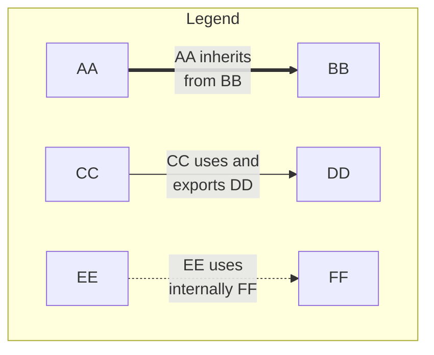
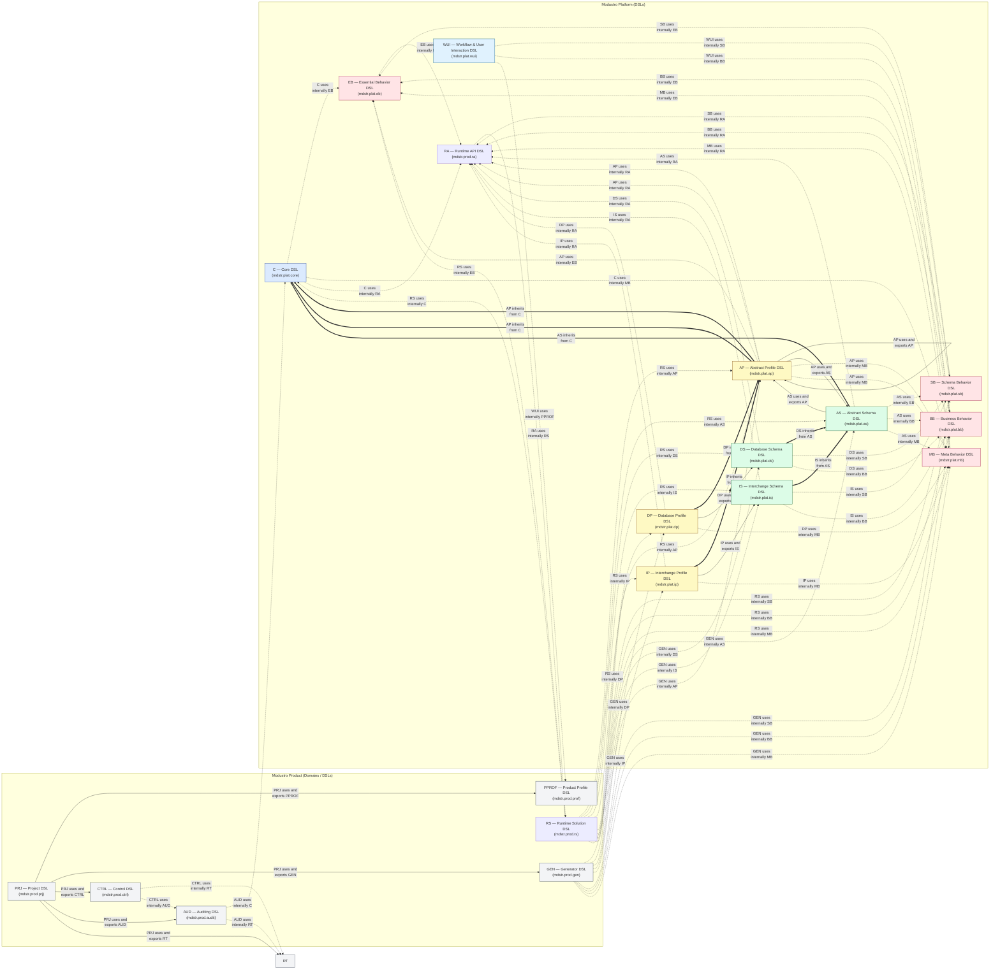
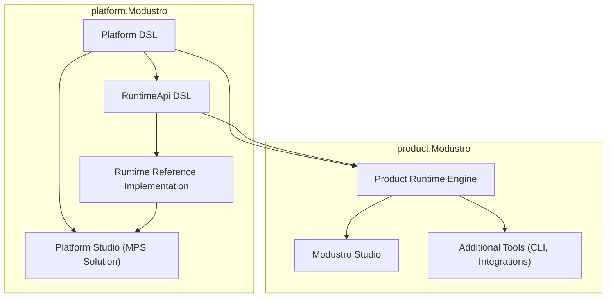
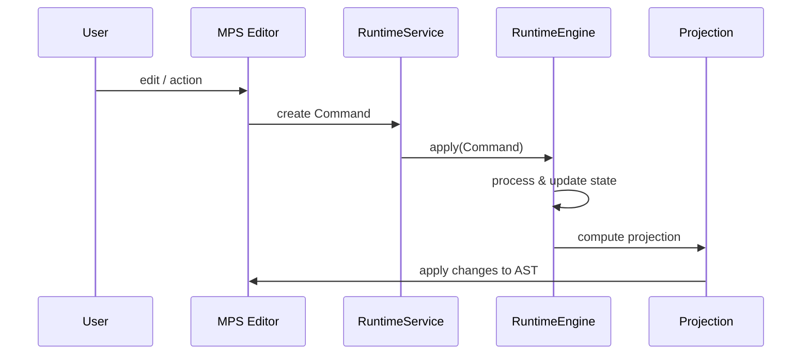
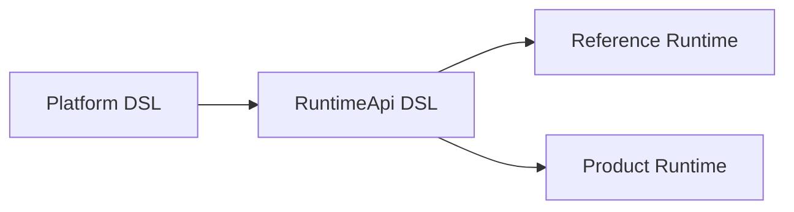
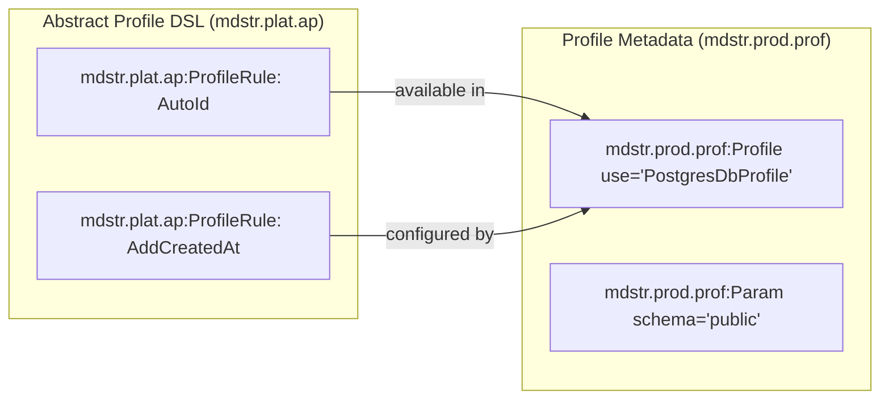

# Modustro Platform Specification

## Preamble – The Spirit of Modustro

Modustro is founded on the belief that software systems should be shaped by the domains they serve,
not constrained by the tools that implement them.
Instead of adapting problems to generic frameworks, Modustro empowers architects and developers
to use or even define or extend precise domain languages based on a universal platform. To customize 
and build their own modeling tools and generator systems that reflect their true intent.

At the entrance to the Modustro ecosystem stands **Modustro Prometheus** — the canonical reference
implementation of a product based on the platform.
Named after the mythological bringer of fire, Prometheus embodies the idea of making foundational
power accessible: providing the essential runtime, APIs, and tooling that enable others to create,
extend, and innovate.

Modustro does not aim to replace one closed toolbox with another.
Its purpose is to open the meta-level itself — to give control over languages, models, and
transformations back to those who build and maintain complex systems.

Building on this foundation, **Modustro Studio by Algites** represents a full-fledged commercial
realization of the Modustro vision.
It combines the power of the platform with advanced runtime capabilities, integrated tooling,
and professional support, delivering a production-ready environment for organizations that rely
on domain-driven modeling at scale.

In this sense, Modustro Prometheus is not the destination, but the spark:
a baseline from which products, studios, and ecosystems can grow — while Modustro Studio
transforms that spark into a sustainable, industrial-grade solution.

## 0. Introduction

The Modustro Platform Specification defines the stable, public modeling surface of the Modustro ecosystem.  
It describes the **CoreDSL** and **Design DSLs** (Type, Schema, Profile, etc.), their relationships and namespaces, and the rules that every Modustro-compatible product must follow when creating, transforming, or analyzing models.

This document **does not** prescribe any particular runtime implementation/solution, persistence format, UI, or IDE integration. Those aspects belong to product‑specific documentation and the Product Internal Specification of the various products, which may be based on the Modustro Platform Specification.

The goals of this document are:

- To provide a precise and stable description of the domain modeling languages.
- To enable independent tools and products to operate on Modustro models.
- To separate domain concepts (design) from implementation details (runtime implementation/solution, storage).

Modustro introduces a comprehensive ecosystem of interconnected domain-specific languages (DSLs) designed to model data, schemas, behavior, constraints, and generator profiles in a unified, extensible way.  
Rather than creating a monolithic language, Modustro decomposes responsibilities into layered DSLs—each dedicated to a specific abstraction level.  
This modular structure enables:

- clear separation of concerns,
- easier evolution of the modeling stack,
- maintainable generators,
- extensibility for future profiles, database engines, and interchange formats,
- easier onboarding for users (learn only what they need).

### 0.1 Purpose of the Platform Specification

The Platform Specification defines:

- The **set of DSLs** that form the logical modeling layer (Core + Design).
- The **semantic contracts** of these DSLs (what a model means).
- The **namespaces** and naming rules for XML/XSD representations of models.
- The **invariants** that must hold in any valid Modustro model.

It intentionally does **not** define how a Modustro product:

- Stores models on disk in a conflict‑free way.
- Implements history, undo/redo, or collaborative editing.
- Integrates with version control systems.

### 0.2 What the Platform Defines (and what not)

The platform defines:

- Conceptual types and their relationships (entities, fields, types, profiles…).
- Abstract structure of model elements and references between them.
- Minimal identity: every element carries a globally unique `guid`.

The platform does **not** define:

- Hybrid logical clocks (HLC), ordering metadata, relocation markers.
- Audit trails, authorship, sessions, or system timestamps.
- Merge strategies or conflict resolution logic.

### 0.3 Target Audience

This document is intended for:

- Designers of Modustro‑compatible tools and generators.
- Library and plugin authors who want to build on the platform DSLs.
- Architects who need to understand how Modustro models are structured.

### 0.4 Terminology Overview

- **DSL** – domain specific language, a typed modeling language inside Modustro.
- **Node / Element** – an instance of some DSL concept (e.g. EntityDef, TypeDef).
- **guid** – a globally unique identifier for an element, stable across time.
- **Def / Ref** – *Def* denotes a defining element (e.g. EntityDef); *Ref* denotes a reference element pointing to a Def.
- **CoreDSL** – common super‑layer for all design DSLs; provides identity and generic abstraction.
- **DesignDSL** – user‑facing modeling DSLs: AP, AS, DS, IS, AP, etc.

---

## 1. Platform Architecture Overview

Modustro models are built on a layered approach:

- **CoreDSL (core.\*)**: generic abstractions such as ObjectDef, ObjectRef, common identity.
- **Design DSLs (mdstr.plat.\*)**: concrete domain languages for types, schemas, and profiles.

Product‑specific runtime implementation/solution and storage DSLs are **not** part of this document.

### 1.1 Four DSL Conceptual Views

Although this document only standardizes **Core DSL**, **Design DSL** and **Behavior DSLs**, it is useful to keep the broader picture:

1. **Core DSL (mdstr.plat.core.*)** – abstract identities, object definitions and references; shared semantics.
2. **Design DSLs (mdstr.plat.*)** – domain modeling: types, schema entities, DB entities, IC entities, profiles.
2. **RuntimeApi DSL (mdstr.plat.ra)** – API for the communication of the design DSLs with the Runtime Solution.
3. **Behavior DSLs (mdstr.plat.eb, mdstr.plat.sb, mdstr.plat.bb, mdstr.plat.mb)** - DSLs defining general behavior of the given level of the objects
4. **Runtime Solution / PDS (mdstr.prod.rs, mdstr.prod.pds)** – implementation‑specific layers, covered by the Product Internal Specification for products using the Modustro platform.

The platform defines the first two layers; the third is free for product implementations as long as they respect the semantic contracts of Core + Design.

### 1.2 Relation of Platform DSLs to Modustro Products

Modustro products (like modeling IDEs, code generators, CI integrations) must:

- Use **Core DSL** concepts as the base for all higher‑level DSLs.
- Implement the **Design DSLs** semantics faithfully.
- Preserve `guid`s and structural relationships when performing refactorings or migrations.

Products are free to choose:

- Their own persistence model, as long as it can be mapped back to valid Core+Design models supporting all required properties.
- Their own runtime implementation/solution metadata model, including history, ordering, audit, etc.

### 1.3 Goals: Stability, Versioning, Interoperability

The platform is designed to:

- Evolve in a controlled manner with explicit **DSL versioning**.
- Support multiple products working on the same logical model.
- Allow future extensions via backward‑compatible additions.

### 1.4 Compatibility Rules Across DSL Versions

Each DSL will have:

- A **major version** indicating breaking changes.
- A **minor/micro version** for additive or strictly backward‑compatible changes.

Products must:

- Declare which platform versions they support.
- Provide migration paths when upgrading models to newer versions.

---

### 1.5 Namespace and Versioning Rules

This chapter defines the normative rules for namespaces, prefixes, and
versioning used across the Modustro Platform DSL stack. These rules
ensure long-term evolvability, compatibility management, and unambiguous
mapping to generated code artifacts.

#### 1.5.1 Scope and Principles

The rules in this chapter apply to all Modustro Platform domains
(prefixed by `mdstr.plat.*`) and Modustro Product domains (prefixed by
`mdstr.prod.*`) that are modeled as DSLs.

**Principles:**

-   Namespaces express **domain identity**, not implementation
    technique.
-   All domains are modeled using DSLs implicitly.
-   Major, backward-incompatible changes are handled via **namespace
    versioning**.
-   XML namespaces (URIs) are the authoritative identifiers.
-   Programming language packages (e.g., Java) must always encode the
    version.
-   Prefixes are aliases and may be adapted by tooling.

#### 1.5.2 Namespace Topology and Design Principles

Namespaces are grouped into two root categories:

-   **Platform domains:** `mdstr.plat.*` --- Modustro language stack and
    modeling building blocks.
-   **Product domains:** `mdstr.prod.*` --- Runtime, configuration,
    orchestration, and control domains.

Each Platform DSL receives its own namespace under the root:

```
mdstr.plat.<DSL-prefix>
```

Similary, every Product DSL receives its own namespace under the root:

```
mdstr.prod.<DSL-prefix>
```
The product namespaces should be kept unique also on the "abgreviated level". 
The implementors of the products based on Modustro platform are responsible 
for the synchronization of the used namespaces on possible specific product level
to not interfere with existing namespaces. 

Examples of platform domains:

-   `mdstr.plat.core` (Core DSL with core concepts)
-   `mdstr.plat.ra` (Runtime API)
-   `mdstr.plat.td` (Type Definition)
-   `mdstr.plat.as` (Abstract Schema)
-   `mdstr.plat.ds` (Database Schema)
-   `mdstr.plat.is` (Interchange Schema)
-   `mdstr.plat.wui` (Workflow & User Interaction)

Examples of product domains:

-   `mdstr.prod.rs` (Runtime)
-   `mdstr.prod.pds` (Persistence Data Storage)
-   `mdstr.prod.audit` (Auditing)
-   `mdstr.prod.ctrl` (Control / Management)
-   `mdstr.prod.prj` (Project)
-   `mdstr.prod.prof` (Profile)
-   `mdstr.prod.gen` (Generator)

#### 1.5.3 XML Namespace URI Structure

Every namespace URI MUST contain a **major version identifier**.

General form:

    https://modustro.eu/xmldefs/{platform|product}/{DomainName}/v{N}

Where:

-   `{DomainName}` is the canonical domain name in PascalCase.
-   `{N}` is the major version number starting at `1`.

### Example URIs

    https://modustro.eu/xmldefs/platform/AbstractSchema/v1
    https://modustro.eu/xmldefs/platform/DatabaseSchema/v1
    https://modustro.eu/xmldefs/platform/WorkflowUI/v1
    https://modustro.eu/xmldefs/product/RuntimeSolution/v1
    https://modustro.eu/xmldefs/product/Auditing/v1

##### 1.5.4 Default namespace

Inside DSL root elements, a **default namespace** SHOULD be used:

```xml
<td:Type
    xmlns="https://modustro.eu/xmldefs/platform/TypeDomain/v1"
    core:guid="..."
    mdstr.product.rt:xxx="yyy">
    <TypeName>...</TypeName>
    <TypeBase>...</TypeBase>
</td:Type>
```

Rules:

- All child elements *without prefix* belong to the DSL namespace of the parent (here: TD).
- Metadata and other DSLs MUST use prefixes (`core:`, `as:`, `ds:`, …).

#### 1.5.5. Root Platform Namespace (mdstr)

The root platform namespace:

- Prefix: `mdstr`
- Namespace URI:

```text
https://modustro.eu/xmldefs/platform
```

This namespace is mainly used for conceptual grouping and is **rarely used directly** in XML instances. Instead, individual sub-namespaces are used for model, DSLs, and metadata.

Top-level, general-purpose namespace for metadata not tied to a specific subsystem.  
This namespace SHOULD remain minimal to preserve clarity.

Examples:

```
mdstr:deprecated="true"
mdstr:note="Generated automatically"
```

Should rarely be used.

---

#### 1.5.6 Attributes vs. elements

- Attributes from `core:` and `as:` are used for:
    - identity,
    - references within the DSL inheritance structure,
    - product specific internal structures used for runtime implementation/solution, auditing, project persistence, etc.

- Logical DSL properties must be elements in the appropriate DSL namespace (e.g. `TypeName` in AP, `FieldName` in AS).

#### 1.5.7 XML Prefix Conventions

Prefixes are aliases bound to namespace URIs. The default form omits the
version:

    xmlns:mdstr.plat.as="https://modustro.eu/xmldefs/platform/AbstractSchema/v1"
    xmlns:mdstr.plat.ra="https://modustro.eu/xmldefs/product/RuntimeApi/v1"
    xmlns:mdstr.prod.rs="https://modustro.eu/xmldefs/product/RuntimeSolution/v1"

This is the **standard form** and SHOULD be used when only one version
of a domain appears in a document.

### Parallel Versions in One Document

If multiple major versions of the same domain are used within a single
document, the version MUST be encoded in the prefix:

    xmlns:mdstr.plat.as.v1="https://modustro.eu/xmldefs/platform/AbstractSchema/v1"
    xmlns:mdstr.plat.as.v2="https://modustro.eu/xmldefs/platform/AbstractSchema/v2"

Elements then reference the appropriate prefix:

    <mdstr.plat.as.v1:Schema>...</mdstr.plat.as.v1:Schema>
    <mdstr.plat.as.v2:Schema>...</mdstr.plat.as.v2:Schema>

or:

    <as.v1:Schema>...</as.v1:Schema>
    <as.v2:Schema>...</as.v2:Schema>

---

##### 1.5.7.1 Prefix shortening

To reduce verbosity:

- In **documentation and examples**, long prefixes like `mdstr.plat.td` may be used to emphasize structure.
- In **internal files**, short prefixes SHOULD be used:
    - `td`, `as`, `ds`, `is`, `ap`, `core`, `audit`, `prj`, `gen`.

Constraint:

- Prefixes MUST be unique in the document.
- The short prefix SHOULD correspond to the last segment (e.g. `td` ↔ TypeDomain DSL).


#### 1.5.8 Namespace Version Semantics

The version identifier in the namespace URI denotes a **major version**.

-   **Major version change (v1 → v2):**
    -   Indicates backward-incompatible changes in structure or
        semantics.
    -   Requires a new namespace URI.
    -   May coexist with older versions.
-   **Minor or patch changes:**
    -   MUST NOT change the namespace URI.
    -   MUST remain backward compatible.
    -   Are handled via tooling, optional elements, or documentation.

#### 1.5.9 Migration and Evolution

When a new major version is introduced:

-   The old namespace remains valid and supported.
-   Migration tools SHOULD be provided to transform models between
    versions.
-   Coexistence of versions in the same system is allowed and supported.

This enables clean architectural shifts without breaking existing models
or deployments.

---

#### 1.5.10 Namespace URIs and prefixes

Official URIs:

```
xmlns:mdstr="https://modustro.eu/xmldefs/platform"
xmlns:mdstr.plat.core="https://modustro.eu/xmldefs/platform/Core/v1"
xmlns:mdstr.plat.ra="https://modustro.eu/xmldefs/platform/RuntimeApi/v1"
xmlns:mdstr.plat.td="https://modustro.eu/xmldefs/platform/TypeDomain/v1"
xmlns:mdstr.plat.as="https://modustro.eu/xmldefs/platform/AbstractSchema/v1"
xmlns:mdstr.plat.ds="https://modustro.eu/xmldefs/platform/DatabaseSchema/v1"
xmlns:mdstr.plat.is="https://modustro.eu/xmldefs/platform/InterchangeSchema/v1"
xmlns:mdstr.plat.ap="https://modustro.eu/xmldefs/platform/AbstractProfile/v1"
xmlns:mdstr.plat.dp="https://modustro.eu/xmldefs/platform/DatabaseProfile/v1"
xmlns:mdstr.plat.ip="https://modustro.eu/xmldefs/platform/InterchangeProfile/v1"
xmlns:mdstr.plat.eb="https://modustro.eu/xmldefs/platform/EssentialBehavior/v1"
xmlns:mdstr.plat.sb="https://modustro.eu/xmldefs/platform/SchemaBehavior/v1"
xmlns:mdstr.plat.bb="https://modustro.eu/xmldefs/platform/BusinessBehavior/v1"
xmlns:mdstr.plat.mb="https://modustro.eu/xmldefs/platform/MetaBehavior/v1"
xmlns:mdstr.prod.prj="https://modustro.eu/xmldefs/product/Project/v1"
xmlns:mdstr.prod.rs="https://modustro.eu/xmldefs/product/RuntimeSolution/v1"
xmlns:mdstr.prod.prof="https://modustro.eu/xmldefs/product/Profile/v1"
xmlns:mdstr.prod.gen="https://modustro.eu/xmldefs/product/Generator/v1"
xmlns:mdstr.prod.audit="https://modustro.eu/xmldefs/product/Auditing/v1"
```

All Modustro tools must treat these URIs as identifiers for semantic processing.


---


#### 1.5.11 Mapping to Java Packages

All generated or hand-written Java code MUST encode the domain and major
version in the package name.

General form:

    eu.modustro.{plat|prod}.{domain}.v{N}

### Examples

From:

    https://modustro.eu/xmldefs/platform/AbstractSchema/v1

Map to:

    eu.modustro.plat.as.v1

From:

    https://modustro.eu/xmldefs/platform/RuntimeApi/v1

Map to:

    eu.modustro.prod.ra.v1

This rule ensures:

-   Parallel existence of incompatible versions in one JVM.
-   Safe class loading and dependency management.
-   Deterministic mapping from models to code.

---

### 1.5.12 JSON compatibility

For JSON renderings of the same model:

- Element and type names may be serialized with **namespace-qualified keys**, e.g.:

```json
{
  "td:Type": {
    "TypeName": "Email",
    "TypeBase": "string"
  }
}
```

- The prefix mapping (`td` → URI) must be part of the project-level metadata or the serialization context.

This ensures a round-trip between XML and JSON without losing namespace semantics.


---

#### 1.5.13 Tooling Responsibilities

Modustro tooling (serializers, generators, runtime implementation/solution) MUST:

-   Treat the namespace URI as the authoritative identity.

-   Maintain a mapping table:

        (domain, version) → prefix

-   By default, emit prefixes without version suffix.

-   When multiple versions are detected in one document, emit versioned
    prefixes.

-   Use the URI-to-package mapping rules for code generation.

#### 1.5.14 Namespace Hierarchy Overview

Modustro uses a modular, layered namespace system:

| Namespace                             | Prefix full                       | Prefix short | Purpose                                                                                               |
|---------------------------------------|-----------------------------------|--------------|-------------------------------------------------------------------------------------------------------|
| **Platform namespace**                | `mdstr`                           | `mdstr`      | Core platform namespace                                                                               |
| **Model namespace**                   | `mdstr.plat.core`                 | `mdl`        | Model identity, ordering, metadata used inside Schema DSL & AP                                        |
| **RuntimeApi namespace**              | `mdstr.plat.ra`                   | `ra`         | Runtime API DSL defines communication of the Design DSLs with the solution/implementation DSL         |
| **Project namespace**                 | `mdstr.prod.prj`                  | `prj`        | Project configuration, settings, versioning, metadata                                                 |
| **Type Domain DSL namespace**         | `mdstr.plat.td`                   | `td`         | Domain type definitions, properties, domain metadata                                                  |
| **Abstract Schema DSL namespace**     | `mdstr.plat.as`                   | `as`         | Abstract schema structures, like Entities, Fields, etc.                                               |
| **Database Schema DSL namespace**     | `mdstr.plat.ds`                   | `ds`         | Database schema structures, like tables, Columns, etc.                                                |
| **Interchange Schema DSL namespace**  | `mdstr.plat.is`                   | `is`         | Interchange schema structures, like Complex types, elements, etc.                                     |
| **Abstract Profile DSL namespace**    | `mdstr.plat.ap`                   | `ap`         | Abstract profile namespace definitions, like Profile structures, general interfaces for plugins, etc. |
| **Database Profile DSL namespace**    | `mdstr.plat.dp`                   | `dp`         | Database profile namespace definitions                                                                |
| **Interchange Profile DSL namespace** | `mdstr.plat.ip`                   | `ip`         | Interchange profile namespace definitions                                                             |
| **Essential Behavior DSL namespace**  | `mdstr.plat.eb`                   | `eb`         | Definition of essential behaviors for types                                                           |
| **Schema Behavior DSL namespace**     | `mdstr.plat.sb`                   | `sb`         | Definition of schema behaviors for single entity field behaviors                                      |
| **Business Behavior DSL namespace**   | `mdstr.plat.bb`                   | `bb`         | Definition of business behaviors impacting multiple entities                                          |
| **Meta Behavior DSL namespace**       | `mdstr.plat.mb`                   | `mb`         | Definition of behaviors impacting the DSLs as they are                                                |
| **Profile namespace**                 | `mdstr.prod.prof`                 | `prof`       | Profile definitions, profile rules, overrides                                                         |
| **Generator namespace**               | `mdstr.prod.gen`                  | `gen`        | Generator-related metadata, physical mappings                                                         |
| **Audit namespace**                   | `mdstr.prod.audit`                | `audit`      | Auditing-related metadata                                                                             |
| **(Reserved for future)**             | `mdstr.prod.ui`, `mdstr.prod.doc` | `doc`, `ui`  | UI metadata, documentation metadata apod                                                              |

This allows clean separation and massive long-term flexibility.

Short prefixes should be used always in the case the Modustro XML elements are used fully only within Modustro namespaces
without any reference to any external namespaces. In the case some external namespaces are included, then the full prefix
usage is recommended

---

#### 1.5.15 Summary

##### Mermaid Diagram – DSL Layering




Rules:

1.  Every namespace URI MUST contain a major version `/vN`.
2.  Prefixes SHOULD omit version unless multiple versions coexist.
3.  Java packages MUST always include the version.
4.  Namespace roots are grouped into `mdstr.plat.*` and `mdstr.prod.*`.
5.  Major versions denote incompatible changes; minor changes do not
    affect namespaces.
6.  Tooling MUST manage prefix assignment and mapping deterministically.

These rules are normative for all Modustro Platform and Product DSL
definitions.

Benefits of DSL Namespacing

- Crystal clear distinction between model structure and metadata
- Strong XSD validation per DSL
- Extensibility for future DSLs (GraphQL DSL, Protobuf DSL, …)
- Eliminates naming conflicts
- Supports modularity in Modustro Studio
- Simplifies generator processing

---

#### 1.5.16 Interaction Rules Between Namespaces

##### 1.5.16.1 Model Namespace (mdstr.plat.core)
- MUST appear on **every AST node**
- MUST implement GUID attribute, every concept in the subsequent DSL inherits from basic structures defined in Core
- CANNOT be removed
- CANNOT be overridden by profiles or generators

##### 1.5.16.2 Project Namespace (mdstr.prod.prj)
- Used only in project files
- Must not appear in schema nodes

##### 1.5.16.3 Profile Namespace (mdstr.prod.prof)
- Must not override mdstr.plat.core attributes
- Can introduce profile-specific semantics

##### 1.5.16.4 Generator Namespace (mdstr.prod.gen)
- MUST NOT appear in project or profile files
- Used for generation pipeline metadata only

---

#### 1.5.17. Validation Requirements

The Modustro Product MUST validate the platform-defined properties, especially during the saving etc.:

- namespace correctness
- mandatory attributes (Guid)
- uniqueness of Guid inside model
- namespace placement rules
- XML schema (XSD) validation
- generator metadata presence where required

Invalid namespace placement must cause load failure.

---

#### 1.5.18 Strategy for Future Extensions

Modustro reserves additional namespace modules for any level.
currently <level> ~ {platform|product}, <level-abbreviation> ~ {plat|prod}:

```
mdstr.<level-abbreviation>.ui      – UI hints  
mdstr.<level-abbreviation>.doc     – documentation annotations  
mdstr.<level-abbreviation>.bld     – build-specific support  
mdstr.<level-abbreviation>.ext.*   – extension namespaces for plugins  
```

All must follow the pattern:

```
https://modustro.eu/xmldefs/<level>/<DSL-module>
```

---

#### 1.5.19 Benefits of Namespace Architecture

| Benefit | Description |
|--------|-------------|
| Modular Separation | Prevents mixing model, project, profile, generator metadata |
| Better XML Clarity | Metadata is grouped logically and semantically |
| Zero Collisions | Business-level attributes never conflict with Modustro system metadata |
| XSD-Friendly | Namespaces map cleanly onto XSD schemas |
| Git-Friendly | Consistent metadata formats reduce diff noise |
| Extensible | Future modules can be added without breaking existing models |
| Professional | Matches industry standards (XMI, MPS, JCR, W3C XML) |

---

#### 1.5.20 Summary

Modustro adopts **multi-namespace XML metadata** structured as:

```
mdstr         – global platform metadata
mdstr.plat.core     – AST model metadata (GUID)
mdstr.prod.prj     – project metadata
mdstr.prod.prof    – profile metadata
mdstr.prod.gen     – generator metadata
```

This standard provides a scalable and professional foundation for all DSLs, models, editors, generators, and future extensions.

This namespace standard also ensures that the products based on the Modustro platform fulfill the following requirements:

- All Modustro-platform based XML is:
    - **unambiguous**,
    - **extensible**,
    - **merge-friendly**,
    - **aligned with the Conflict-Free Merge Standard**,
    - and **ready for multi-format serialization** (XML/JSON/etc.).

External tools are expected to:

- rely on **Model API** for semantics,
- use these namespaces only when they need to generate or inspect raw XML,
- and avoid depending on any implicit or undocumented namespace behavior.

---
# 1.6 Modustro Ecosystem Architecture

This chapter describes the target architecture of the Modustro ecosystem
from the platform perspective, the separation of responsibilities
between the design-time layer and product implementations, and the way
JetBrains MPS serves as the host environment for creating DSLs, editors,
and generators.

The goals of the architecture are: - to provide a **stable platform**
with normative DSL languages, - to enable **independent development and
testing** of the platform without product complexity, - to allow
**multiple runtime implementations** of the platform, - to keep MPS as
the **primary design-time tool** for users and extension authors.

## 1.6.1 Overview

The Modustro ecosystem is divided into two main MPS projects:

-   **platform.Modustro** -- the platform and SDK,
-   **product.Modustro** -- product implementations of the platform.



## 1.6.2 platform.Modustro -- Platform Project

The **platform.Modustro** project represents the foundation of the
entire Modustro architecture.

### 1.6.2.1 Platform DSL Languages

The platform contains all normative design-time DSL languages, for
example:

-   Core DSL (ObjectDef, GUID, basic types),
-   Type Domain DSL (TDD),
-   Abstract Schema DSL (ASD),
-   Database Schema DSL (DSD),
-   Interchange Schema DSL (ISD),
-   Profile DSL (APD, DPD, IPD),
-   other supporting languages.

These languages form: - the **meta-model of Modustro**, - a unified
semantics of structures, - the basis for validations and generators.

Platform DSL languages are the **source of truth** for model meaning.

### 1.6.2.2 RuntimeApi DSL

The platform includes a dedicated design-time language:

-   **RuntimeApi DSL**

This language defines: - generic **commands** (e.g., `SetValue`,
`MoveItem`, `AddItem`, `DeleteItem`), - basic data types (`Guid`,
`ObjVal`, `Command`), - the contract of the runtime engine interface.

The RuntimeApi DSL serves as: - a **narrow communication interface**
between the DSL world and the runtime world, - a unified API used by all
other DSLs in editors and behavior.

Platform DSLs do not call the runtime directly; instead, they only
create and submit commands defined in the RuntimeApi DSL.

### 1.6.2.3 Runtime Reference Implementation

The platform contains one or more **runtime reference implementations**,
whose purpose is to:

-   provide a **simple local realization** of the runtime API,
-   enable development and testing of platform DSLs, editors, and
    generators,
-   avoid any product-specific complexity.

Typical characteristics of a reference implementation include: -
in-memory state, - mechanical execution of commands, - direct projection
of the resulting state back into the DSL AST, - no advanced distributed
or persistent mechanisms.

The reference implementation serves exclusively as: - a **development
and testing tool for the platform**, - the default runtime for extension
and generator authors.

### 1.6.2.4 Modustro Prometheus Solution

Modustro Prometheus, named after the mythological bringer of fire to humankind, serves as the canonical reference 
implementation of the Modustro platform, empowering developers with the foundational runtime needed to build their 
own Modustro-based products.

Within the platform Modustro Prometheus is an MPS solution that:

-   provides an IDE environment over the Platform DSLs,
-   acts as the Runtime Reference Implementation,
-   enables:
    -   authoring and debugging DSLs,
    -   development of editors,
    -   creation and testing of generators,
    -   development of customizations.
    -   demonstration of the way, how the plugins shall be developed.

Prometheus acts as: - an **SDK and laboratory environment** for the
Modustro platform, - a base for demonstration how to build installable extension packages, etc.

## 1.6.3 Algites Modustro products

The **product.Modustro** from Algites represents concrete product
realizations of the platform.

### 1.6.3.1 Product Runtime Solutions

The Algites product project contains the full-scale runtime engine implementation(s)
that:

-   implement the contract defined by the RuntimeApi DSL,
-   realize all product-level functionalities,
-   provide the runtime behavior of the platform.
-   extend the basic functionalities about additional user functionalities

These implementations are: - fully replaceable from the platform
perspective, - injected into the RuntimeApi at product startup.

The platform itself contains no product-specific logic.

### 1.6.3.2 Algites Modustro Studio

**Algites Modustro Studio** is one of the product implementations of the
platform:

-   an MPS solution built on top of the Platform DSLs,
-   using a product runtime engine instead of the reference
    implementation,
-   providing the end-user IDE for working with Modustro models.

From the platform perspective, Modustro Studio is: - just one possible
runtime realization, - without any impact on the definition of platform
DSLs.

### 1.6.3.3 Additional Product Tools

The product project may further contain:

-   command-line tools (CLI),
-   integration utilities,
-   automation tools,
-   other application components,

which: - use the same runtime engine, - operate on the same platform
meta-model.

## 1.6.4 Command-Based Interaction Model

The interaction between the DSL world and the runtime world is based on
a command model.



Principles: - the DSL expresses only the **intent of change**, - the
runtime engine decides how the change is realized, - the resulting state
is **projected** back into the DSL AST, - the DSL is never modified
directly without runtime participation.

## 1.6.5 Separation of Concerns

The architecture separates:

-   the **Platform**:
    -   meta-model,
    -   normative DSLs,
    -   basic editors,
    -   basic validations,
    -   basic generators,
    -   runtime API contract.
-   the **Products**:
    -   product-specific DSLs and DSL extensions like profiles, editors, validations, generators, ...
    -   concrete runtime implementations,
    -   integration and application logic,
    -   distribution packages.
    -   VCS integrations

Products MAY introduce additional DSL languages and extensions on top of the platform meta-model, provided they remain compatible with the platform semantics and the RuntimeApi contract.



This ensures: - a stable platform core, - independent evolution of
products, - reuse of DSLs across implementations.

## 1.6.6 Benefits of the Ecosystem Architecture

The proposed architecture provides:

-   **Isolation of the platform** from product complexity,
-   **Iterative platform development** using the reference runtime,
-   **Pluggable runtimes** for different products,
-   **Full utilization of MPS** for design-time tooling,
-   **Extensibility** of the ecosystem by third parties.

This structure establishes a solid foundation for the long-term
evolution of the Modustro platform and its family of products.


---
## 2. Core DSL Specification (mdstr.plat.core)

### 2.1 Purpose of Core DSL

Core DSL provides:

- A **uniform identity model** (`guid`).
- A generic concept of **Def** and **Ref** objects.
- A generic concept of Value object, concept of the protected value marker interface
- The basis for generic tooling (navigation, search, refactoring) independent of the specific DesignDSL.

It is deliberately minimal; most domain semantics live in the DesignDSLs.

The **core** namespace:

- Prefix: `mdstr.plat.core` (documentation)
- Recommended runtime prefix: `core`
- Namespace URI:

```text
https://modustro.eu/xmldefs/platform/Core/v1
```

Responsibilities:

- Core All DSL level attributes applied to **any element** in the Modustro model:
    - `mdstr.plat.core:guid` – unique identifier of an element or property value node
- Optional structural metadata used in the product parts, implementing the specific modustro platform based products:
    - element history and auditing information, relocation references, internal indexing keys, etc.

Important:

- Logical, user-visible properties (names, types, order, flags, …) are **not** carried as attributes in this namespace; they live as child elements in DSL namespaces, but reuse `core:*` attributes for identity and timestamps.

It defines:

- **unique identity** of every AST element
- **logical ordering** for stable generation
- **metadata relevant for Schema DSLs, TD, Profiles, etc.**

Mandatory attributes:

```
mdstr.plat.core:guid   (XML attribute, immutable, GUID, immutable)
mdstr.plat.core:ancestorGuid    (XML attribute, immutable, GUID, denotes reference to ancestor object - for example ds:Table references as:Entity, immutable)
```

- All DSL elements MUST contain the attribute **guid** and in the case the DSL inherits from specific
non-abstract concept, then also the attribute ancestorGuid to reference the ancestor data, which might
be in the XML stored on another place - the specific's of the XML format are the role of the products
based on Modustro platform.
- The term ancestor denotes semantic inheritance of definitions and MUST NOT be confused with revision predecessors in the CFR DAG.


### 2.2 Common Concepts

All concrete DSL elements that are part of platform models must satisfy:

- They have a globally unique `guid` (string, usually a UUID).
- They can be visited and introspected via reflection‑like APIs.

There are two principal categories:

- **ObjectDef** – defining element; owns properties that introduce or declare something.
- **ObjectPropertyValue** - predecessor for all possible property value encapsulators 
- **SimpleObjectPropertyValue** - value represented by the simple value, defined mainly in TD
- **ReferenceObjectPropertyValue** – foreign-key-like semantic structure - refernce to other ObjectDef, as the type of the type ObjectRef
- **ObjectPropertyDef** - predecessor for all possible property value definitions
- **SimpleObjectPropertyDef** - value represented by the simple value, defined mainly in TD
- **ReferenceObjectPropertyDef** – foreign-key-like semantic structure
- **ObjectProperty** consisting from the object property definition and value
- **ObjectRef** – descendant of ObjectProperty, referencing element; points to some ObjectDef via direct pointer or indirectly via `defGuid` or an equivalent mechanism.

### 2.3 Core Object Types

#### 2.3.1 ObjectDef

A conceptual meta‑type representing any defining element (EntityDef, TypeDef, ProfileDef, etc.).

Common properties:

- `guid`: string – globally unique identifier.
- `name`: string (optional) – human‑readable name.
- `description`: string (optional) – human‑readable description.
- `secretNotes`: string (optional) – in UI human‑readable stored as encrypted value, encrypted during the storage to the final file containing the project data.

Rules:

- Each `guid` is unique within a project.
- A `guid` never changes for the lifetime of the element.

#### 2.3.2 ObjectRef

A conceptual meta‑type representing a reference to some ObjectDef.

Common properties:

- `guid`: string – identity of the reference itself.
- `defGuid`: string – `guid` of the target ObjectDef.

Rules:

- `defGuid` must point to an existing ObjectDef (referential integrity).
- Multiple ObjectRefs can point to the same ObjectDef.

#### 2.3.3 ObjectDefListDef

Represents an ordered collection of ObjectDef elements.

The precise ordering semantics (e.g. deterministic storage order) are defined in product‑side documents. The platform only requires that a list is a sequence and that order must be stable enough for tooling.

Each ObjectDefListDef SHALL provide exactly two canonical orders:

1. definedOrder():
   The domain-defined order of elements, reflecting either:
    - explicit order defined by the user, or
    - the AST child order if no explicit user order is defined.
      This order represents the user's intended semantic ordering.

2. guidOrder():
   A deterministic technical order obtained by sorting elements
   lexicographically by their GUID.
   This order SHALL be used for persistence, sealing, hashing,
   and conflict-free replication.

No other global ordering semantics are defined by the platform.
Any additional grouping, filtering, or alternative ordering
MUST be applied explicitly at the point of use.


#### 2.3.4 ObjectRefListDef

Represents an ordered collection of ObjectRef elements.

Same remarks as for ObjectDefListDef apply.

#### 2.3.5 ObjectDefListRef

Represents an reference to ordered collection of ObjectDef elements.

#### 2.3.6 ObjectRefListRef

Represents an reference to ordered collection of ObjectRef elements.

#### 2.3.6 Summary of general approach to Object elements in Core DSL

Every domain-relevant structure that may change over time, be referenced, shared, or merged SHALL be represented as an ObjectDef with its own GUID and revision history, including collection and list structures.

Structures without GUIDs SHOULD be limited to purely syntactic or transient constructs with no semantic identity.

### 2.4 Rules of Inheritance Between CoreDef and Specialized DSLs

Each DesignDSL introduces its own concrete Def and Ref types (EntityDef, DBEntityDef, ICEntityDef, etc.) by extending the CoreDSL concepts.

Key rules:

- Every concrete `*Def` type inherits the semantics of ObjectDef.
- Every concrete `*Ref` type inherits the semantics of ObjectRef.
- A concrete Ref must always be tied to a specific Def type (e.g. EntityRef → EntityDef).

### 2.5 Validation Model (Referential Integrity, Def/Ref Matching)

The platform requires:

- All `defGuid` references must resolve to an existing Def of the correct kind.
- Additional constraints (e.g. no cycles, uniqueness of names) are defined in each DesignDSL section.

---

## 3. Design DSLs Specification 

### 3.1 Purpose of Design DSLs

Design DSLs are the **user‑facing languages** of Modustro. They define:

- Type domains (AP).
- Abstract schema entities and fields (AS).
- Database‑specific schema concepts (DS).
- Interchange (API/IC) schema concepts (IS).
- Abstract and concrete profiles (AP, and profile DSLs).

DesignDSLs are composable: the same abstract EntityDef can be used in both DS (for DB) and IS (for API), so that a project can maintain a single source of truth.

#### 3.1.1 Purpose of DSL Namespaces
DSL namespaces define *structural* elements of Modustro models for each individual DSL (AS, DS, IS, AP, AP, …).  
Each DSL forms a semantic “sub-language” within the unified Modustro Model.  
Namespaces ensure:

- clear separation of DSL structures
- no naming collisions among DSLs
- modular extensibility
- clean XML schema validation
- precise tooling behavior (Studio, CLI, generators)

---

### 3.2 General Principles

- All DesignDSL elements are ultimately based on CoreDSL.
- Identity (`guid`) is stable and shared across layers (AS → DS/IS mappings).
- Definitions and references are clearly separated (`*Def` vs `*Ref`).
- Profiling and platform‑specific extensions are attached via Profile DSLs, not by mutating base definitions.

### 3.3 Schema @ Domain DSLs

Schema and Domain DSLs define the main structures used within the Modustro products for the definition of the modelled data. 

#### 3.3.1 Abstract Schema DSL (mdstr.plat.as)

The Abstract Schema DSL defines high‑level domain entities and relations, independent of persistence or wire format.

- Documentation prefix: `mdstr.plat.as`
- Recommended runtime prefix: `as`
- URI:

```text
https://modustro.eu/xmldefs/platform/AbstractSchema/v1
```

Represents:

- entities, fields, relationships, common schema constructs independent of physical DB or transport formats.

Core concepts:

- `EntityDef` – abstract business entity (Customer, Product…).
- `FieldDef` – logical attribute of an entity (Customer.email, Product.price).
- Relations between entities (associations, compositions, etc.).

Key properties:

- `guid`: identity of each EntityDef/FieldDef.
- `name`: entity or field name.
- Optional metadata (documentation, tags, domain constraints).

AS is the **single logical source** from which specialized schema DSLs (DS, IS) derive.

**Purpose:** Define a technology‑agnostic schema-level structure of entities, fields, and relationships.

AS provides:
- **Entity** – top-level schema objects
- **Field** – referencing TD types or other entities (abstract)
- **Multiplicity rules** – optional, required, 1:1, 1:n, n:n
- **Logical naming** – stable identifiers independent of any target system
- **Physical naming proposals** – optional rules for derived names
- **Abstract constraints** – cardinality, required fields, default values

AS is the backbone for both database schemas and interchange schemas.

#### 3.3.2 Type Domain DSL (mdstr.plat.td)

TD defines reusable domain types and their constraints:

- Documentation prefix: `mdstr.plat.td`
- Recommended runtime prefix: `td`
- URI:

```text
https://modustro.eu/xmldefs/platform/TypeDomain/v1
```

Represents:

- domain types like `Email`, `Price`, `UUID`, `Money`, including base type, constraints, and metadata.

The **Type Namespace** defines the XML metadata layer for the **TypeDomain DSL (AP)** within the Modustro Platform.  
It isolates all domain type definitions from schema, project, profile, and generator structures, ensuring a clean, modular design.

This DSL and its namespace is intended for:
- **Primitive type definitions** - primitive types used in the Type definitions string, number, boolean
- **Derived type definitions** – consisting from primitive type + abstract behavior e.g., `Email`, `UUID`, `Price`, `String100`
- **Type Constraints** – min/max length, ranges, regex patterns
- **Annotations** - custom meta-properties of various structures
  @TODO - clarify what should be this one and is it here correctly? 
- **Primitive adapters** – mapping abstract types to primitive categories (string, number, boolean)
- **Base categories** – numeric, textual, temporal, enumerated
- **Inter-domain composition** – domain types can be built from other domain types (e.g., `Address = Street + City + Zip`)

- type groups
- aliases and semantic wrappers


- `TypeDef` – represents a logical type (Email, Price, UUID, Currency).
- Can be based on primitive types (string, integer) with additional constraints (regex, ranges, length).
- Used by AS FieldDef definitions to specify field types.

Properties:

- `guid`
- `name`
- `baseType` (e.g. string, int)
- Optional validation rules and metadata.

##### 3.3.2.1 Namespace Prefix and URI

Official namespace declaration:

```
xmlns:mdstr.plat.td="https://modustro.eu/xmldefs/platform/TypeDomain/v1"
```

Prefix:

```
mdstr.plat.td
```

---

##### 3.3.2.2 Type Domain Structuring, Categories, Annotations and Derived Types

This section defines how Type Domain elements are structured,
categorized, grouped into packages, and semantically refined in
Modustro. It clarifies the role of primitive types, semantic wrappers,
aliases, annotations, and the use of packages as a general grouping
mechanism.

The goal is to keep the Type Domain DSL minimal, non-object-centric, and
semantically expressive, while deferring structural and behavioral
complexity to Schema and Behavior DSLs.

------------------------------------------------------------------------

###### 3.3.2.2.1 Package-Based Structuring (`PackageDef`)

All top-level domain elements MAY be organized into hierarchical
packages.

A package represents a logical namespace and organizational unit and MAY
later be mapped to technical concerns such as database schemas,
tablespaces, modules, or bounded contexts.

**Normative rules:** - A `PackageDef` defines a named hierarchical
container. - A `TypeDef` MAY reference exactly one `PackageDef` via
`packageRef`. - If no package is specified, the type belongs to the
implicit root package. - Package assignment is structural and does not
change type semantics.

**Rationale:**\
This replaces ad-hoc grouping concepts (such as `TypeGroup`) with a
general, reusable mechanism applicable across DSL layers.

**Example:**

``` td
package financial {
    type Money : Decimal {
        currency: Currency
    }
}

package identity {
    type Email : String {
        constraint regex = ".+@.+"
    }
}
```

------------------------------------------------------------------------

###### 3.3.2.2.2 Primitive Types and Base Categories

Primitive types represent the lowest-level value carriers in the Type
Domain, such as:

-   `Boolean`
-   `Integer`
-   `Decimal`
-   `String`
-   `Date`
-   `DateTime`
-   `Binary`

Historically, *base categories* such as `numeric`, `textual`, or
`temporal` were introduced to classify types. In Modustro, these
categories are considered **derivable** from the primitive backing type
and therefore SHALL NOT be stored as mandatory independent information.

**Normative rules:** - Each type has exactly one backing primitive type
(directly or indirectly). - Base categories MUST be derivable from the
primitive type. - Redundant storage of base categories SHOULD be
avoided.

**Rationale:**\
Avoids duplicated information and keeps the model canonical.

------------------------------------------------------------------------

###### 3.3.2.2.3 Semantic Categories

While base categories are technical, some types carry domain semantics
that go beyond their primitive backing type.

Examples: `identifier`, `money`, `email`, `countryCode`.

**Normative rules:** - A `TypeDef` MAY declare a `semanticCategory`. -
Semantic categories are domain-level hints for validation, UI, and
generators. - Semantic categories MUST NOT change the primitive
representation by themselves.

**Example:**

``` td
type UserId : UUID {
    semanticCategory = identifier
}
```

------------------------------------------------------------------------

###### 3.3.2.2.4 Semantic Wrappers (Derived Types)

A semantic wrapper defines a new domain type derived from another type,
typically a primitive, adding constraints and meaning.

**Normative rules:** - A wrapper is a full `TypeDef` with a
`baseTypeRef`. - It MAY define constraints and later behavior
bindings. - It represents a new semantic type, even if the primitive
representation is unchanged.

**Example:**

``` td
type Price : Decimal {
    constraint min = 0
}

type Email : String {
    constraint regex = ".+@.+"
}
```

**Rationale:**\
Wrappers allow expressing domain meaning without introducing structural
objects.

------------------------------------------------------------------------

###### 3.3.2.2.5 Type Aliases

A type alias provides an alternative name for an existing type without
introducing new semantics.

**Normative rules:** - An alias does not create a new semantic type. -
It is interchangeable with its target type in all contexts. - Aliases
exist purely for readability and contextual naming.

**Example:**

``` td
typeAlias UserId = UUID
typeAlias OrderId = UUID
```

**Rationale:**\
Improves expressiveness while preserving type equivalence.

------------------------------------------------------------------------

###### 3.3.2.2.6 Annotations vs. Attributes

Annotations provide extensible, cross-cutting metadata that can be
attached to types without changing their core structure.

**Normative rules:** - Use **attributes/properties** for normatively
defined, structurally relevant information. - Use **annotations** only
for optional, extensible metadata (e.g., UI hints, documentation,
generator hints). - Annotations are model elements and MUST be
serializable to XML.

**Rationale:**\
Prevents the core type model from being polluted by optional concerns
while still enabling extensibility.

**Example:**

``` td
@ui(label = "E-mail address", readOnly = false)
type Email : String {
    constraint regex = ".+@.+"
}
```

------------------------------------------------------------------------

###### 3.3.2.2.7 Structured and Combined Types

The Type Domain DSL primarily targets non-object value types. Structured
or composite types MAY be introduced cautiously.

**Normative rules:** - Simple structured value types MAY be defined if
needed. - Advanced type algebra (formal composition such as `A = B + C`)
is OUT OF SCOPE for the current phase. - Computed or formula-based
fields belong to Behavior DSL, not TD.

**Example (value object style):**

``` td
type Address {
    street: Street
    city: City
    zip: Zip
}
```

**Rationale:**\
Keeps TD focused on value semantics and avoids premature complexity.
More advanced composition MAY be considered in later evolution phases.

------------------------------------------------------------------------

###### 3.3.2.2.8 Relationship to Later DSL Layers

Types defined in TD serve as:

-   value carriers in Schema DSL,
-   targets for validation and operations in Behavior DSL,
-   inputs for Profile and Generator DSLs.

TD MUST remain free of: - persistence details, - interchange formats, -
runtime or infrastructure concerns.

**Rationale:**\
Ensures clear separation between *what a value means* (TD) and *how it
is used or realized* (Schema, Profile, Runtime).

---

##### 3.3.2.2 Elements Expected in the Type Namespace

The TypeDomain DSL may define the following elements, all of which belong in this namespace:

- **TypeListDef** — optional container element
- **TypeDef** — definition of a domain type
- **TypeGroup** — grouping construct for related types
- **TypeAliasDef** — alternative names for reuse
- **TypeConstraintListDef** — validation rules bound to a type
- **TypeConstraintDef** — individual constraint definition

These structure names reflect AP concepts but must always live under the `mdstr.plat.td` namespace.

---

##### 3.3.2.3 Required Metadata (From Core Namespace)

All type elements MUST include the universal Modustro core metadata:

```
mdstr.plat.core:guid   (required, immutable GUID)
```

Example:

```xml
<mdstr.plat.td:TypeDef
    mdstr.plat.core:guid="59fdbf05-b9c8-4f32-bb7c-88d2a83f5a13"
    mdstr.prod.audit:xxx="aaa"
	mdstr.prod.rs:yyy="rrr"
    >
    <core:Name
		mdstr.plat.core:guid="59fdbf05-b9c8-4f32-bb7c-88d2a83fnnn"
		mdstr.prod.audit:xxx="aaa"
		mdstr.prod.rs:yyy="rrr">Email</core:Name>
    <td:BaseType 
        mdstr.plat.core:guid="59fdbf05-b9c8-4f32-bb7c-88d2a83fbbb"
		mdstr.prod.audit:xxx="aaa"
		mdstr.prod.rs:yyy="rrr">string</td:BaseType>
</mdstr.plat.td:TypeDef>
```

These attributes **never** belong to the `mdstr.plat.td` namespace,  
because identity is global platform semantics.

---

##### 3.3.2.4 Example Structure of the Type Namespace

```xml
<mdstr.plat.td:TypeDefListDef>

	<mdstr.plat.td:TypeDef
		mdstr.plat.core:guid="59fdbf05-b9c8-4f32-bb7c-88d2a83f5a13"
		mdstr.prod.audit:xxx="aaa"
		mdstr.prod.rs:yyy="rrr"
	>
		<core:Name
			mdstr.plat.core:guid="59fdbf05-b9c8-4f32-bb7c-88d2a83fnnn"
			mdstr.prod.audit:xxx="aaa"
			mdstr.prod.rs:yyy="rrr">Email</core:Name>
		<td:BaseType
			mdstr.plat.core:guid="59fdbf05-b9c8-4f32-bb7c-88d2a83fbbb"
			mdstr.prod.audit:xxx="aaa"
			mdstr.prod.rs:yyy="rrr">string</td:BaseType>

        <mdstr.plat.td:TypeConstraintDefListDef>
            <mdstr.plat.td:TypeConstraintDef
                name="emailFormat"
                regex="^[^@]+@[^@]+$"
                mdstr.plat.core:guid="8c9d8fe6-a4b7-41c7-a71f-a7acb4f1cbc5"
				mdstr.prod.audit:xxx="aaa"
				mdstr.prod.rs:yyy="rrr">
                <mdstr.prod.rs:OOOO>....</mdstr.prod.rs:OOOO>
            </mdstr.plat.td:TypeConstraintDef>
			...
		</mdstr.plat.td:TypeConstraintDefListDef>

    </mdstr.plat.td:TypeDef>

    <mdstr.plat.td:TypeDef
		mdstr.plat.core:guid="59fdbf05-b9c8-4f32-bb7c-88d2a83f5a13"
		mdstr.prod.audit:xxx="aaa"
		mdstr.prod.rs:yyy="rrr">
        <core:Name
            mdstr.plat.core:guid="59fdbf05-b9c8-4f32-bb7c-88d2a83fnnnn"
            mdstr.prod.audit:xxx="aaa"
            mdstr.prod.rs:yyy="rrr">UUID</core:Name>
        <td:BaseType
            mdstr.plat.core:guid="59fdbf05-b9c8-4f32-bb7c-88d2a83fbbbb"
            mdstr.prod.audit:xxx="aaa"
            mdstr.prod.rs:yyy="rrr">string</td:BaseType>
        ...
    </mdstr.plat.td:TypeDef>
</mdstr.plat.td:TypeDefListDef>
```

---
[[UNCLEAR]]
##### 3.3.2.5 Interaction with Other Namespaces

| Namespace       | Allowed in AP? | Purpose |
|-----------------|----------------|---------|
| `mdstr.plat.core`     | **Required**    | element identity and ordering |
| `mdstr.plat.td`    | **Primary**      | type definition metadata |
| `mdstr.prod.prof`    | Allowed         | profile rules applied to types |
| `mdstr.prod.gen`     | Allowed         | generator metadata (e.g., DB type mapping) |
| `mdstr.prod.prj`     | **Not allowed** | project metadata belongs only in project files |
| `mdstr`         | Allowed sparingly | global annotations (deprecated, notes, etc.) |

[[/UNCLEAR]]

#### 3.3.3 Database Schema DSL (mdstr.plat.ds)

DS specializes AS entities for relational databases.

- Documentation prefix: `mdstr.plat.ds`
- Recommended runtime prefix: `ds`
- URI:

```text
https://modustro.eu/xmldefs/platform/DatabaseSchema/v1
```

Represents:

- db-entities, db-columns, db-indexes, db-constraints, DB-specific schema details.

Typical elements:

- `DBEntityDef` – maps to a database table.
- `DBFieldDef` – maps to a database column.
- `DBIndexDef`, `DBKeyDef` – indices and keys.

Each `DBEntityDef` has a link to its ancestor `EntityDef` (from AS), allowing generators to:

- Keep logical and physical schema in sync.
- Support multi‑profile usage (same EntityDef mapped to multiple DB platforms).

#### 3.3.4 Interchange Schema DSL (mdstr.plat.is)

IS defines objects used in external communication (XSD, JSON, OpenAPI…).

- Documentation prefix: `mdstr.plat.is`
- Recommended runtime prefix: `is`
- URI:

```text
https://modustro.eu/xmldefs/platform/InterchangeSchema/v1
```

Represents:

- XSD/JSON/OpenAPI-style transport schemas, message structures, external contract types.

Elements:

- `ICEntityDef` – interchange representation (e.g. DTO).
- `ICFieldDef` – fields of the interchange object.
- Mappings to abstract EntityDef or specific views.

This enables:

- Generating XSD/JSON schemas from the same logical model.
- Generating mapping code (e.g. `loadFromCO` / `saveToCO` style methods if desired by a product).

---

### 3.4 Profile DSLs

#### 3.4.1 Abstract Profile DSL (AP)

- Documentation prefix: `mdstr.plat.ap`
- Recommended runtime prefix: `ap`
- URI:

```text
https://modustro.eu/xmldefs/platform/AbstractProfile/v1
```

Represents:

- abstract profiling of schemas for specific targets:
    - DB profiles,
    - interchange profiles,
    - generator profiles.

---

### 3.5 Behavior DSLs

This chapter defines the Behavior DSL layer of the Modustro Platform.
Behavior DSLs specify how domain structures defined by schema DSLs act,
react, and interact over time. They form the semantic layer between
static structure and workflow/user interaction orchestration.

The Behavior layer is composed of four DSLs:

-   Essential Behavior DSL (`mdstr.plat.eb`)
-   Schema Behavior DSL (`mdstr.plat.sb`)
-   Business Behavior DSL (`mdstr.plat.bb`)
-   Meta Behavior DSL (`mdstr.plat.mb`)

Together, they provide a progressive refinement from atomic, type-level
semantics to cross-entity business logic and meta-level DSL governance.

Essential Behavior DSL (EB) defines the generic expression language
for behavior in Modustro, while Schema Behavior DSL (SB),
Business Behavior DSL (BB), and Meta Behavior DSL (MB)
do not extend EB but use it to express the semantics of their domain-specific rules
in different contexts.

```mermaid
  flowchart AP
    EB["Essential Behavior DSL (EB)\n<<behavior expression language>>"]

    SB["Schema Behavior DSL (SB)\n<<schema-bound rules>>"]
    BB["Business Behavior DSL (BB)\n<<cross-entity business rules>>"]
    MB["Meta Behavior DSL (MB)\n<<DSL/meta-level rules>>"]

    CORE["Core DSL\n<<domain ontology>>"]
    AP["Type Definition DSL\n<<primitive types>>"]
    SCHEMA["Schema DSLs (AS/DS/IS)\n<<entity structures>>"]

    CORE -->|defines exact\nbehavior\nbased on| EB
    AP -->|defines exact\nbehavior\nbased on| EB
    SCHEMA -->|provides\ncontext for| SB

    EB -->|provides expression\nlanguage for| SB
    EB -->|provides expression\nlanguage for| BB
    EB -->|provides expression\nlanguage for| MB

    SB -->|binds\nbehavior to| SCHEMA
    BB -->|orchestrates\nbehavior across| SCHEMA
    MB -->|constrains\nand governs| CORE
    MB -->|constrains\nand governs| AP
    MB -->|constrains\nand governs| SCHEMA

    classDef lang fill:#e8f0ff,stroke:#4a6cf7;
    classDef use fill:#e8ffe8,stroke:#3aa655;
    classDef domain fill:#fff3e0,stroke:#fb8c00;

    class EB lang;
    class SB,BB,MB use;
    class CORE,AP,SCHEMA domain;


```
------------------------------------------------------------------------

#### 3.5.1 Essential Behavior DSL (EB)

**Namespace:** `mdstr.plat.eb`\
**Prefix:** `eb`

##### 3.5.1.1 Purpose

The Essential Behavior DSL defines the **meta-language for expressing
behavior** in Modustro. It provides the generic concepts used to
describe operations, predicates, expressions, relations, and constraints
over elements defined by Core and Type Definition DSLs.

EB does **not** define the structure of domain objects and does **not**
decide which concrete behaviors exist. Instead, it defines **how
behavior is described**.

EB answers the question:

> *By which language constructs can behavior be expressed in Modustro?*

The declaration that a concrete type provides a specific operation or behavior
belongs to the specific **Type Definition DSL (`mdstr.plat.td`)** or some from the **Schema Definition DSLs**. EB provides
the semantic machinery to describe and implement those operations and behaviors based on the general type independent generics.

##### 3.5.1.2 Scope

EB is used to define:


-   The abstract concept of an **Operation**
-   **Parameters** and **result types**
-   **Predicates** and boolean conditions
-   **Expressions** over values and references
-   **Relations** between objects (e.g., equality, containment,
    reference)
-   **Constraints** and rules expressed over Core/AP elements
-   Deterministic evaluation semantics
-   Composition and reuse of behavioral constructs

EB is domain-independent and reusable across all DSL layers that need to
express behavior.

##### 3.5.1.3 Relationship to Core and Type Definition DSL

In Modustro, responsibilities are split as follows:

-   **Core DSL (`mdstr.plat.core`)** defines:
    -   the ontology of the object world (ObjectDef, ObjectProperty,
        ObjectPrimitive, ObjectRef, containers, revisions),
    -   and their structural relationships.
-   **Type Definition DSL (`mdstr.plat.td`)** defines:
    -   concrete primitive types (e.g., Money, Email),
    -   their internal structure and invariants,
    -   and may declare which operations or constraints apply to a type.
-   **Essential Behavior DSL (EB)** defines:
    -   the generic language constructs used to express those operations
        and constraints.

Normatively:

> Core and AP define **what exists**.\
> EB defines **which behavior possibilities are there to express the behavior ot elements of specific types or schema DSL**.

EB does not introduce new domain structures; it only provides behavioral
meta-constructs applied to structures defined elsewhere.

##### 3.5.1.4 Example: Declaring Semantics Using EB Constructs

In Type Definition DSL, a type may declare that certain operations or
constraints apply:

    type Money {
      amount: Decimal
      currency: Currency

      invariant sameCurrencyForAdd
      operation add(other: Money) : Money
    }

In Essential Behavior DSL, the behavioral constructs used by such
declarations are defined, they are then used to define the semantics of
operations declared in AP:

    operation Money.add(a: Money, b: Money) : Money {
      require a.currency == b.currency
      result Money {
        amount = a.amount + b.amount
        currency = a.currency
      }
    }

    constraint sameCurrencyForAdd(a: Money, b: Money) {
      a.currency == b.currency
    }

Here, EB provides the concepts of `operation`, `constraint`, `invariant`, `require`,
expressions, and result construction, while AP decides that and how they apply
to `Money`.

##### 3.5.1.5 Example: Defining Operation Semantics in EB

**Example A --- Applying EB to Type Definition DSL**

In Essential Behavior DSL:

    operation Money.add(a: Money, b: Money) : Money {
      require a.currency == b.currency
      result Money {
        amount = a.amount + b.amount
        currency = a.currency
      }
    }

    operation Money.compare(a: Money, b: Money) : Int {
      if a.amount < b.amount then -1
      else if a.amount > b.amount then 1
      else 0
    }

These definitions provide the semantic bodies for operations declared in
AP.

**Example B --- Applying EB to Core DSL Elements**

EB constructs can also be applied directly to elements defined in **Core
DSL**, independently of any concrete type domain. Example, what is defined in Core DSL in a function-style (static) form:

    predicate ObjectRef.isResolvable(ref: ObjectRef) : Boolean {
      exists(target in ObjectDef) {
        target.guid == ref.defGuid
      }
    }

This example states that an `ObjectRef` is resolvable if there exists
some `ObjectDef` whose `guid` matches the reference target.

The same semantics can also be expressed as an instance-bound predicate with implicit this:

    predicate ObjectRef.isResolvable() : Boolean {
        exists(target in ObjectDef) {
            target.guid == this.defGuid
        }
    }

or - having also the static form defined as described above - like:

    predicate ObjectRef.isResolvable() : Boolean {
        isResolvable(this)
    }

In Modustro, the instance-bound form SHOULD be preferred for predicates and operations that conceptually belong to a single object instance.
The function-style form MAY be used for generic or multi-parameter predicates.

EB does not define what `ObjectRef`, `ObjectDef`, or `guid` are --- that
is the role of Core DSL. EB only provides the language to express the
predicate logic over such elements.

##### 3.5.1.4.1 Understanding `exists` --- Explained Simply

The EB construct:

    exists(target in ObjectDef) { P(target) }

should be understood as a **generic operation** provided by EB,
conceptually equivalent to:

    exists<T>(x: T, p: predicate<T>) : Boolean

with the meaning:

    for each x of type T in the current evaluation context: {
      if p(x) is true, return true;
    }
    return false;

In plain words:

> *"Is there at least one object of type `T` for which the condition
> holds?"*

So the example:

    exists(target in ObjectDef) {
      target.guid == ref.defGuid
    }

means:

> *"Is there at least one `ObjectDef` in the current model/runtime whose
> `guid` equals the `targetGuid` of this reference?"*

Important clarifications:

-   `exists` is **defined in EB** as a generic quantifier operation.
-   `ObjectDef` and its predicate `ObjectDef.isResolvable` is **defined in Core DSL** and is just a concrete type
    substituted for the generic `T`.
-   `target` is a **local variable** introduced by EB for iteration.
-   The body `{ ... }` is a **Predicate`<T>`{=html}**, written using EB
    expression constructs.
-   The set of all instances of `T` comes from the **evaluation
    context** (model or runtime), not from EB itself.

EB therefore remains completely independent of Core: it only defines the
*form* of such expressions, while Core provides the *types* used in
them.

###### 3.5.1.4.2 Java translation example

The above dynamic form of the predicate could be then generated to java int he followng form:

```java
    public boolean isResolvable() {
        for (ObjectDef target : repo.allObjectDefs()) {
            if (Objects.equals(target.getGuid(), this.getDefGuid())) {
                return true;
            }
        }
        return false;
    }
```


##### 3.5.1.5 Characteristics

-   Operates at **value/type level**, not at entity or schema level.
-   Pure, deterministic, and side-effect free.
-   Independent of schemas and business context.
-   Reusable across all schemas and profiles.
-   Serves as the semantic foundation for higher behavior layers.

##### 3.5.1.6 Dependencies of other Behavioral DSLs on EB:

-   EB is referenced by operations declared in `mdstr.plat.td`.
-   SB may invoke EB operations for field and entity behavior.
-   BB may orchestrate EB operations across entities.
-   EB does not select which types or entities are used; this is the
    role of schemas and profiles.

------------------------------------------------------------------------

#### 3.5.2 Schema Behavior DSL (SB)

**Namespace:** `mdstr.plat.sb`\
**Prefix:** `sb`

##### 3.5.2.1 Purpose

The Schema Behavior DSL defines behaviors bound to **fields and
entities** within a specific schema. It refines essential behaviors with
structural and relational context.

SB answers the question:

> *How does this field or entity behave in the context of its schema?*

##### 3.5.2.2 Scope

SB is used to define:

-   Field-level validation rules
-   Derived or computed fields
-   Referential integrity checks
-   Defaulting based on other fields
-   Entity lifecycle hooks (onCreate, onUpdate)
-   Intra-entity consistency rules

##### 3.5.2.3 Examples

-   Field `email` must be unique within `User`.
-   Field `total` is derived from order line items.
-   Entity cannot be activated unless required fields are set.
-   Foreign key existence validation.

##### 3.5.2.4 Characteristics

-   Bound to schema elements (entities, fields).
-   May reference multiple fields of the same entity.
-   Deterministic within schema context.
-   No cross-entity business orchestration.

##### 3.5.2.5 Relations

-   SB behaviors attach to elements defined in `mdstr.plat.as`,
    `mdstr.plat.ds`, or `mdstr.plat.is`.
-   They reuse EB operations for field types.
-   BB may orchestrate SB behaviors across entities.

------------------------------------------------------------------------

#### 3.5.3 Business Behavior DSL (BB)

**Namespace:** `mdstr.plat.bb`\
**Prefix:** `bb`

##### 3.5.3.1 Purpose

The Business Behavior DSL defines **cross-entity, domain-level
behaviors** expressing business rules, invariants, and processes that
impact multiple entities.

BB answers the question:

> *How does the business domain behave as a whole?*

##### 3.5.3.2 Scope

BB is used to define:

-   Business rules spanning multiple entities
-   State machines and domain processes
-   Aggregation and consistency rules
-   Transactional invariants
-   Domain services and actions
-   Event-driven reactions

##### 3.5.3.3 Examples

-   Creating an `Order` reserves `Inventory`.
-   Cancelling an order releases reservations and refunds payment.
-   Customer status changes based on total turnover.
-   Approval workflows impacting multiple aggregates.

##### 3.5.3.4 Characteristics

-   Cross-entity and cross-aggregate.
-   Business-context dependent.
-   May involve orchestration and transactions.
-   May reference profiles for runtime strategies.

##### 3.5.3.5 Relations

-   BB orchestrates SB behaviors across schemas.
-   It is the primary input for workflow and interaction DSLs (WUI).
-   Profiles may influence BB execution strategies.

------------------------------------------------------------------------

#### 3.5.4 Meta Behavior DSL (MB)

**Namespace:** `mdstr.plat.mb`\
**Prefix:** `mb`

##### 3.5.4.1 Purpose

The Meta Behavior DSL defines behaviors that operate on the **DSLs
themselves**, rather than on domain data. It governs how languages
evolve, validate, and interact.

MB answers the question:

> *How do Modustro DSLs behave as languages?*

##### 3.5.4.2 Scope

MB is used to define:

-   DSL validation rules and constraints
-   Cross-DSL consistency checks
-   Language evolution and migration rules
-   Defaulting and inference across DSLs
-   Tooling and generation policies
-   Semantic compatibility rules

##### 3.5.4.3 Examples

-   A schema must reference only existing types.
-   Profiles must be compatible with schema versions.
-   Automatic inference of indexes from constraints.
-   Migration rules between DSL versions.

##### 3.5.4.4 Characteristics

-   Operates at **meta-level**.
-   Does not affect runtime business data directly.
-   Drives tooling, generators, and validators.
-   Defines semantic contracts between DSLs.

##### 3.5.4.5 Relations

-   MB observes and constrains all platform DSLs.
-   It is consumed by Modustro tooling and generators.
-   It ensures platform-wide consistency.

------------------------------------------------------------------------

#### 3.5.5 Layered Relationship Overview

The following diagram illustrates how Behavior DSLs relate to Schema and
Profile DSLs.

``` mermaid
flowchart AP
    AP["Type Definitions (td)"]
    AS["Abstract Schema (as)"]
    DS["Database Schema (ds)"]
    IS["Interchange Schema (is)"]

    EB["Essential Behavior (eb)"]
    SB["Schema Behavior (sb)"]
    BB["Business Behavior (bb)"]
    MB["Meta Behavior (mb)"]

    AP["Abstract Profile (ap)"]
    DP["Database Profile (dp)"]
    IP["Interchange Profile (ip)"]

    AP --> EB
    EB --> SB
    AS --> SB
    DS --> SB
    IS --> SB

    SB --> BB
    AS --> BB
    DS --> BB
    IS --> BB

    EB -.-> AP
    SB -.-> AP
    BB -.-> AP

    AP --> DP
    AP --> IP

    MB -.-> AP
    MB -.-> AS
    MB -.-> DS
    MB -.-> IS
    MB -.-> AP
    MB -.-> DP
    MB -.-> IP

    classDef schema fill:#eef,stroke:#88a;
    classDef behavior fill:#efe,stroke:#8a8;
    classDef profile fill:#ffe,stroke:#aa8;
    classDef meta fill:#fef,stroke:#a8a;

    class AP,AS,DS,IS schema;
    class EB,SB,BB behavior;
    class AP,DP,IP profile;
    class MB meta;
```

------------------------------------------------------------------------

#### 3.5.6 Summary

-   **EB** defines the language and semantics for operations and other basic behaviors over objects from core DSL;
    concrete operations are declared in AP.
-   **SB** defines schema-bound behaviors of fields and entities.
-   **BB** defines cross-entity business logic and domain processes.
-   **MB** defines meta-level behaviors governing DSL semantics and
    evolution.

Together, these DSLs provide a layered, composable behavior model that
separates concerns from type semantics to full business orchestration
and platform governance.


---

### 3.7 Extensibility Model

Design DSLs are intended to be extensible:

- New profile DSLs may extend AP and attach extra concerns (e.g. Java ORM, caching, REST annotations).
- New schema DSLs may be added on top of AS if required by future platforms.

Any extension must preserve the basic identity and reference rules defined in CoreDSL.

---

## 4. Namespace Rules

This chapter defines the **complete namespace architecture** for the Modustro Platform.  
It ensures:

- clean separation of concerns
- guaranteed non‑collision of attributes
- strong XML/XSD compatibility
- clean Git diffing and AST mapping
- robust identity and ordering metadata
- scalability for future extensions
- professional interoperability with tooling

This chapter also standardizes all XML namespaces and prefix usage for the Modustro Platform and partially also for products based on the Modustro platform.

It defines:

- core platform namespaces,
- DSL-specific namespaces,
- metadata namespaces (model, auditing),
- recommended prefix conventions,
- and rules for minimizing XML verbosity while keeping semantics clear.

### 4.1 Namespace Prefixes for DSL Groups

The exact prefixes are recommendations but should be consistent:

- `core.*` – for CoreDSL concepts.
- `mdstr.plat.as`, `mdstr.plat.td`, `mdstr.plat.ds`, `mdstr.plat.is`, etc. – for DesignDSLs.

In XML/XSD representations:

- Short, readable prefixes are preferred (`as`, `td`, `ds`, `is`).
- Fully qualified URIs identify each DSL version (e.g. `https://modustro.eu/xmldefs/mdstr.plat/AbstractSchema DSL/v1`).

### 4.2 Naming Conventions

- DSL names use `PascalCase` for concepts (`EntityDef`, `TypeDef`).
- XML element names mirror DSL concept names.
- Attribute names are in `camelCase` (`guid`, `name`, `defGuid`).

### 4.3 Short Prefixes and Minimal Verbosity

Because models may grow large, namespace prefixes should be:

- Short (`as`, `ds`, `td`) but unambiguous.
- Consistent across tools and examples.

### 4.4 Rules for Reuse and Collisions

- Each DSL owns its namespace; collisions are avoided by design.
- Shared concepts (like `guid`) are defined once in CoreDSL and reused.

### 4.5 Examples of Correct Namespace Usage

Illustrative XML snippets will be added in later revisions; for now the rules are normative even without canonical serialization.

---

## 5. Guidelines for Tooling & Integration

### 5.1 Generators (XSD, JSON Schema)

Tools may generate:

- XSD based on AP + IS.
- JSON Schema or OpenAPI based on IS.
- SQL DDL based on DS.

The platform only defines the **semantics** of the DSLs, not specific generator implementations.

### 5.2 Plugin Architecture Guidelines

Plugins should:

- Work against CoreDSL + DesignDSL APIs, not against storage formats.
- Communicate via stable interfaces and avoid depending on product internals.

### 5.3 Accessing DSL Semantic Information

CoreDSL and DesignDSL should provide:

- Programmatic access to model types and properties.
- Navigation from defs to refs and back.
- Introspection APIs for generic tools (visualizers, validators, analyzers).

### 5.4 Stability and Forward‑Compatibility Guidelines

New features in DSLs should:

- Prefer additive changes (new optional properties).
- Avoid breaking existing model semantics.

---

## 6. Versioning Model

### 6.1 Major DSL Versioning

Each DSL has a major version; when incremented, it may introduce incompatible changes. Products must explicitly support each major version they claim to handle.

### 6.2 Deprecation Mechanisms

Deprecated properties or concepts should be:

- Marked as deprecated in DSL descriptions.
- Supported for some time with clear migration paths.

### 6.3 Migration Rules Across DSL Evolutions

Platform documents and tools may provide:

- Schema transformations.
- Automated migration scripts.
- Guidelines for manual migration.

---

## 7. Security and Safety Considerations

### 7.1 What the Platform Guarantees

The platform guarantees:

- A consistent, typed model of domain definitions.
- Clear boundaries between model semantics and implementation.

### 7.2 API Safety, Immutability Where Needed

Implementations should:

- Use immutable structures where it improves safety.
- Provide transactional updates or model snapshots to avoid inconsistent states.

### 7.3 Separation of Product and Platform Code

The platform remains neutral:

- It can be implemented in different products.
- It does not impose a particular persistence or licensing model.

### 7.4 Minimal Exposure Principles

Products should not expose runtime or PDS internals as part of the platform API. Only DesignDSL and CoreDSL APIs are considered stable contracts.

---

## 8. Appendixes

### 8.1 Example Minimal Project (Conceptual)

A minimal project would define:

- A small set of TypeDefs (Email, Price).
- A few EntityDefs (Customer, Product).
- DS/IS specializations if the project targets DB or APIs.

Details of file formats and persistence belong to the Product Internal Specification.

### 8.2 Appendix: Profile DSLs vs Profile Metadata

#### 8.2.1 Purpose
Although both are called “profiles”, Modustro separates:

1. **Profile DSLs (AP / DPD / IPD)** → structural language describing rules
2. **Profile Metadata (mdstr.prod.prof)** → activation and configuration of rules specific for products based on Modustro platform

They must NOT share the same namespace.

---

#### 8.2.2 Abstract Profile DSL – `mdstr.plat.ap`

This defines **what a profile is** and **what rules it contains**:

[[TO-BE-MODIFIED]]
```xml
<mdstr.plat.ap:ProfileRule
    name="AutoId"
    appliesTo="Entity"
    action="AddGeneratedPrimaryKey"
    mdstr.plat.core:guid="..."
    rt:yyy="rrr"
    audit:aaa="bbb"
/>
```
[[/TO-BE-MODIFIED]]

This is part of the **Modustro Design AST**.

- Versioned
- Structured
- Extensible
- Affects code generation and validation

---

#### 8.2.3 Product Profile Metadata – `mdstr.prod.prof`

This defines **which profiles are active** in a given project and how they’re parametrized:

```xml
<mdstr.prod.prof:ProfileDef use="PostgresDbProfile">
    <mdstr.prod.prof:ParamDef name="schema" value="public"/>
</mdstr.prod.prof:ProfileDef>
```

This is **not part of the Design AST**.  
It is configuration applied on top of the Design DSLs and their objects.

---

#### 8.2.4 Key Differences Table

| Aspect | Abstract Profile DSL (`mdstr.plat.ap` or other Profile DSL) | Product Profile DSL (`mdstr.prod.prof`)     |
|--------|-------------------------------------------------------------|---------------------------------------------|
| Purpose | Define profile rules                                        | Activate profile on a project               |
| Type | DSL ancestor of other profile DSLs                          | Just DSL for Project metadata speficication |
| Namespace | `mdstr.plat.ap`, `mdstr.plat.dp`, `mdstr.plat.ip`, ...      | `mdstr.prod.prof`                           |
| Versioning | Yes                                                         | Yes                                         |
| Applied to | DSL schema DSLs                                             | Project configuration                       |
| Example | Rule definition                                             | Enable profile for project                  |

---

#### 8.2.5 Diagram – Two-Layer Profile Architecture



---

#### 8.2.6 Summary

- **Profile DSLs** = defines rules how the 
- **Profile Metadata** = activates/parametrizes them
- Should *never* share a namespace
- Matches patterns from UML, XMI, MPS, EMF

---
